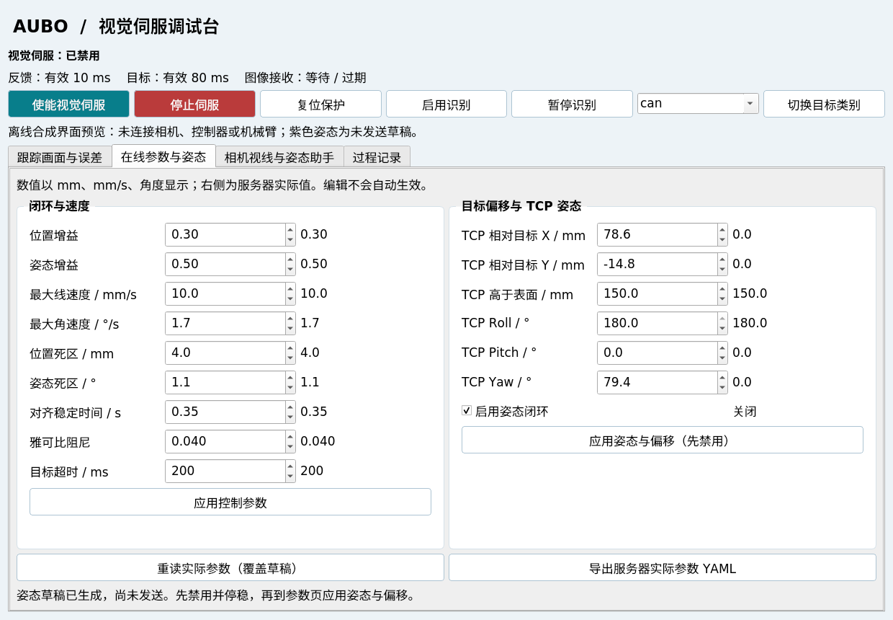
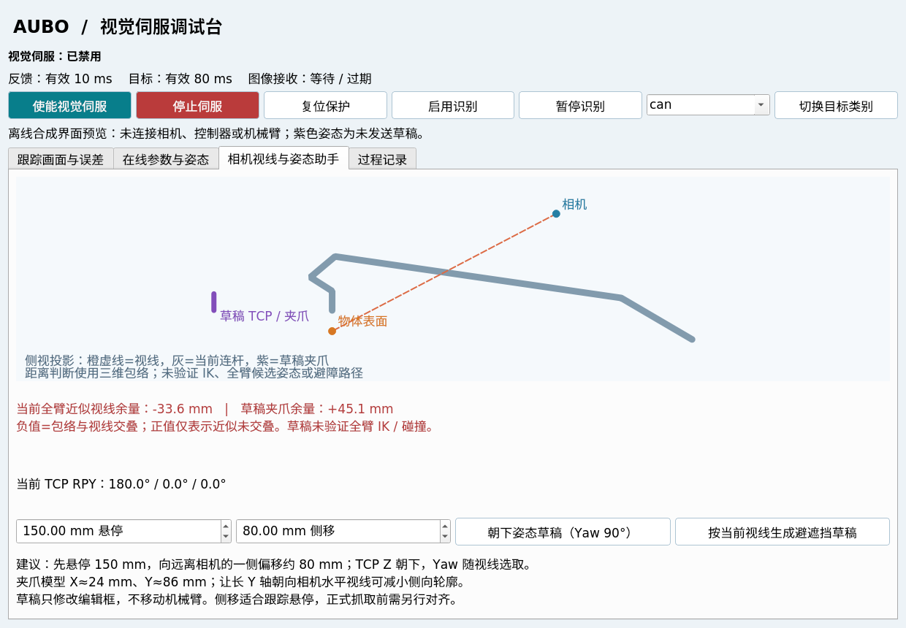

# 视觉伺服调试台与避遮挡姿态

适用当前眼在手外 YOLO 独立按需 PBVS，日期 2026-11-03。
它与分拣工作台是同包中的两个 rqt 插件，分别连接对应控制器。

## 打开界面

```bash
source /home/zlab/aubo/ros_mobile_manipulation_lab/devel/setup.bash
rosrun aubo_sorting_rqt visual_servo_panel
# 或
roslaunch aubo_sorting_rqt visual_servo_panel.launch
```

从 rqt 菜单也可选择 `Plugins → Robot Tools → AUBO 视觉伺服调试台`。
界面本身不连接 SDK，不加载相机，不自动使能、不自动写参数，关闭界面也不会停机。
已有测试入口默认 `rqt:=true`，可单独设置 `rviz:=false` 减少一个图像显示窗口：

```bash
roslaunch aubo_ros_control eye_to_hand_visual_servo_real.launch \
  target_class:=can rqt:=true rviz:=false \
  camera_serial_no:=335222076553 camera_initial_reset:=true
```

需要重启新版控制节点和感知节点，才能使用本次新增的后端姿态校验与 YOLO 控制接口。
重启流程和运动记录见[实机测试步骤](../../../docs/AUBO眼在手外视觉伺服实机测试.md)。

## 页面与操作

| 页面 | 内容 |
| --- | --- |
| 跟踪画面与误差 | YOLO 画面、反馈/目标年龄、类别/置信度、实际及期望 TCP、最近60秒 XYZ 误差 |
| 在线参数与姿态 | 增益、速度上限、死区、目标超时、阻尼、丢失衰减/等待时长、TCP 偏移、期望 RPY 和姿态闭环开关 |
| 相机视线与姿态助手 | 相机—目标视线、当前机械臂连杆、草稿夹爪、当前 TCP RPY 和近似遮挡余量 |
| 过程记录 | 状态变化、参数接受/拒绝、服务结果；最多400行 |

数值采用 mm、mm/s、° 显示，发送时换算为 m、m/s、rad。右侧列显示服务器实际值。
普通参数更新不会覆盖未提交的编辑。点击“应用控制参数”或“应用姿态与偏移”
只发送相应组中编辑过的字段；草稿不会因为刷新画面而自动发送。
“重读实际参数”明确覆盖草稿。“导出参数”保存服务器当前实际值，尚未提交的编辑不导出。
导出的标量字段用于动态调参记录；若要作为 launch 的持久化覆盖，偏移应写为
`target_offset: [x,y,z]`，姿态写为 `desired_target_rpy: [roll,pitch,yaw]`，单位均为 SI。

使能要求控制连接、近期遥测和真实反馈有效。配置了初始观测位时，可以在无目标时
显式使能前往该位；未配置时还要求目标有效。后端仍会检查停稳、跟随误差、
碰撞及 SDK 就绪。停止按钮使用独立服务线程，不等待其它调参请求结束。
停止是连续减速请求，不能撤回控制柜已提交点，不能替代硬件急停。
姿态和目标偏移只能在禁用并停稳后应用，后端还要求真实反馈新鲜并跟上指令。

YOLO 类别切换要求伺服禁用。可选 can/bottle/box，也可输入模型实际类别。
切换、重新启用识别或感知复位后，旧源图像的迟到推理结果会被丢弃。
未配置初始观测位时，界面等待类别确认及切换后的新目标遥测后才重新允许使能。
配置初始观测位时，允许先前往观测位；跟踪仍须等待新目标。
“暂停识别”只关闭目标输出；“停止伺服”控制机械臂减速，图像仍可继续用于观察。

## 应采用什么姿态

当前实机入口默认使用 2026-11-03 19:31:58 记录的真实观测位，顶部显示保存的六关节角。
使能后先到该位；跟踪时保持此次 TCP 朝向：RPY 约 `[-175.857°, 45.623°, 92.903°]`。
目标丢失后先衰减速度、停稳，再回到相同的六关节位。启动或使能不会重新记录观测位。
详见[采集依据与回位流程](../../../docs/眼在手外观测姿态与丢失回位.md)。

如果实际图像仍有遮挡，可在有转腕空间的悬停区禁用、停稳后建立以下候选姿态；
它们属于需要核对后显式应用的草稿：

1. **TCP Z 轴竖直朝下**：`Roll=180°、Pitch=0°`，这是 `base_link → tcp_link`
   的期望姿态，不是六个关节角。沿用分拣的 `Yaw=90°` 可作为第一份草稿。
2. **根据相机水平视线选择 yaw**：当前 URDF 中夹爪本体约 X=24 mm、Y=86 mm、
   Z=102 mm。让较长的 Y 轴沿相机—目标的水平视线放置，可以减小侧面横向轮廓。
   `tcp_link` 与夹爪基座的轴方向一致；TCP 位于基座 Z 正方向约120 mm。
3. **让 TCP 离开观测射线**：仅在物体正上方悬停仍可能遮住物体。姿态助手默认
   悬停150 mm，并沿目标远离相机水平投影的方向侧移80 mm。侧移会改变对齐点，
   适合保持物体可见的跟踪测试，不能直接作为最终夹取点。

设相机和目标在基座系的位置分别为 `C`、`T`，水平角
`φ=atan2(Cy−Ty,Cx−Tx)`，助手生成：

```text
offset_xy = −侧移距离 × normalize(Cxy − Txy)
offset_z  = 悬停高度
RPY       = [π, 0, φ ± π/2]
```

两份等价朝向中选择与当前 TCP yaw 较近的一份。相机几乎正对目标上方或高度关系
不适用时，助手拒绝自动选侧移方向，需要人工编辑偏移。
“朝下草稿”和“按当前视线生成草稿”都只填编辑框；核对后到参数页显式应用。
它不会自动求解整臂 IK，也不会将近似余量当作运动授权。

## 为什么不能仅凭姿态保证不遮挡

相机位置、目标位置、肘部/腕部位置、夹爪开度、线缆和负载都会改变视线。
固定一组 RPY 只能限制末端朝向，不能确定整臂连杆的位置。

当前界面在相同 TF 时刻取得肩、上臂、前臂、三腕、夹爪基座和 TCP，
用60 mm半径的连杆胶囊包络估算其与相机—目标线段的最小距离。
负余量表示近似包络交叠；正余量表示该近似模型未交叠。
候选草稿只估计 TCP 到基座120 mm夹爪段的余量，不预测候选整臂姿态。
缺少 TF、目标过期或反馈无效时显示未知，绝不沿用上次的绿色结果。

该近似不覆盖准确指形、线缆、附着物、桌面或真实 RGB-D 可见像素面积；
碰撞保护仍由伺服的 MoveIt 场景检查负责。候选位置还必须处于可达、无碰撞的局部区域。
实际验收应同时查看 YOLO 是否持续检出、源图像年龄、深度有效性和跟随误差。
目标变化后，重新预览视线，而不是在运动中连续改写姿态或侧移方向。

## 验证与预览

本轮通过离线 Qt/几何/ROS边界测试、原分拣界面回归、感知单元测试，
以及生产视觉前端＋假 SDK 的眼在手上/眼在手外回归。
ROS 回归验证了运动中拒绝姿态/偏移修改、接受普通增益调节、禁用停稳后允许修改，
同时继续检查反向、停止及跨批次指令的 V/A/J 连续性。
rqt 插件还在独立 master 上用 offscreen 模式实际启动并正常退出，没有连接机械臂。

下面截图为离线合成数据，只展示界面布局，不是实机测量结果：




