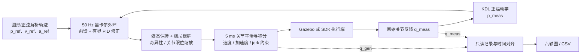
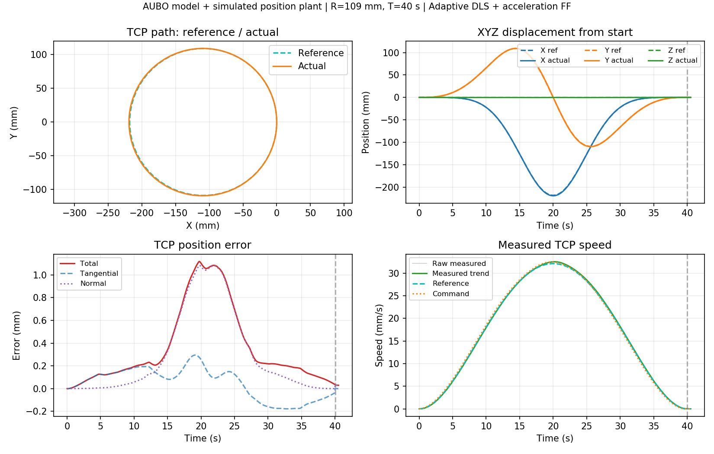
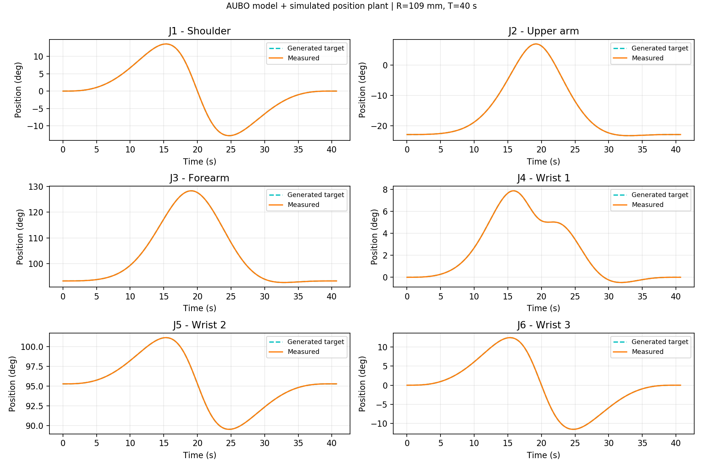
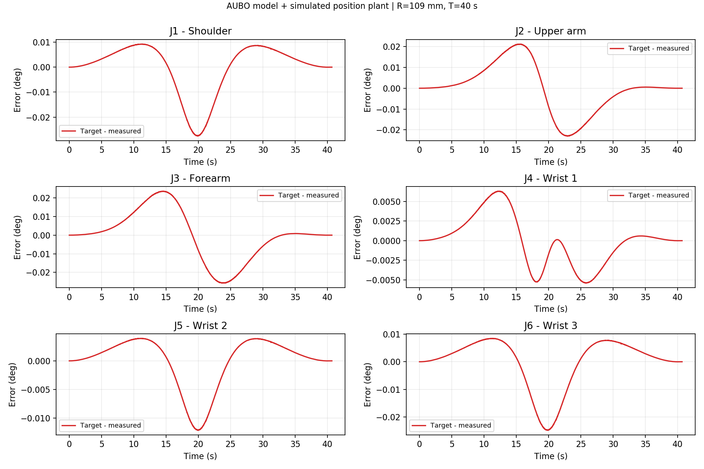
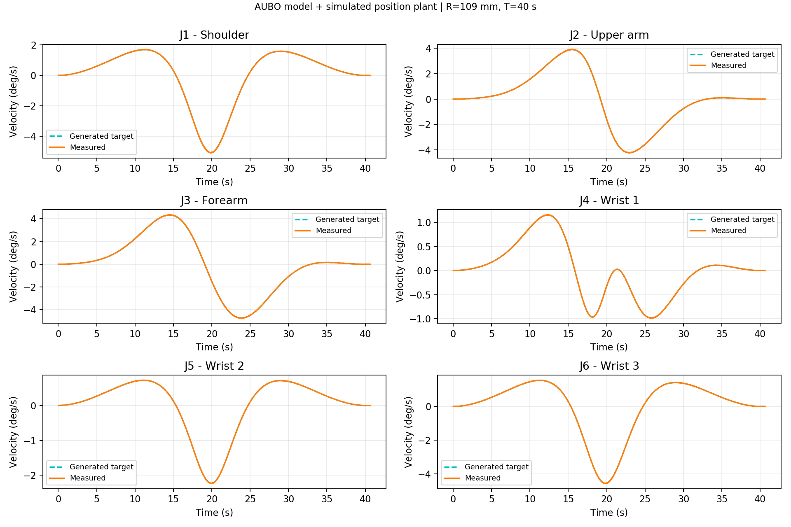
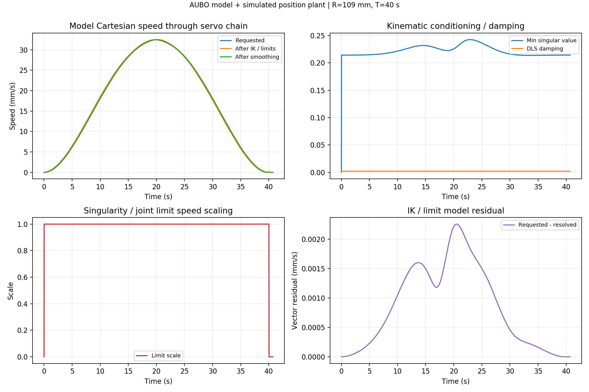
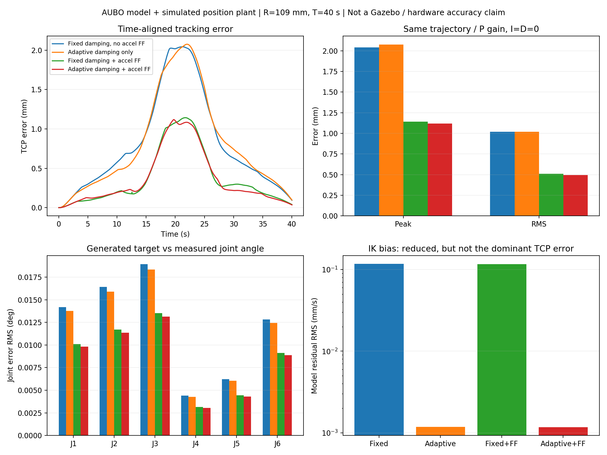

# AUBO 当前轨迹跟踪控制器与图表阅读说明

本文对应 2026-10-26 的工作区实现，用于理解圆形/正弦跟踪的控制方式、默认参数、运行流程和导出的图。主入口为 `roslaunch aubo_trajectory_tracking tracking_gazebo.launch`。

**当前 Gazebo 默认方案是：解析速度/加速度前馈 + 笛卡尔位置 P 修正 + 底层姿态保持、阻尼逆解与关节平滑。程序支持完整外环 PID，但默认 I、D 关闭。它不是我们自行实现的六个电机电流/力矩 PID。**

本文插图全部来自 **AUBO URDF + ROS 模拟位置执行端**。执行端按位置指令作一阶跟随，没有运行 Gazebo 动力学或 SDK。它们用于解释实现与对照结果，不是之前用户截图的重新绘制，也不是实机精度记录。详细实验边界见 [CONTROL_ANALYSIS.md](CONTROL_ANALYSIS.md)。

## 1. 先分清三种目标与两层反馈

| 名称 | 含义 | 在哪里看 |
| --- | --- | --- |
| 理论 TCP 目标 `p_ref(t)` | 圆或正弦曲线上，在指定时刻应该到达的位置 | TCP 路径、XYZ、TCP 误差图 |
| 生成关节目标 `q_gen(t)` | 末端速度经过逆解、限速和平滑后，积分产生的六个关节位置目标 | 六轴位置/速度图的 Generated target |
| 实际关节反馈 `q_meas(t)` | Gazebo 或 SDK 返回的关节位置 | 六轴位置图的 Measured |
| 实际 TCP `p_meas(t)` | 使用 `q_meas` 和同一机器人模型做正运动学得到的位置 | TCP 图的 Actual |

关节位置图中两条线很接近，只说明执行端接近**生成关节目标**；如果逆解和平滑已经让生成目标落后于理论曲线，TCP 仍然可能有误差。这是同时画 TCP 图和六轴图的原因。

图中的“六轴”是机械臂六个关节的输出角，通常对应关节编码器/仿真关节反馈，不是减速器前电机转子的角度，也不是电流或力矩。

## 2. 总体控制结构



| 层次 | 当前职责 | 周期或特点 |
| --- | --- | --- |
| 轨迹层 | 根据形状、平面、尺寸、圈数和时长生成位置、速度、加速度 | 同一解析定义用于预览与执行 |
| 笛卡尔外环 | 用实际 TCP 修正轨迹误差，输出线速度 | 名义 50 Hz，角速度请求为零 |
| 点动运动学层 | 保持末端姿态，把线速度转换为六轴速度 | 名义 50 Hz 更新逆解目标 |
| 关节生成层 | V/A/J 平滑、制动碰撞检查、积分成位置 | 固定 5 ms，名义 200 点/s |
| 执行层 | 跟随关节位置命令 | Gazebo 关节控制器或原 SDK 透传链路 |
| 诊断层 | 记录六轴与链路中间量，绘图导出 | 不发送运动指令 |

SDK 和 Gazebo 复用同一套点动运动学与保护逻辑；本包没有另外建立 SDK 连接，也没有调用控制柜自带的圆弧运动指令。

## 3. 圆和正弦轨迹如何生成

### 3.1 五次时间缩放

令 `T` 为总时长，`u=clip(t/T,0,1)`：

```text
s(u)   = 10u³ - 15u⁴ + 6u⁵
s_dot  = 30u²(1-u)² / T
s_ddot = 60u(1-u)(1-2u) / T²
```

轨迹不是匀速画出来的。起终点参考速度、参考加速度均为零，中间逐渐加速再减速，减少突然启动和停止。图上的参考速度呈单峰形是设计结果。

### 3.2 圆形

以 `xy` 平面、半径 `r`、整数圈数 `n` 为例：

```text
theta = 2π n s
p_ref = p_origin + [r(cos(theta)-1), r sin(theta), 0]
```

`p_origin` 是更新预览时捕获的实际 TCP，位于圆周上。圆心位于起点的负 X 方向一个半径处，所以离起点最远的点是一个**直径**。`xz`、`yz` 使用对应的基坐标轴，而非工具坐标轴。

109 mm、40 s、1 圈的例子：

| 量 | 数值与含义 |
| --- | --- |
| 最大相对位移 | 218 mm，需要 `max_extent >= 0.218 m` |
| 平均参考速度 | `2πr/T ≈ 17.12 mm/s` |
| 最大参考速度 | `1.875 × 2πr/T ≈ 32.10 mm/s` |
| 相对起点坐标 | X 约为 `[-218,0] mm`，Y 约为 `[-109,109] mm` |

`max_speed` 是速度上限，不是要求整个过程一直以这个速度运动。参数检查还要求最大参考速度不超过速度上限的 80%，为反馈修正留出余量。

### 3.3 正弦

令前进距离为 `L`、振幅为 `A`、波数为 `w`：

```text
p_ref = p_origin + [L s, A sin(2π w s), 0]  # xy 平面
```

结束时停在前进 `L` 的位置，不自动返回起点。这里支持的是 `sine` 正弦曲线，不是任意三角函数表达式。两种形状的速度和加速度均由解析公式计算，不通过位置噪声差分得到。

## 4. 当前外环控制器：前馈 + 可选 PID

### 4.1 实际实现公式

`e_p = p_ref(now) - p_meas(latest)`，`v_hat` 是短窗位置拟合得到的有方向 TCP 速度。定义 `sat_norm(x,L)` 为按向量模长限幅：超限时整体缩放方向，不单独截断 XYZ。

```text
acceleration_lead = sat_norm(tau_ff * a_ref, 0.1 * vmax)
v_ff = sat_norm(v_ref + acceleration_lead, 0.8 * vmax)

I_candidate = sat_norm(I + Ki * e_p * dt, beta * vmax)
D = Kd * (v_ref - v_hat)
correction = sat_norm(Kp * e_p + I + D, beta * vmax)

v_cmd = sat_norm(v_ff + correction, vmax)
```

默认 `beta=0.2`。因此前馈合量最多占总速度预算的 80%，P/I/D 总修正最多占 20%，加速度前馈自身还限制在 10%。这些是**指令速度约束**，不是对真实反馈速度尖峰的硬件保证。

| 项 | 作用 | 单位与默认设置 |
| --- | --- | --- |
| `v_ref` 速度前馈 | 告诉执行端沿曲线应当怎样运动，不必等出现位置误差才动作 | m/s，始终存在 |
| `tau_ff * a_ref` 加速度前馈 | 对参考速度作有界的超前修正，部分补偿关节平滑造成的滞后 | `tau_ff` 单位 s；Gazebo 入口 0.10，通用/实机 YAML 0 |
| `Kp * e_p` | 位置落后时追赶，偏离时拉回 | `Kp=1.0 /s` |
| 积分 `I` | 补偿持续偏差 | `Ki` 单位 1/s²，默认 0 |
| 速度误差 D | 对跟随速度差增加修正，避免直接微分原始位置噪声 | `Kd` 无量纲，默认 0 |

这里的 PID 是**笛卡尔位置外环**，输出仍是线速度；不是替代 Gazebo 或控制柜内部的电机伺服。

### 4.2 为什么不默认把 I、D 全打开

积分需要时间累积；在不断换方向的圆轨迹上，旧方向积累的修正可能增加相位误差。D 项会受速度估计滞后与反馈噪声影响。更多控制项不保证更好。

实现中，积分向量有幅值限制；修正或总速度饱和时停止继续积累，允许已有积分反向释放。停止/故障/新一轮开始时清零，末点收敛时以约 0.5 s 时间常数泄放。D 项使用默认 80 ms 的位置线性拟合速度，不用速度模长代替三维速度向量。

程序已验证非零 I/D 的一个测试组合能在合成滞后模型中收敛、满足速度上限；这不意味着它已针对当前 Gazebo 动力学或真实机器人整定。当前优先使用 `Kp=1, Ki=0, Kd=0` 与前馈做对照。

## 5. 底层姿态保持、逆解与关节平滑

### 5.1 固定末端姿态不等于腕关节不动

上层只请求线速度。点动节点捕获使能后的起始末端姿态，内部根据旋转误差生成角速度修正：增益为 2，每个角速度分量限制在约 ±0.1 rad/s。

为了在末端位置改变时保持姿态，六个关节可能都需要运动。即使画的是一个正弦或圆，单个关节的位置也不必是正弦；它取决于整个机械臂的几何耦合。

### 5.2 阻尼最小二乘逆解 DLS

点动节点使用**生成关节位置**计算 Jacobian：

```text
qdot_raw = J(q_gen)^T [J(q_gen)J(q_gen)^T + lambda² I]^-1 * [v_cmd; omega_hold]
```

阻尼让接近奇异位形时的逆解更稳定，但也会削弱某些方向的速度。随后仍执行整体限速缩放，保护方向关系。

| 参数 | 当前默认值 | 含义 |
| --- | ---: | --- |
| `singularity_stop` | 0.008 | 最小奇异值达到停止阈值时故障停止 |
| `singularity_slow` | 0.06 | 低于该值逐渐减速 |
| `dls_lambda` | 0.02 | 原固定阻尼/自适应阻尼上界 |
| `dls_lambda_min` | 0.002 | 自适应阻尼下界 |
| `adaptive_damping` | Gazebo 默认 true，其余默认 false | 远离奇异时减小阻尼，接近停止阈值时恢复原阻尼 |

最小奇异值和阻尼依赖 Jacobian 的模型及尺度，不能把它们当作 TCP 距离或机械阻尼力。

### 5.3 速度/加速度/jerk 平滑

关节位置由平滑后的速度积分生成。默认前三轴速度上限为 0.25 rad/s、加速度上限 0.60 rad/s²、jerk 上限 8 rad/s³；后三轴分别为 0.35、0.80、12。

平滑器先限制速度变化率，再通过低通环节限制加速度变化：

```text
alpha = min(1, jerk_limit * h / (2 * acceleration_limit))
velocity += alpha * (ramped_target - velocity)
q_gen += velocity * h
```

`h=0.005 s`。前三轴 `alpha≈0.0333`，低通部分等效时间常数约 0.147 s；后三轴约 0.131 s。这解释了为什么平滑器有助于启停，却会产生相位滞后。限加速度阶段、Jacobian 变化、执行器和 SDK 队列还会增加复杂性，不能把这个时间常数当作真实总延迟。

加速度前馈用于部分补偿此类滞后，并没有取消 V/A/J、奇异性、关节限位、碰撞或制动保护。

## 6. 实际反馈、时间对齐和末点收敛

### 6.1 统计使用同一反馈时刻

实际 TCP 由原始关节位置做 KDL 正运动学得到。绘图和统计使用：

```text
e_plot(t_feedback) = p_ref(t_feedback) - FK(q_meas(t_feedback))
```

每帧有效反馈最多统计一次。控制回路本身仍使用“当前参考与最新有效实际位置”计算修正；没有以预测位置替换真实反馈。

轨迹相位按 ROS 时间推进，Gazebo 变慢时与 `/clock` 保持一致；反馈过期、控制循环阻塞和收敛超时等看门狗使用真实时间。暂停仿真不会无限延长保护等待。

### 6.2 两种实际 TCP 速度

| 曲线 | 来源 | 怎么理解 |
| --- | --- | --- |
| Raw measured | 相邻实际 TCP 位置的位移模长除以反馈时间间隔 | 对抖动和时间间隔敏感，完整保留 |
| Measured trend | 默认 80 ms 窗口内，按真实采样时间拟合三维位置斜率，再取模长 | 更便于看持续运动趋势，但存在窗口滞后 |

例如相邻 20 ms 的位置变化 1 mm，差分速度就是 50 mm/s。因此尖峰既可能是真实运动，也可能包含反馈抖动/接触/数值求解的影响，不能只靠平滑后的线判断。停稳判据同时检查原始速度和趋势速度。

### 6.3 40 s 到底表示什么

`duration=40` 表示参考轨迹在 40 s 到达终点，随后可能还有 `SETTLING`：

- 默认位置容差 2 mm，速度阈值 3 mm/s。
- 误差进入半容差（1 mm）后，进入零指令保持；超过完整容差（2 mm）才重新修正，减少追逐小抖动。
- 位置在 2 mm 内，原始速度和趋势速度都不超过 3 mm/s，连续满足 0.5 s 后请求禁用。
- 默认最大收敛等待 15 s，超时进入故障。

`COMPLETED` 表示满足上层判据并接受了禁用请求；SDK 已提交的点和物理减速尾段仍需执行。普通“停止”不是硬件急停。

## 7. 图一：TCP 跟踪四联图



本图为自适应阻尼 + 0.10 s 加速度前馈的模型验证结果，默认采用相对起点坐标。

| 子图 | 图例/坐标 | 重点看什么 |
| --- | --- | --- |
| 左上 TCP path | 青色虚线 Reference，橙色实线 Actual；mm | 是否走出同一几何形状；相对坐标中的圆心不在原点是正常的 |
| 右上 XYZ | 各轴虚线为目标、实线为实际；横轴 s，纵轴 mm | 同一时刻是否落后、超前或有持续偏置；xy 圆的 Z 近似不变 |
| 左下 TCP position error | Total 红色、Tangential 蓝色虚线、Normal 紫色点线；mm | 区分主要是沿路径落后，还是偏离局部运动方向 |
| 右下 Measured TCP speed | 原始实测灰色、趋势绿色、参考青色虚线、指令橙色点线；mm/s | 参考运动形状、控制修正、持续滞后与原始尖峰是否一致 |

右上和下方时间图中的灰色竖虚线标出进入参考终点后的收敛阶段；不是故障线。速度峰值出现在中间是五次时间缩放的结果，起终点速度下降是正常设计。

误差分解如下：当参考速度非零，`t_hat=v_ref/|v_ref|`：

```text
Total      = |e_plot|
Tangential = dot(e_plot, t_hat)                  # 有正负号
Normal     = |e_plot - Tangential * t_hat|       # 非负
Total²     = Tangential² + Normal²
```

本图在约 19.74 s 达到总误差峰值 1.118 mm，此时切向分量约 0.275 mm、法向分量约 1.084 mm。也就是说，组合改进后这段剩余误差主要是局部法向偏差，不能简单说成“只是沿路径落后”。在曲线运动中，关节滤波、变化的 Jacobian 和执行器跟随会共同影响几何轨迹；法向分量较大本身也不能证明必须加大某一个 PID 增益。

Normal 是相对**当前参考切向**的分量，不是到整条圆/正弦曲线的严格最近距离。参考速度接近零时，程序把 Tangential 记为 0、Normal 记为 Total。

图中“指令速度”是本次发布速度的模长；它与参考速度不必重合，因为包含前馈超前和误差修正。当前实现把它记录到最近反馈样本行中，CSV 的 `feedback_age_s` 表明接收时差；不要把曲线上每个点当作控制柜实际消费速度。

窗口中的峰值/RMS统计全部已接收的本轮 TCP 样本，含收敛段；第 12 节对照表只统计 `phase_settling=0` 的运行段。统计范围不同会产生小的 RMS 差异。

### 如何理解之前的速度尖峰截图

之前截图约 3.9 mm 的中段误差和起止阶段速度尖峰，应分别看待：中段平滑误差可能与相位滞后有关；尖峰还需对照原始关节位置/速度、指令关节曲线和 Gazebo 接触状态。本文的模拟位置执行端不包含 Gazebo 动力学，不能据此宣布原截图中的尖峰已经消失或确定其唯一原因。

## 8. 图二：六轴指令与实际位置



六个子图依次为：J1 肩部、J2 上臂、J3 前臂、J4 腕 1、J5 腕 2、J6 腕 3。横轴是本轮运行时间 s，纵轴是关节角 deg。青色虚线是 **Generated target**，橙色实线是 **Measured**。

阅读时注意：

1. 两条线在几十度的纵轴范围内看起来重合，并不代表误差为零，需要看专门的误差图。
2. J4 出现非正弦形状或局部双峰，不一定是振荡；参考本身也有相应形状时，可能只是运动学耦合和姿态保持的结果。
3. 腕关节运动正常，固定的是末端姿态，不是锁死腕关节。
4. 如果指令平滑而实测单独出现锯齿或跳动，优先检查执行器、仿真接触/约束和反馈链路；如果指令也在跳动，再检查上层修正、逆解与限幅。

## 9. 图三：六轴关节位置误差



定义为 `error_j = q_gen,j - q_meas,j`，单位 deg，保留正负号。正值表示目标角大于实际角；在目标角下降时，滞后也可能表现为负值。因此负误差不能单独解释为超调。

本次组合改进模型样本的各轴统计如下，使用导出关节记录中的全部保留样本：

| 关节 | RMS / deg | 绝对峰值 / deg |
| --- | ---: | ---: |
| J1 | 0.00982 | 0.02753 |
| J2 | 0.01137 | 0.02296 |
| J3 | 0.01313 | 0.02576 |
| J4 | 0.00305 | 0.00629 |
| J5 | 0.00430 | 0.01213 |
| J6 | 0.00887 | 0.02478 |

这里 RMS 是 `sqrt(mean(error_j²))`，峰值是 `max(abs(error_j))`，正负误差不会在 RMS 中抵消。J3 的 RMS 较大不等于它一定是 TCP 误差的唯一来源；不同关节对末端位移的影响不同，局部可用 `delta_p ≈ J_position * delta_q` 理解。

图中的曲线是原始测量与时间插值目标的差，没有通过低通处理把位置误差“画小”。

## 10. 图四：六轴关节速度



横轴 s，纵轴 deg/s；青色虚线是生成目标的平滑关节速度，橙色实线是实际速度。实际速度优先使用反馈消息中的速度，缺少时由相邻关节位置差分计算；CSV 最后一列记录来源。

- 正负速度表示转动方向，过零是反向，不能与始终非负的 TCP 速度模长直接比较。
- 速度曲线比位置曲线更容易看见相位差、高频抖动和执行器跟随不足。
- 只有实测速度有尖峰、位置变化却很小时，需要检查差分、反馈时间间隔和仿真抖动；不能仅凭一条速度线提高 PID 增益。
- 指令速度受限，不等于测量速度必然无尖峰；模型接触或数值问题也可能让实际运动偏离命令。

## 11. 图五：逆解、限速和平滑诊断



| 子图 | 数据定义 | 本次图的解释 |
| --- | --- | --- |
| 左上 Model Cartesian speed | 请求线速度模长；`J*qdot_target` 的线速度模长；`J*qdot_filtered` 的线速度模长 | 逆解后速度接近请求，平滑环节带来相位差 |
| 右上 Kinematic conditioning / damping | 最近一次有效逆解的最小奇异值和实际阻尼 | 运动段最小奇异值约 0.21–0.24，远高于 0.06，组合方案使用阻尼 0.002 |
| 左下 Limit scale | 奇异性/关节速度/限位制动余量共同决定的整体缩放 | 运行段为 1，说明这组模型没有因这些约束减速 |
| 右下 IK / limit model residual | `norm(v_requested - v_resolved)`，mm/s | 用向量差而不是模长之差，检查逆解/限速后的模型偏差 |

这些是**模型中间量**，不是实际电机速度传感器读数。速度模长重合也不代表方向完全相同，应结合右下的向量残差。

静止、零指令或收敛结束时，程序可能没有新的非零逆解请求：缩放显示 0 或条件量保留上次值，不能直接判为运动中的奇异减速。应在请求速度非零的运行区间判断。

## 12. 图六：四组控制方案对照



共同条件：AUBO URDF、109 mm 半径、40 s、1 圈、`kp=1 / ki=0 / kd=0`、速度上限 0.10 m/s、`max_extent=0.25 m`、相近起始关节姿态。执行端以 100 Hz 向位置指令作 0.7 比例跟随，点动节点仍运行完整逆解、平滑与模型保护。

| 方案 | TCP 峰值 / mm | TCP RMS / mm | 逆解模型速度残差 RMS / mm/s |
| --- | ---: | ---: | ---: |
| 固定阻尼，无加速度前馈 | 2.0421 | 1.0178 | 0.11767 |
| 自适应阻尼，无加速度前馈 | 2.0744 | 1.0207 | 0.00118 |
| 固定阻尼，0.10 s 加速度前馈 | 1.1423 | 0.5095 | 0.11678 |
| 自适应阻尼，0.10 s 加速度前馈 | 1.1181 | 0.4953 | 0.00117 |

对照图的左上是 TCP 误差时间曲线，右上是 TCP 峰值/RMS，左下是六轴关节误差 RMS，右下以对数轴显示逆解模型残差。

可以得到的结论是：

- **这条模型轨迹的主要改善来自加速度前馈。** 单独改变阻尼，TCP 误差没有明显改善。
- 自适应阻尼确实降低了模型逆解速度偏差，但原偏差不大，不能把“逆解残差降低约两个数量级”等同于“TCP 误差降低两个数量级”。
- 组合方案的运行段峰值约下降 45%，RMS 约下降 51%，只适用于本次单轮模型对照。
- 这些图没有复现 Gazebo 接触、真实电机动力学、负载、SDK 排队或真实传感器噪声，不能据此承诺实机精度。

图表数值的机器可读摘要保存在 [benchmark_summary.json](docs/images/controller/benchmark_summary.json)。这是单轮对照，不是重复试验的统计显著性结论。

## 13. 运行流程、预览与保护

```text
设置曲线参数
  → 搜索推荐起点（可选，不运动）
  → 检查推荐路径并显式移动到起点（可选，会运动）
  → 更新预览：检查实际起点和整条曲线，冻结本轮参数
  → 开始跟踪：使能、至少约 0.3 s 零指令握手
  → RUNNING → SETTLING → COMPLETED
```

任何阶段都可以请求停止；反馈异常、控制器状态异常或误差越界进入 `FAULT`。停止或完成后需要重新预览，不自动重新使能。

“搜索推荐起点”从当前姿态、配置 HOME 及其扰动构成的 22 个候选中评分，不是全局最优搜索。更新预览默认检查连续逆解、关节跳变、已知场景碰撞、限位余量、奇异性及关节速度/加速度预算。它是离散模型检查，不是连续碰撞或完整动力学可行性证明。Gazebo 物体不会自动全部进入 MoveIt 碰撞场景。

| 上层保护参数 | 默认值 | 说明 |
| --- | ---: | --- |
| `max_error` | 0.04 m | 当前控制位置误差越界时停止 |
| `feedback_timeout` | 0.15 s | 原始反馈有效性与新鲜度检查 |
| `state_timeout` | 0.35 s | 底层状态新鲜度 |
| 循环阻塞/时间跳变检查 | 正向超过 0.10 s，倒退即停止 | 异常时请求零速度与禁用 |
| `settle_tolerance` | 0.002 m | 末点位置容差 |
| `settle_speed` | 0.003 m/s | 原始/趋势速度都需满足 |
| `settle_timeout` | 15 s | 最大末点收敛等待 |

底层继续检查中立指令、指令/反馈超时、关节速度/加速度/jerk、奇异性、关节限位、实际跟随偏差、候选运动与制动尾段碰撞。查看 [cartesian_jog.yaml](../aubo_ros_control/config/cartesian_jog.yaml) 获取具体值。

## 14. 使用和导出自己的曲线

启动前关闭原来的同一套 launch，重新加载环境：

```bash
source /home/zlab/aubo/ros_mobile_manipulation_lab/devel/setup.bash
roslaunch aubo_trajectory_tracking tracking_gazebo.launch
```

Gazebo 默认前馈时间为 0.10 s。做同参数对照时，可关闭它：

```bash
roslaunch aubo_trajectory_tracking tracking_gazebo.launch acceleration_ff_time:=0.0
```

面板也可修改 `kp / ki / kd / acceleration_ff_time`，然后重新预览；移动起点使用的推荐参数改变后，需要重新搜索。通用/实机 YAML 默认前馈时间为 0，I/D 也为 0。

在“跟踪曲线 / 导出”中：

| 当前页面 | 保存 PNG | 导出 CSV |
| --- | --- | --- |
| TCP 跟踪 | 当前 TCP 四联图 | 16 列 TCP 数据 |
| 六轴关节 / 链路诊断 | 一次保存 `_positions`、`_errors`、`_velocities`、`_servo` 四张图 | 34 列关节数据和独立 `_servo.csv` |

图中位置/误差单位为 mm 或 deg，CSV 保留 SI 单位 m、rad、m/s、rad/s、s。六轴记录从本轮跟踪开始，不把之前的起点移动自动混入同一轮数据；停止后继续记录约 2 s 的尾段。

关节记录按名称匹配并在测量时间戳处插值生成目标，不外推。目标缺失时跳过并显示缺失信息；不以实测值冒充目标。记录/绘图不生成运动命令。

SDK 下的 `q_gen` 是供点生成位置，生成时间不是控制柜消费时间，差值会包含队列超前。此时不能直接把六轴差值称为“真实电机伺服误差”。

## 15. 判断问题时的顺序

| 看到的现象 | 下一步 |
| --- | --- |
| TCP 有误差，六轴位置基本跟上生成目标 | 看逆解残差、平滑相位、模型/TCP 标定与目标时间对齐 |
| 运行段缩放明显小于 1 | 先调整起始姿态、轨迹尺寸或时长，避免用更大 PID 增益对抗保护 |
| 逆解后正常，平滑后模型速度落后 | 比较前馈 0 与 0.10 s，保持其他参数一致 |
| 指令平滑，单轴实测抖动/滞后 | 查执行端、Gazebo 接触/约束、反馈时间与关节控制器 |
| 指令也一起振荡 | 查外环增益、速度估计、逆解/限幅切换 |
| 开启 I/D 后变差 | 恢复默认 0，先确认偏差属于持续偏置还是相位滞后 |

一次只改变一组因素，保留相同起点、轨迹和统计范围，导出原始 CSV。不要仅凭曲线“更平滑”判断误差已经减小。

## 16. 实现位置与验证入口

| 文件 | 作用 |
| --- | --- |
| `src/tracking_curve.h` | 圆/正弦解析位置、速度、加速度，参数与预算检查 |
| `src/tracking_control.h` | 加速度前馈、有界 PID 修正、速度趋势估计、末点保持 |
| `src/trajectory_tracker.cpp` | 反馈、运行状态机、时间对齐统计、命令发布 |
| `src/trajectory_preparation.cpp` | 起点搜索与整条曲线模型检查 |
| `../aubo_ros_control/src/cartesian_jog.cpp` | 姿态保持、DLS、限速、关节目标生成与诊断 |
| `scripts/joint_tracking_recorder.py` | 六轴只读时间对齐与记录 |
| `scripts/tracking_plot.py`、`scripts/joint_tracking_plot.py` | TCP、六轴、链路图与导出 |

已有验证包括解析加速度与差分一致性、前馈/修正限幅、积分抗饱和、末点保持、DLS 边界与原平滑制动约束、关节数据时间对齐、目标缺失、控制状态/超时保护、非零 I/D 的合成模型收敛，以及上述四组 AUBO 模型对照。当前文档和插图没有增加新的运动控制行为。

可复现的模型测试入口：

```bash
# 原有跟踪保护、前馈与可选 PID：使用合成执行端
rostest aubo_trajectory_tracking tracking.test

# AUBO 模型和模拟位置执行端，不启动 Gazebo/SDK
rostest aubo_trajectory_tracking preparation.test \
  tracking_radius:=0.109 tracking_duration:=40 \
  adaptive_damping:=true acceleration_ff_time:=0.10

# 将上面两个开关分别改为 false / 0，可组成四组对照
# 慢仿真时钟及暂停保护
rostest aubo_trajectory_tracking tracking_clock.test
```
