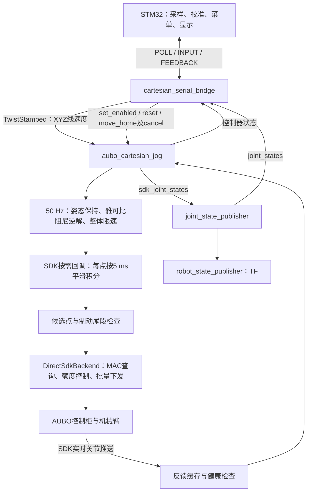

# AUBO 实机串口遥控与点动伺服执行流程

整理日期：2026-10-25；计算与误差分析补充：2026-10-30。本文依据当前仓库源码，入口为
[`cartesian_remote_real.launch`](../aubo/aubo_remote_bridge/launch/cartesian_remote_real.launch)。
本文梳理默认 `backend=sdk` 的程序调用、状态机、控制算法、线程时序和参数；不代表完成了新的实机验证。

本文的计算分成三个层次：**遥控输入的理想值、当前算法生成的轨迹值、实机测量值**。前两者可以从代码离线复算；第三者需要采集反馈或外部测量，文中的演算数字均不作为实机精度结论。

需要按计算顺序阅读时，可依次查看：第4.7～4.9节的深度/速度/位移换算，第6.7～6.10节的URDF、DH、雅可比与逆解，第7.4～7.5节的积分和增益，第8.7节的实际下发，以及第15～16节的误差计算和离线复算程序。

## 1. 总体职责与运行链路

这套程序实现末端 XYZ 连续点动：STM32 采集方向、速度和允许运动键，PC 将输入转换为笛卡尔线速度，计算六轴关节速度，平滑积分为位置点，再通过 AUBO SDK 下发。

启动时 SDK 会执行上电、松刹车相关初始化，但点动默认禁用，也不会自动回 HOME。点动需要显式 ENABLE；HOME 是另一个显式运动请求，要求点动禁用。



这里的“伺服”指 PC 持续更新运动目标并输出位置点。电机电流、速度、位置等驱动器内部控制环不在本仓库中实现。该入口使用 KDL 计算运动学、MoveIt 模型进行碰撞检查；默认不启动 MoveGroup 轨迹执行器、MoveIt Servo 或 JTC。

## 2. launch 展开：实际启动什么

```text
cartesian_remote_real.launch
├── aubo_ros_control/launch/cartesian_jog_real.launch
│   ├── aubo_moveit_config/launch/planning_context.launch
│   │   ├── robot_description：URDF / xacro
│   │   ├── robot_description_semantic：SRDF
│   │   └── 关节限位、笛卡尔限制、运动学配置
│   ├── aubo_joint_state_relay：joint_state_publisher
│   ├── robot_state_publisher
│   └── aubo_ros_control/launch/cartesian_jog.launch
│       └── aubo_cartesian_jog_node，节点名 aubo_cartesian_jog
└── aubo_remote_bridge/launch/cartesian_serial_bridge.launch
    └── cartesian_serial_bridge，节点名 cartesian_serial_bridge
```

launch 的包含顺序不是节点就绪屏障。串口桥和控制节点可以在初始化阶段同时运行，运动权限由状态与反馈检查决定。

### 2.1 顶层参数

| 参数 | 默认值 | 传递位置与作用 |
| --- | --- | --- |
| `port` | `/dev/ttyUSB0` | 串口桥私有参数 `~port` |
| `robot_ip` | `192.168.1.2` | 点动节点及其 SDK 后端 |
| `robot_xacro` | `aubo_i5_with_camera.xacro` | 从 `aubo_description/urdf` 加载对应模型 |
| `robot_srdf` | `aubo_i5_with_camera.srdf` | 从 `aubo_moveit_config/config` 加载语义模型 |
| `max_speed_mm_s` | `100.0` | 遥控输入线速度上限，允许 `(0,100]` mm/s |

顶层还固定传入 `panel=false`、串口桥 `joint_states_topic=/joint_states`。
下层实机 launch 默认 `backend=sdk`，原始六轴发布话题为 `/cartesian_jog/sdk_joint_states`，碰撞场景状态话题为 `/joint_states`。

`backend`、`config`、`panel`、`timing_trace_path` 等虽然在下层 launch 存在，但当前顶层没有声明和转发；不能直接给该顶层入口追加这些参数来修改下层行为。

### 2.2 模型与辅助节点

[`planning_context.launch`](../aubo/aubo_moveit_config/launch/planning_context.launch) 加载 URDF、SRDF、规划限位和运动学配置。点动实际使用自己的 KDL 雅可比求解器，加载 MoveIt 运动学配置不等于执行 MoveIt 全局规划。

`aubo_joint_state_relay` 将 SDK 六轴状态汇总为 `/joint_states`。夹爪模型的 `joint1`、`joint2` 以 `zeros={joint1: 0.0, joint2: 0.0}` 提供默认位置，表示模型采用 open 姿态；它们不是实机夹爪反馈，也不产生夹爪执行指令。

`robot_state_publisher` 依据模型和 `/joint_states` 发布 TF。串口桥使用汇总关节话题回传角度，碰撞场景使用该话题补全模型状态；运动控制健康检查仍来自 SDK 实际推送缓存。

带相机模型包含相机安装结构及碰撞几何，但此入口不启动相机驱动、视觉识别或点云建图。

## 3. 程序与源码索引

以下路径相对仓库根目录 `src/`。

| 文件/程序 | 职责 | 关键入口 |
| --- | --- | --- |
| [`aubo_remote_bridge/src/cartesian_serial_bridge.cpp`](../aubo/aubo_remote_bridge/src/cartesian_serial_bridge.cpp) | 遥控授权、ROS接口、离散操作与应答 | `run / receive / tick / halt / publishTwist / feedback` |
| [`aubo_remote_bridge/src/jog_remote_core.cpp`](../aubo/aubo_remote_bridge/src/jog_remote_core.cpp) | 点动轮询、会话切换、使能确认 | `JogPoller::poll / receive`、`JogEnableConfirmation::update` |
| [`aubo_remote_bridge/include/aubo_remote_bridge/posix_serial.hpp`](../aubo/aubo_remote_bridge/include/aubo_remote_bridge/posix_serial.hpp) | Linux termios串口、读写超时、字节解析接入 | `PosixSerial` |
| [`aubo_remote_bridge/src/RemoteProtocol.c`](../aubo/aubo_remote_bridge/src/RemoteProtocol.c) | 公共帧头、CRC、小端编解码 | `Remote_ParseByte / Remote_Encode / Remote_CRC` |
| [`aubo_remote_bridge/src/RemoteJogProtocol.c`](../aubo/aubo_remote_bridge/src/RemoteJogProtocol.c) | 点动 INPUT/FEEDBACK 编解码、字段检查 | `RemoteJog_DecodeInput / EncodeFeedback` |
| [`aubo_remote_bridge/src/remote_core.cpp`](../aubo/aubo_remote_bridge/src/remote_core.cpp) | 此链路复用请求结果缓存、关节名、帧编码 | `Ledger / jointNames / encode`；旧 `Poller` 不是本入口轮询器 |
| [`aubo_ros_control/src/cartesian_jog.cpp`](../aubo/aubo_ros_control/src/cartesian_jog.cpp) | 点动、HOME、状态机、模型与安全检查 | `CartesianJog` |
| [`aubo_ros_control/include/aubo_ros_control/cartesian_jog_common.h`](../aubo/aubo_ros_control/include/aubo_ros_control/cartesian_jog_common.h) | 固定周期平滑器、停止距离估算 | `VelocitySmoother / interpolationSteps` |
| [`aubo_ros_control/src/direct_sdk_backend.cpp`](../aubo/aubo_ros_control/src/direct_sdk_backend.cpp) | SDK启动、推送接收、MAC供点、传输故障锁存 | `connect / jogOutputLoop / queryDiagnosis / healthyAt` |
| [`aubo_ros_control/include/aubo_ros_control/sdk_jog_timing.h`](../aubo/aubo_ros_control/include/aubo_ros_control/sdk_jog_timing.h) | MAC目标缺口、发送预算、生产速率额度 | `SdkJogTiming / SdkPointPacer` |
| [`aubo_ros_control/include/aubo_ros_control/sdk_flow_control.h`](../aubo/aubo_ros_control/include/aubo_ros_control/sdk_flow_control.h) | MAC观测与在途预留、诊断超时 | `SdkFlowControl`，点动选 `SequentialMac` |
| [`aubo_ros_control/include/aubo_ros_control/sdk_tcp_transport.h`](../aubo/aubo_ros_control/include/aubo_ros_control/sdk_tcp_transport.h) | 当前进程SDK套接字的NODELAY/QUICKACK设置 | `configure / prepare` |
| [`aubo_ros_control/include/aubo_ros_control/motion_lease.h`](../aubo/aubo_ros_control/include/aubo_ros_control/motion_lease.h) | 本机运动写入进程互斥 | `MotionLease::acquire` |
| [`aubo_ros_control/include/aubo_ros_control/sdk_io_diagnostics.h`](../aubo/aubo_ros_control/include/aubo_ros_control/sdk_io_diagnostics.h) | 查询/发送批次、耗时与历史快照 | `SdkIoDiagnostics` |
| [`aubo_ros_control/include/aubo_ros_control/motion_timing_trace.h`](../aubo/aubo_ros_control/include/aubo_ros_control/motion_timing_trace.h) | 可选内存时序记录，退出后落盘 | `MotionTimingTrace` |

`aubo_cartesian_jog_node` 将 `cartesian_jog.cpp`、`direct_sdk_backend.cpp`、`visual_servo_common.cpp` 编译进同一个可执行程序。`DirectSdkBackend` 是节点内部对象，不是额外 ROS 节点。虽然复用视觉伺服命名空间及公共类型，本入口不会启动视觉伺服节点，也没有图像误差输入。

## 4. 串口桥：从输入到 ROS 指令

### 4.1 主循环与串口生命周期

`CartesianSerialBridge::run()` 的单次循环为：

```text
ros::spinOnce() 处理状态、关节、action回调
→ tick() 检查看门狗、异步服务结果、使能确认、周期发布
→ 打开串口或等待重试
→ JogPoller决定是否发送POLL
→ 读取并解析串口帧
→ 验证INPUT的字段、session、sequence及响应时限
→ receive() 处理实时输入与离散请求
→ tick()
→ 回传FEEDBACK
```

串口为 `115200 / 8N1 / 无流控`，独占打开。读操作单次 poll 最多等待 10 ms；写操作总预算 50 ms。异常后调用 `halt()`，释放串口，约 1 s 后重新打开并创建新会话。`baud` 虽为节点私有参数，但串口实现只接受 115200，launch 也未开放波特率参数。

ROS回调与串口在桥节点主线程执行；服务调用使用 `std::async`，避免同步服务阻塞串口心跳和取消。HOME action客户端使用主线程回调处理。

### 4.2 轮询与报文检查

| 项目 | 当前实现 |
| --- | --- |
| 外层帧 | `A5 5A`、版本`02`、类型、sequence、长度、payload、CRC |
| CRC | CRC-16/CCITT-FALSE，初值`0xFFFF`，多项式`0x1021` |
| 字节序 | 多字节整数小端 |
| POLL | 类型`0x11`，payload 4字节：PC生成的session |
| INPUT | 类型`0x12`，payload 18字节 |
| FEEDBACK | 类型`0x13`，payload 28字节 |
| 正常轮询间隔 | 约20 ms，同时最多一个未完成POLL |
| 响应有效窗口 | 小于100 ms，必须匹配当前session和sequence |

无效CRC、越界字段、旧session、旧sequence或重复响应不会刷新输入看门狗。
输入从有效退化为未校准/无效、响应超时或sequence用完后，轮询器会更换session。
新session第一帧只建立编号基线，并触发停止/禁用处理，防止恢复连接时执行缓存请求。

### 4.3 输入字段与速度换算

| 字段 | 范围/含义 |
| --- | --- |
| `request_id` | 离散请求编号，非零命令必须搭配非零编号 |
| `command` | 0无请求、1使能、2停止、3HOME、4取消、5复位 |
| `flags bit0/bit1` | 采样有效、校准完成；两者都为1才认为输入有效 |
| `flags bit2` | 允许运动键（deadman/SW）按住 |
| `frame` | 0基坐标系、1工具坐标系 |
| `speed` | 0.1 mm/s为单位，最大1000；方向非零时速度不能为0 |
| `axis[3]` | XYZ各分量`-1000..1000` |

设方向向量为 `a`，串口速度字段为 `s`，桥接限速为 `Smax`：

```text
S = min(s / 10, Smax)                       # mm/s
v = (S / 1000) × a / max(1000, ||a||)        # m/s
```

例如 `s=100, a=(1000,0,0)` 得到 X+ 10 mm/s；`a=(500,0,0)` 得到5 mm/s；`a=(1000,1000,0)` 的合速度仍为10 mm/s。摇杆死区和校准由MCU处理，回中发送精确零。

`publishTwist()` 发布 `geometry_msgs/TwistStamped`，时间戳为当前ROS时间，`frame_id` 使用配置的 `base_link` 或 `tcp_link`，角速度保持为零。
周期发布约50 Hz；`halt()` 还会额外立即发布一次零速度。

只有同时满足以下条件才发非零值：本端 `armed`、输入有效且新鲜、控制器状态新鲜、deadman按住，以及状态为 `ENABLED_IDLE/JOGGING`。

### 4.4 显式使能的两层授权

桥接节点的 `armed_` 与点动节点的 `enabled_` 是两个不同变量。

1. 输入回中、deadman释放，桥已见过中立输入，控制器状态为 `DISABLED`。
2. 发送新的ENABLE编号，桥异步调用 `/cartesian_jog/set_enabled(true)`。
3. 底层检查反馈、平滑器停稳、无故障、碰撞/限位条件以及SDK诊断就绪；`armMotion()`成功后设置 `enabled_`。
4. 服务成功返回时桥仍保持 `armed_=false`，继续发送零速度。
5. 等待服务返回后新收到的 `ENABLED_IDLE` 状态，最多1 s。
6. 确认后设置 `armed_=true`，该ENABLE请求反馈DONE；此后按住deadman才能点动。

等待期间输入离开中立、断链、控制器状态失效/故障、STOP/CANCEL会撤销授权并请求禁用。桥通过代次编号处理迟到的服务结果，避免已停止后又被旧服务成功结果重新授权。

### 4.5 离散请求、去重与停止

相同编号与命令只回放已有结果；同编号更换命令会拒绝并停止。编号倒退会拒绝，uint16前进距离需小于32768。请求缓存 `Ledger` 最多保存64条结果。

STOP/CANCEL优先进入停止路径；ENABLE/HOME/RESET则要求中立、状态新鲜并且没有未完成服务、使能确认、禁用或HOME等冲突操作。BUSY/拒绝的请求不会自动重试，需要新的显式编号。

`halt()` 会撤销 `armed_`、清除中立确认、发布零速度、取消使能确认、取消正在执行的HOME，并安排禁用服务。禁用服务失败后约250 ms再试。
STOP/CANCEL最终应答还会等待控制器新鲜状态为 `DISABLED`、HOME已结束以及禁用事务完成。

### 4.6 回传信息

FEEDBACK包含请求应答、控制器状态、HOME action状态、输入/授权/事务标志、六轴mrad角度、HOME最大关节误差和故障码。关节消息需时间戳有效，且有效期不超过500 ms；缺失或过期的关节通过mask标记无效。

`/remote/cartesian_status` 约10 Hz输出文字状态。FEEDBACK随有效INPUT返回，不是独立的固定10 Hz发送任务。完整逐字节定义见[串口协议](../aubo/aubo_remote_bridge/CARTESIAN_SERIAL_PROTOCOL.md)。


### 4.7 “摇杆深度”如何变成输入值

先区分三个量，避免把“推到一半”直接当作末端走了一半距离：

1. **物理行程深度**：摇杆偏离中心的机械行程或ADC比例，校准与死区处理前的量。
2. **协议深度**：`axis/1000`，已经经过MCU校准、死区、可能的非线性映射；PC实际使用这个值。
3. **末端运动量**：对经过逆解、缩放、平滑后的速度积分，最后还受实机跟随影响。

本仓库的这条桥接链路包含协议和PC端，没有提供对应MCU的ADC采样/深度映射实现。因此下面的ADC公式是**用于说明和核对固件的示例定义**，不是已确认的遥控器固件算法。

例如某12位ADC的中心为 `c=2048`，正端点 `x+=4095`，负端点 `x-=0`，可先作非对称校准：

```text
x >= c：u = (x - c) / (x+ - c)
x <  c：u = (x - c) / (c - x-)
u = clamp(u, -1, 1)
```

若采用5%死区，并将死区外剩余行程重新拉伸为0～100%：

```text
|u| <= δ：d = 0
|u| >  δ：d = sign(u) × (|u| - δ) / (1 - δ)，δ = 0.05
axis = round(1000 × d)
```

| 物理正向深度 `u` | 示例死区后深度 `d` | 示例协议 `axis_x` |
| --- | --- | --- |
| 0% | 0 | 0 |
| 5% | 0 | 0 |
| 10% | 0.052632 | 53 |
| 25% | 0.210526 | 211 |
| 50% | 0.473684 | 474 |
| 75% | 0.736842 | 737 |
| 100% | 1 | 1000 |

因此，“物理50%行程”是否等于 `axis=500` 取决于固件。实验记录应同时保存原始ADC、校准参数、死区算法和实际发出的axis。下文所有“25%/50%深度”均指**协议深度**，即axis为250/500；负方向只改变符号。

设 `a=(ax,ay,az)`，则PC桥输出的合速度为：

```text
ρ = ||a|| / 1000
||v|| = S × min(ρ, 1)                 # mm/s
v方向 = a / ||a||                     # a非零时
```

单轴时就是 `vx=S×ax/1000`。多轴时要按向量计算，不能把每个轴都当成独立满速。例如设定 `S=10 mm/s`：

| `axis=(ax,ay,az)` | 输出 `(vx,vy,vz)`，mm/s | 合速度，mm/s | 说明 |
| --- | --- | --- | --- |
| `(500,0,0)` | `(5,0,0)` | 5 | 单轴50% |
| `(500,500,0)` | `(5,5,0)` | 7.071068 | 范数小于1000，不额外归一化 |
| `(1000,1000,0)` | `(7.071068,7.071068,0)` | 10 | 对角线合速度饱和 |
| `(1000,1000,1000)` | `(5.773503,5.773503,5.773503)` | 10 | 三轴合速度饱和 |
| `(-250,0,0)` | `(-2.5,0,0)` | 2.5 | X负向25% |

### 4.8 不同速度、深度对应的速度与理想前进量

默认桥接上限100 mm/s。以下表格是单轴、未触发其他缩放时的**桥输出速度**，单位mm/s：

| 菜单设定 `S` | 协议speed | 0%，axis=0 | 10%，axis=100 | 25%，axis=250 | 50%，axis=500 | 75%，axis=750 | 100%，axis=1000 |
| --- | --- | --- | --- | --- | --- | --- | --- |
| 0.1 mm/s | 1 | 0 | 0.01 | 0.025 | 0.05 | 0.075 | 0.1 |
| 1 mm/s | 10 | 0 | 0.1 | 0.25 | 0.5 | 0.75 | 1 |
| 10 mm/s | 100 | 0 | 1 | 2.5 | 5 | 7.5 | 10 |
| 50 mm/s | 500 | 0 | 5 | 12.5 | 25 | 37.5 | 50 |
| 100 mm/s | 1000 | 0 | 10 | 25 | 50 | 75 | 100 |

若启动时设置 `max_speed_mm_s=20`，菜单发来的100 mm/s先被压到20 mm/s，再乘深度；50%深度得到10 mm/s。不能先算出50 mm/s再只按合速度限到20 mm/s，两者在部分深度下不同。

恒定方向、恒定速度时，桥输出对应的理想位移是：

```text
Δp_ideal = v_bridge × T
单轴：L_ideal = S × d × T               # S为mm/s，T为s，L为mm
```

| `S`，mm/s | 深度 | `axis_x` | `vx`，mm/s | 5 ms理想位移，mm | 20 ms理想位移，mm | 1 s理想位移，mm | 2 s理想位移，mm |
| --- | --- | --- | --- | --- | --- | --- | --- |
| 1 | 25% | 250 | 0.25 | 0.00125 | 0.005 | 0.25 | 0.5 |
| 10 | 25% | 250 | 2.5 | 0.0125 | 0.05 | 2.5 | 5 |
| 10 | 50% | 500 | 5 | 0.025 | 0.1 | 5 | 10 |
| 10 | 100% | 1000 | 10 | 0.05 | 0.2 | 10 | 20 |
| 50 | 50% | 500 | 25 | 0.125 | 0.5 | 25 | 50 |
| 100 | 75% | 750 | 75 | 0.375 | 1.5 | 75 | 150 |
| 100 | 100% | 1000 | 100 | 0.5 | 2 | 100 | 200 |

这些5 ms位移用于理解速度单位，**不是每个下发点都能立即前进这么多**。启动阶段关节平滑器从零爬升；正常运动也可能因阻尼、奇异值、关节速度与剩余限位空间减速。工具坐标输入时还要积分随姿态变化的 `R(q)v_tool`。

改变深度时应逐段积分。例如同一X+菜单10 mm/s，先25%持续0.4 s，再50%持续0.3 s，最后100%持续0.3 s：

```text
L_ideal = 2.5×0.4 + 5×0.3 + 10×0.3 = 5.5 mm
```

实际日志中使用每次有效速度的保持区间求和 `Σ vk Δtk`；失效、deadman释放或桥撤销授权后的区间取零。单帧输入不表示“走一固定步长”，也不能把轮询包个数直接当成位移。

### 4.9 从串口字段到ROS值的逐项例子

在会话和授权均有效时，X+、10 mm/s菜单、50%协议深度的一帧可具有：

```text
command=0，request_id=0                  # 连续输入，不重复发ENABLE
flags=0x07                             # 有效、已校准、deadman按住
frame=0                                # base_link
speed=100                              # 小端字节 64 00，单位0.1 mm/s
axis=(500,0,0)                         # 小端 F4 01 00 00 00 00
```

`INPUT`的payload偏移10～11是speed，12～17是三个int16轴值，偏移9必须为0；session及外层sequence必须响应当前POLL。该字段片段不是可直接发送的完整帧，完整帧还需帧头、会话、sequence和CRC。

计算为 `S=100/10=10 mm/s`，分母 `max(1000,500)=1000`，于是 `linear.x=0.005 m/s`，其余五个Twist分量均为0。若 `speed=0` 且任一axis非零，协议层直接拒绝，不将它解释成普通零速输入。

## 5. 点动节点初始化与并发结构

### 5.1 `CartesianJog` 构造过程

```text
parameters()：读取并验证参数，创建六个VelocitySmoother
→ initializeModel()：KDL链、FK、Jacobian、MoveIt场景
→ 注册command/state、set_enabled、reset
→ 创建DirectSdkBackend，注册generate回调并连接SDK
→ 创建50 Hz SDK反馈读取定时器
→ 创建10 Hz状态定时器和move_home action server
→ 启动50 Hz控制目标线程
```

模型检查包括：`base_link→tcp_link` 必须恰有六个活动关节，顺序必须匹配 `joint_names`；SRDF存在；MoveIt组存在；配置限位不能超出模型对应限制。模型错误会拒绝启动。

### 5.2 线程与频率

| 执行位置 | 工作 | 默认频率/触发方式 |
| --- | --- | --- |
| 点动主线程 | 监视健康、处理退出流程 | 50 Hz轮询 |
| ROS `AsyncSpinner(3)` | command、服务、action、反馈定时器、状态定时器等回调 | 按事件调度 |
| `control_thread_` | `updateControlTarget()`，计算关节速度目标 | 50 Hz，即20 ms |
| SDK `output_thread_` | 查询MAC、按需生成一批点、同步下发 | 取决于MAC和SDK RPC耗时 |
| SDK实时推送回调 | 接收真实六轴位置并缓存 | SDK/控制柜决定 |
| `readSdk`定时器 | 检查SDK缓存、更新控制反馈并发布六轴状态 | 50 Hz |
| `publishStatus`定时器 | 状态发布、HOME反馈与结果判定 | 10 Hz |

控制目标、平滑器及反馈等共享状态主要由点动节点 `mutex_` 保护。SDK缓存、流控、诊断等另有短锁。50 Hz目标计算与SDK供点仍可能因同一运动状态锁发生等待。

**5 ms是每个轨迹点的模型积分/执行周期，并不表示PC每隔5 ms准时进行一次网络发送。** SDK可能一次生成并发送多个点；批内每次调用生成器都按5 ms推进。RPC耗时不作为积分步长，也不用于判定控制柜已经消费了多少点。

## 6. 点动伺服：输入、姿态保持与逆解

### 6.1 输入检查 `command()`

禁用时忽略点动command。使能后必须先收到一次零线速度，才接收后续非零速度。
每条指令还需满足：

- XYZ及角速度均有限，角速度三个分量必须精确为0。
- 坐标系必须等于配置的基/工具坐标系。
- 时间戳非零，年龄不大于 `command_timeout`，未来偏差不超过50 ms。
- 时间戳不能倒退；同时间戳直接丢弃且不刷新看门狗。

无效输入触发 `invalid_or_stale_command`。有效XYZ合速度按 `max_linear_velocity` 再限幅，记录为 `requested_`。

### 6.2 两类关节位置变量

| 变量 | 含义 | 主要用途 |
| --- | --- | --- |
| `position_` | 生成轨迹当前推进到的六轴位置，可能领先实机 | FK、Jacobian、HOME误差控制、下一点积分与制动预测 |
| `feedback_` | SDK反馈经ROS定时器读取的实际位置 | 跟随误差、HOME实际到位、反馈速度估计 |
| SDK `last_position_` | 后端最近追加到发送批次的位置基准 | 下一点连续性与速度/加速度检查；失败后不恢复供点 |

初次SDK生成时，`position_` 由后端传入的起点初始化；连接时该起点来自SDK实时反馈。此后不会每个周期将轨迹位置强行跳回反馈位置。

因此，当前笛卡尔逆解不是简单的“每次用最新实际关节位置重算并覆盖轨迹”。生成端保持轨迹连续，实际反馈负责约束跟随偏差和判断健康/到位。

### 6.3 50 Hz目标更新 `updateControlTarget()`

```text
检查初始化、反馈超时、点动command超时
→ 无故障且未退出：HOME用homeVelocity，点动用desiredVelocity
→ 本次锁等待与计算达到控制周期预算：触发致命计算超时
→ 保存control_target_、更新时间及ready标志
```

控制线程每次从实际周期起点安排下一周期，发生延迟后不连续突发补算多个控制周期。
供点时若活动目标超过 `2×control_period` 未更新，默认40 ms，则触发 `control_target_timeout`。
零输入、禁用、HOME减速、故障或退出时供点目标直接取零，随后仍经过平滑器。

### 6.4 基坐标/工具坐标转换

`desiredVelocity()` 使用 `position_` 计算TCP正运动学 `R,p` 与六维雅可比 `J`。

```text
基坐标输入：v_base = v_input
工具坐标输入：v_base = R × v_input
```

工具坐标方向随当前TCP姿态定义；控制点是模型中的 `tcp_link`，不是固定假定的法兰原点。

### 6.5 姿态保持

每次使能设置 `capture_orientation_=true`。第一次计算非零点动目标时，保存当前生成轨迹TCP姿态为 `hold_rotation_`；零输入阶段不捕获新姿态。

```text
e_R = KDL::diff(R, R_hold)
ω_i = clamp(2.0 × e_R_i, -0.1, 0.1)       # rad/s
twist = [v_base_x, v_base_y, v_base_z, ω_x, ω_y, ω_z]
```

遥控器只输入XYZ，算法仍使用完整六维任务，通过姿态误差回授保持TCP朝向。增益2.0与角速度限幅0.1在源码中固定，不是当前YAML参数。姿态误差依据生成轨迹FK；对真实姿态的保持效果仍取决于跟随和模型精度。

### 6.6 阻尼最小二乘逆解

关节速度计算为：

```text
qdot_raw = Jᵀ × (J × Jᵀ + λ² × I)⁻¹ × twist
λ = dls_lambda = 0.02
```

SDK默认 `adaptive_damping=false`，因此这里使用固定λ；Gazebo默认开启自适应阻尼，离开奇异区后可减小到 `dls_lambda_min=0.002`，不能把本节SDK数值直接套用到Gazebo。源码使用矩阵分解求解而不是显式求逆。FK/Jacobian失败触发 `kinematics_failed`，结果非有限触发 `invalid_joint_velocity`。

随后以同一个比例缩放全部六轴速度，保持原关节速度向量方向：

```text
σ = J的最小奇异值
σ <= 0.008：singularity_stop
scale_sing = min(1, (σ - 0.008) / (0.06 - 0.008))

scale_vel = 各轴 V_i / |qdot_raw_i| 与1的最小值

room_i = 沿当前运动方向到“关节限位减去margin”的剩余角度
scale_limit_i = clamp((room_i - stoppingDistance_i) / 0.10, 0, 1)

qdot_target = qdot_raw × min(scale_sing, scale_vel, 所有scale_limit_i)
```

这里 `0.10` 是源码固定的关节余量缩放尺度，单位rad，不是末端100 mm/s速度。`singularity_slow/stop` 是当前雅可比定义下的数值阈值，不是距离或角度。


### 6.7 依据实际URDF建立机器人运动学模型

#### 6.7.1 坐标、单位及精确的连乘定义

以下只建模 `base_link→tcp_link` 的六个活动关节。关节角 `q1…q6` 顺序同第11节，单位rad；平移单位m。采用列向量、右手系，`⁰T₆`将第6坐标系的坐标变换到基坐标系。

本程序的运动学依据是[`arm.xacro`](../aubo/aubo_description/urdf/arm.xacro)及[`jiazhua.urdf`](../aubo/aubo_description/urdf/jiazhua.urdf)。URDF的关节变换为：

```text
Oi = Trans(xi,yi,zi) × Rz(yawi) × Ry(pitchi) × Rx(rolli)
Ti(qi) = Oi × Rz(qi)                    # 六个关节axis均为局部(0,0,1)
⁰T_tcp(q) = T1(q1)…T6(q6) × Trans(0,0,0.12)
```

固定工具链是 `wrist3_Link→gripper_base_link` 恒等变换、`gripper_base_link→gripper_link` 沿局部Z平移0.12 m、`gripper_link→tcp_link` 恒等变换。夹爪手指的两条活动支链不在TCP运动学链上。相机安装变换也不在这条链上。

| i/关节 | URDF origin xyz，m | URDF origin rpy，rad |
| --- | --- | --- |
| 1 / shoulder | `(0,0,0.122)` | `(0,0,3.1416)` |
| 2 / upperArm | `(0,0.1215,0)` | `(-1.5708,-1.5708,0)` |
| 3 / foreArm | `(0.408,0,0)` | `(-3.1416,-5.1632e-18,-5.459e-16)` |
| 4 / wrist1 | `(0.376,0,0)` | `(3.1416,-1.8323e-15,1.5708)` |
| 5 / wrist2 | `(0,0.1025,0)` | `(-1.5708,-1.8709e-15,-1.6653e-16)` |
| 6 / wrist3 | `(0,-0.094,0)` | `(1.5708,0,1.7907e-15)` |

URDF的关节坐标系允许任意固定RPY，因此不能把这里的xyz、rpy直接逐行抄成DH表。首先要按上述顺序相乘；惯性坐标、visual mesh偏移不参与这条关节运动学连乘。

#### 6.7.2 一组与本仓库模型对应的标准DH参数

为方便手算，把URDF中的 `3.1416/1.5708` 理想化为 `π/π/2`，忽略约 `1e-15` 的导出残差，重新选择DH中间坐标系。采用**标准DH**，明确顺序为：

```text
Ai = Rz(θi) × Tz(di) × Tx(ai) × Rx(αi)
θi = qi + θ0i
```

其4×4矩阵为：

```text
      [ cosθ  -sinθ cosα   sinθ sinα   a cosθ ]
Ai =  [ sinθ   cosθ cosα  -cosθ sinα   a sinθ ]
      [  0        sinα        cosα       d   ]
      [  0          0           0         1   ]
```

下表是一组经连乘核对的参数，**只对应本文选定的坐标系，不是SDK的DH字段表，也不是改进DH表**：

| i | `ai`，m | `αi`，rad | `di`，m | `θ0i`，rad | `θi` |
| --- | --- | --- | --- | --- | --- |
| 1 | 0 | `+π/2` | 0.122 | 0 | `q1` |
| 2 | 0.408 | `+π` | 0 | `+π/2` | `q2+π/2` |
| 3 | 0.376 | `+π` | 0 | 0 | `q3` |
| 4 | 0 | `+π/2` | 0.1215 | `+π/2` | `q4+π/2` |
| 5 | 0 | `+π/2` | 0.1025 | `+π` | `q5+π` |
| 6 | 0 | 0 | 0.094 | 0 | `q6` |

构造方法是令 `z(i-1)` 与第i个关节正轴重合，以相邻关节轴公法线确定 `xi`，再用关节零位下的坐标系关系确定θ偏置。平行轴的公法线原点有选择自由，因此URDF中第2行的0.1215 m可以在这套DH坐标选择中出现在第4行的d；中间坐标系不必与URDF link坐标系同名同向。

该选择满足 `⁰T₀_DH=I`、`⁶T_wrist3=I`，所以：

```text
⁰T_tcp_DH = A1 A2 A3 A4 A5 A6 × Tz(0.12)
```

全零关节角的理想化模型可快速验算为：

```text
                 [ 1  0   0     0      ]
⁰T_wrist3(0) =   [ 0  0  -1    -0.2155 ]
                 [ 0  1   0     1.0085 ]
                 [ 0  0   0     1      ]
p_tcp(0) = (0, -0.3355, 1.0085) m
```

这里的全零只用于模型核对，不是系统HOME，也不表示该姿态允许实机运动。

程序实际仍由KDL从**保留原始小数的URDF**建立模型，没有在控制代码中加载此DH表。第16节程序同时计算两种模型：理想化URDF与此DH模型应仅有浮点舍入差；原始URDF与理想化模型存在微小几何差。例如HOME点两者TCP位置差约为微米量级，数值逆解例子统一使用原始URDF，避免混用。

#### 6.7.3 与控制柜DH、基座和实际工具参数的核对

仓库[`CARTESIAN_JOG.md`](../aubo/aubo_ros_control/CARTESIAN_JOG.md)保存的2026-10-23历史SDK日志出现：

```text
DhParam: 0.408000,0.376000,0.098500,0.121500,0.102500,0.094000
```

SDK头文件[`AuboRobotMetaType.h`](../aubo/aubo_sdk/include/aubo_driver/AuboRobotMetaType.h)的 `RobotDhPara` 字段顺序为 `A3,A4,D1,D2,D5,D6`；该历史日志中的第三个几何数值0.0985 m与本仓库URDF首轴高度0.122 m相差 **0.0235 m=23.5 mm**。历史日志不是本次对当前控制柜的重新读取，且仅凭这些数值不能确定两套基座原点、零位约定和标定是否相同。

若只在同一模型中把首个 `Tz(0.122)` 改为 `Tz(0.0985)`，所有TCP绝对位置的基座Z都会平移−23.5 mm，位置差分和几何雅可比不变；这是该单一改动的数学结果。**不能据此断言真实机械臂有23.5 mm定位误差**，也不能直接把URDF改成SDK第三个数值。

比较模型FK与控制柜位姿前，应统一：六轴正方向及零位、控制柜base到ROS `base_link` 的固定变换、法兰坐标定义，以及法兰到真实TCP的工具变换。本文的0.12 m是仓库工具模型值，真实夹具应按实际TCP标定值核对。相机手眼外参用于相机与机器人坐标转换，不自动替代机械臂DH或TCP标定。

### 6.8 从正运动学建立六维雅可比矩阵

在基坐标中，设第i个关节轴方向为 `zi`，轴线上一点为 `oi`，TCP位置为 `p`。本文这里的 `zi` 是第i个活动关节的轴，等于标准DH记号的 `z(i-1)`。转动关节的雅可比第i列为：

```text
Jv_i = zi × (p - oi)                    # 线速度部分
Jω_i = zi                              # 角速度部分
J_i = [Jv_i; Jω_i]
J = [J_1 J_2 … J_6]                    # 6×6
[v_base; ω_base] = J(q) qdot
```

从URDF算这些量时，先令 `G=T1…T(i-1)`，即基座到上一link的变换，然后得到本关节轴变换 `Gi=G×Oi`：`oi=Gi.translation`、`zi=Gi.rotation×(0,0,1)`，再更新 `G=Gi×Rz(qi)`。这里正向累乘始终按 `T1…T(i-1)`，不能倒序；第16节代码给出可直接核对的实现。

控制点偏离法兰会改变J的平移部分：`v_tcp=v_flange+ω×r`，其中 `r=R_flange×(0,0,0.12)`。忽略工具长度会使输入线速度与真实TCP线速度不一致，特别是在需要关节转动补偿姿态时。

取YAML的HOME关节角作为**离线演算点**：

```text
q = [0, 0, 1.6292, 0, 1.6628, 0] rad
p_tcp ≈ [0.465246109, -0.101841441, 0.289336120] m
```

使用原始URDF得到：

```text
J ≈ [ 0.101841441  -0.167336120  -0.240663880   0.218715194   0.001149332   0           ]
    [ 0.465246109  -0.000000615   0.000000884  -0.000002369   0.213094914   0           ]
    [ 0             0.465245289  -0.465243646   0.089884666   0.019627445   0           ]
    [ 0             0.000003673   0.000003673  -0.000011007   0.998294561  -0.058133903 ]
    [ 0            -1             1            -1            -0.000007340   0.091874145 ]
    [ 1             0             0             0.000000429  -0.058377810  -0.994072226 ]
```

上三行将rad/s映射到m/s，下三行映射到rad/s。第6轴不改变此模型中位于其轴线上的TCP位置，所以其平移列约为0；它仍改变TCP朝向。显示为0的微小项仅在展示时舍入，实际求解保留完整精度。

此J的奇异值约为 `[1.843380,1.450588,1.022614,0.386521,0.323296,0.213189]`，最小值大于0.06，因此本演算点没有奇异减速。J混合线/角速度尺度，当前代码未设置任务权重或特征长度；其奇异值、阻尼和残差只在当前“m、rad”的数值约定下解释，不能改成mm后沿用相同阈值。

### 6.9 逆解矩阵的求解过程与数值残差

这里求的是**微分逆运动学**：由当前q和目标Twist求qdot，随后积分得到相邻关节位置。它不是一次解析求出远处目标位姿的所有关节角分支。

对给定 `b=[v;ω]`，阻尼最小二乘可写成：

```text
min_qdot ||J qdot - b||² + λ² ||qdot||²
(JᵀJ + λ²I) qdot = Jᵀb
qdot_raw = Jᵀ (JJᵀ + λ²I)⁻¹ b
```

上述欧氏范数按当前未加权数值坐标使用。实际代码不构造逆矩阵，而是：

1. 计算 `H=JJᵀ+λ²I`，SDK默认λ=0.02，故对角线加0.0004。
2. Eigen对H执行LDLT分解，求 `H y=b`。概念上依次解 `L z=b`、`D w=z`、`Lᵀ y=w`，实现还可能带置换。
3. 计算 `qdot_raw=Jᵀy`。
4. 根据第6.6节的奇异值、轴速度、制动余量计算共同缩放β，得到 `qdot_target=β qdot_raw`。
5. 再经第7节逐轴平滑器，才得到积分所用的速度。

在上面的HOME演算点，取X+10 mm/s，姿态刚捕获所以姿态误差为0：

```text
b = [0.010,0,0,0,0,0]ᵀ
H ≈ [ 0.144529816   0.047625623   0.053796700   0.001143465  -0.292042962   0.101774439 ]
    [ 0.047625623   0.262263384   0.004181599   0.212731494   0.000002303   0.452806095 ]
    [ 0.053796700   0.004181599   0.441769318   0.019592982  -1.020373744  -0.001145769 ]
    [ 0.001143465   0.212731494   0.019592982   1.000371582  -0.005337323  -0.000488953 ]
    [-0.292042962   0.000002303  -1.020373744  -0.005337323   3.008840858  -0.091329536 ]
    [ 0.101774439   0.452806095  -0.001145769  -0.000488953  -0.091329536   1.991987560 ]
y ≈ [0.119357880,-0.031501095,0.057589717,0.005602128,0.031201873,0.002527467]ᵀ

qdot_raw ≈ [ 0.000027284,
             -0.024381373,
             -0.024316515,
              0.000079956,
             -0.000000406,
              0.000028487 ] rad/s
```

各轴均低于速度限额；若平滑器从静止开始，按该点关节位置计算的余量缩放也为1，因此β=1。六轴协同产生的未平滑Twist为：

```text
J qdot_target ≈ [ 0.009952257, 0.000012600,-0.000023036,   # m/s
                 -0.000002241,-0.000012481,-0.000001011 ] # rad/s
```

即X速度约9.952257 mm/s，比10 mm/s少0.047743 mm/s，局部X方向相对差约0.47743%；还存在约+0.012600 mm/s的Y分量、−0.023036 mm/s的Z分量。这是**当前姿态、固定阻尼、尚未平滑时**的局部求解残差。

用SVD `J=UΣVᵀ` 可以看出残差来源：

```text
qdot_raw = V diag(σi/(σi²+λ²)) Uᵀ b
J qdot_raw = U diag(σi²/(σi²+λ²)) Uᵀ b
```

每个奇异方向都有小于1的增益，因此即使没有速度限幅也不保证 `J qdot=b`。在本点、姿态误差同为0且β始终等于1的前提下，X输入改成5/25/100 mm/s，原始qdot及局部残差分别线性乘0.5/2.5/10；一旦触发缩放或改变姿态，这个比例关系就不再足够。

若冻结J并假定已经进入稳态，持续1 s的平移误差向量约为 `(-0.047743,+0.012600,-0.023036) mm`，范数约0.054487 mm。真实启动后的1 s还包含平滑、姿态变化、50 Hz重新线性化、排队和跟随，不能将0.054487 mm用作实机1 s误差承诺。

### 6.10 增益、反馈和哪些误差当前会被纠正

| 作用 | 当前数值/公式 | 误差或输入来源 | 实际作用 |
| --- | --- | --- | --- |
| 摇杆速度比例 | `S/1000`配合axis归一化 | 协议axis与speed | 开环速度输入，不是位置误差反馈 |
| 姿态比例回授 | `K_R=2.0 s⁻¹`，每分量±0.1 rad/s | `FK(position_)`与使能后捕获姿态 | 在生成轨迹上纠正姿态漂移 |
| HOME比例回授 | `K_home=0.8 s⁻¹`，共同限到默认0.10 rad/s | `q_home-position_` | 在生成轨迹上趋近HOME |
| 阻尼 | SDK默认λ=0.02 | 当前J | 抑制逆解对小奇异值的放大，带来求解偏差 |
| 安全共同缩放 | β，范围0～1 | 奇异值、轴速上限、制动余量 | 降低六轴速度目标 |
| 关节速度平滑 | α=0.033333/0.0375 | 斜坡状态r与平滑状态v | 限制下发序列的动态变化 |
| 实机跟随监视 | `max_i abs(position_i-feedback_i)>0.12 rad`触发故障 | 生成位置与真实SDK反馈 | 超差停止；没有用该误差作连续P/PI补偿 |
| HOME结束检查 | 实际HOME误差≤0.005 rad等条件 | 真实SDK反馈 | 确认到位，不直接修改每个下发点 |

例如基坐标小姿态误差 `e_R=(0.01,-0.02,0.08) rad`，回授角速度为 `(0.02,-0.04,0.10) rad/s`；第三项由0.16限幅到0.10。未限幅且理想连续跟随时，一阶近似 `ė_R≈-2e_R`，时间常数约0.5 s；经过阻尼和平滑后不能直接当作真实闭环时间常数。零线速度输入时 `desiredVelocity()`直接返回零，不继续单独执行姿态纠偏。

HOME中若关节误差为0.05 rad，原始速度为0.04 rad/s；若误差0.20 rad，原始0.16 rad/s超过HOME0.10 rad/s，此轴会使六轴共同缩放到不大于0.625。上述两个增益和姿态角速度限幅均写在C++中，当前没有对应YAML可调参数。

**当前普通点动没有积分得到独立的笛卡尔目标位置 `p_ref`，也没有实现 `K_p(p_ref-p_measured)` 的实机平移闭环。** SDK反馈虽进入保护判断，不能把整条点动链路描述成“已有笛卡尔位置PID”。驱动器内部闭环属于控制柜，仓库没有其实现和可核对的PID参数。

若以后增加实机位置反馈，一种需要另行设计和验证的外环形式是：

```text
p_ref[k+1] = p_ref[k] + h × v_user[k]
e_p[k] = p_ref[k] - FK(q_measured_at_reference_time).translation
v_corrected[k] = v_user[k] + K_p e_p[k]
```

这里 `K_p` 的单位是s⁻¹。例如仅作量纲演算，2 mm误差、`K_p=1 s⁻¹`会增加2 mm/s的修正速度；这不是当前配置或推荐实机增益。真正接入前，需要统一参考执行时间、处理MAC前瞻和反馈延迟、限制修正速度，并规定停止时是否冻结参考及清除误差积分。否则用“未来生成点减去现在反馈”的误差直接加速，可能把正常排队当成跟随不足。本文仅说明扩展原理，没有修改当前控制器。

## 7. 5 ms平滑积分与停止预测

### 7.1 平滑器的离散公式

六个关节分别维护 `VelocitySmoother`。设步长 `h=0.005 s`，速度/加速度/jerk限制为 `V/A/J`，内部斜坡状态为 `r`，输出速度为 `v`：

```text
α = min(1, J × h / (2 × A))
u = clamp(qdot_target, -V, V)
r_next = r + clamp(u - r, -A × h, A × h)
v_next = v + α × (r_next - v)
q_next = q + v_next × h
```

第一层限制速度目标变化率，第二层一阶滤波限制加速度变化率。默认前3轴 `α≈0.03333`，后3轴 `α=0.0375`。反向时沿同一状态连续过渡，不直接翻转速度，也不会松手就清空滤波器。

这些限制作用于下发序列的离散速度、加速度、jerk；它们不等同于测得的真实关节瞬态上界。

### 7.2 每个位置点怎样生成

SDK回调调用链：

```text
jogOutputLoop()
→ point_generator_(requested)
→ CartesianJog::generate()
  → prepareGeneration()：初始化、反馈、command、跟随误差检查
  → pointTarget()：读取50 Hz目标或取零
  → interpolatePoint()：复制平滑器，尝试积分下一点
    → safeStop(next, next_filters)：预测该候选状态的完整减速尾段
  → 提交position_和filters_，返回六轴位置点
```

每次供点调用若总耗时超过20 ms（包含等待运动状态锁），触发 `control_computation_overrun` 并置致命标志，本点不继续下发。50 Hz控制目标计算也有自身约20 ms预算，两者不是同一个耗时检查。

### 7.3 `safeStop()`不只检查下一点

1. 复制候选位置和六个平滑器，不改变真实生成状态。
2. 对复制平滑器持续输入零，按5 ms预测减速轨迹。
3. 每个预测点检查有限性及带margin的关节限位。
4. 起点、停稳点、累计最大关节变化达到 `collision_resolution` 等位置执行MoveIt碰撞检查。
5. 最多推进600步，约3 s；不能在此范围内停稳也拒绝。

候选状态不安全时，程序锁存 `collision_or_stopping_limit`，从原有轨迹和平滑器改为零输入减速，不跳回反馈。随后还有不带margin的硬限位检查；非有限或超硬限位触发致命故障。

平滑器用于预先限速的保守剩余角位移估算为：

```text
T = |r| / A
stoppingDistance = |r| × (T + h) / 2 + h × |v| / α
```

碰撞检查依赖已加载模型和已发布场景。程序监听 `/planning_scene`、`/collision_object`、`/planning_scene_world` 等，不会自动识别现实障碍物。`collision_resolution=0.002` 的单位是rad，不是2 mm。离散制动检查不等于连续碰撞检测或全局绕障规划。


### 7.4 速度如何逐点积分：前20 ms完整演算

沿用第6.9节HOME演算点、X+10 mm/s、β=1，并假设这四个点使用同一目标。初始化 `r_i=0,v_i=0`。对第2轴：

```text
qdot_target_2 = -0.024381372784 rad/s
V2=0.25 rad/s，A2=0.60 rad/s²，J2=8 rad/s³
h=0.005 s，α2=8×0.005/(2×0.60)=1/30
每点r2最多变化 A2 h=0.003 rad/s
```

第一个点：

```text
r2[1] = 0 + clamp(-0.024381372784,-0.003,+0.003) = -0.003
v2[1] = 0 + (1/30)×(-0.003-0) = -0.000100000 rad/s
q2[1] = 0 + (-0.000100000)×0.005 = -0.000000500 rad
```

第2～4点继续用上次状态，不重新从零开始：

| 点号n | 轨迹时间，ms | `r2[n]`，rad/s | `v2[n]`，rad/s | 本点`Δq2`，rad | 累计`q2[n]-q2[0]`，rad |
| --- | --- | --- | --- | --- | --- |
| 1 | 5 | -0.003 | -0.000100000000 | -0.000000500000 | -0.000000500000 |
| 2 | 10 | -0.006 | -0.000296666667 | -0.000001483333 | -0.000001983333 |
| 3 | 15 | -0.009 | -0.000586777778 | -0.000002933889 | -0.000004917222 |
| 4 | 20 | -0.012 | -0.000967218519 | -0.000004836093 | -0.000009753315 |

六轴分别用各自的V/A/J积分，再重新计算TCP FK，得到下面的离线结果。表中“累计X位移”是**生成轨迹的位置变化**：

| 点号 | 理想恒速X位移，mm | 平滑生成的累计X位移，mm | 累计Y位移，mm | 累计Z位移，mm |
| --- | --- | --- | --- | --- |
| 1 | 0.05 | 0.000207742 | +0.000002099 | +0.000001345 |
| 2 | 0.10 | 0.000820287 | +0.000006228 | +0.000003984 |
| 3 | 0.15 | 0.002028130 | +0.000012318 | +0.000007863 |
| 4 | 0.20 | 0.004015413 | +0.000020304 | +0.000012930 |

20 ms的X差约为 `0.004015413-0.20=-0.195984587 mm`，主要是规定的启动平滑，不是矩阵计算舍入误差。第16节可复算此表。实际运行中50 Hz目标可能在批次生成期间更新，目标线程和SDK线程没有严格四点分组相位关系，此表只描述保持同一目标时的四步积分。

第2轴斜坡r约在第9个点达到目标，之后v仍需继续逼近r。当r不再变化时：

```text
v[n]-r = (1-α)^(n-n0) × (v[n0]-r)
τ_filter = -h / ln(1-α)
前3轴约0.1475 s；后3轴约0.1308 s
```

所以“50 Hz算一次目标、200 Hz生成位置点”本身不能保证瞬时达到菜单速度。长期位移应使用：

```text
q[N] = q[0] + h Σ(n=1…N) v_joint[n]
Δp_gen = FK(q[N]).p - FK(q[0]).p
L_path_gen = Σ ||FK(q[n]).p - FK(q[n-1]).p||
```

净前进量与轨迹弧长不同：转弯、回摆会增加弧长，但可能不增加目标方向的净位移。

### 7.5 松手后的积分、余量与误差

deadman松开将**后续目标**设为零，r和v会连续减小。例如第2轴处于 `r=v=-0.024381373 rad/s`的稳态，下一点零输入：

```text
r_next = -0.021381373 rad/s
v_next = -0.024281373 rad/s
Δq_next = -0.000121406865 rad
```

该点仍向原方向运动。当前平滑器保守剩余角位移公式给出：

```text
T_r = 0.024381373 / 0.60 ≈ 0.040636 s
d_stop_bound = |r|×(T_r+h)/2 + h×|v|/α ≈ 0.004214 rad
```

这是单轴估算上界；实际停止位置要将六个平滑器一起以零目标推进并计算FK。`safeStop()`做的正是这种关节轨迹预测及碰撞/限位检查，不能把单轴弧度直接换成TCP毫米而忽略雅可比与运动方向。

还需计入已提交点。仅按名义250 ms前瞻、恒定直线速度估算，在该时间内的排队运动量为：

| 生成端稳态TCP速度，mm/s | 250 ms所对应的运动量，mm |
| --- | --- |
| 1 | 0.25 |
| 5 | 1.25 |
| 10 | 2.5 |
| 50 | 12.5 |
| 100 | 25 |

这不是保证的停止距离，也不含平滑制动尾段。名义MAC前瞻不是带执行时间戳的测量；实际还包括输入检测、调度、发送、机械臂动态。测试中应分别记录松手时刻、生成目标归零时刻、最后运动点的执行时刻和实机稳定时刻。

## 8. SDK后端：初始化、反馈与供点

### 8.1 SDK连接过程 `connect()`

1. 读取IP、端口、登录配置、碰撞等级和MAC参数并验证。
2. 获取本机 `/tmp/aubo_motion_writer.lock` 文件锁，拒绝另一个使用同一机制的运动写入进程。
3. 登录三个SDK会话，设置匹配控制柜端点的当前进程TCP连接为 `TCP_NODELAY/TCP_QUICKACK`。
4. 注册控制柜事件日志，检查真实机械臂存在；点动接管前检查控制柜报告停止状态。
5. 调用 `rootServiceRobotStartup`，执行握手；最多约10 s等待上电且无软件/远程急停及碰撞等就绪条件。
6. 注册实时路点回调，最多2 s等待首帧，使用该位置初始化后端轨迹起点。
7. 进入TCP2CANBUS；特定返回错误下先退出模式、等待200 ms再尝试一次。
8. 创建 `SequentialMac` 流控，启用首次运动授权门槛，启动输出线程。

当前工作区还增加了启动诊断就绪阶段：首次接受ENABLE/HOME前，需要连续3次及时返回且MAC为空的诊断。未授权阶段遇到慢诊断会撤销就绪并重新等待，不会仅因这类启动诊断超时直接杀死禁用节点；诊断RPC失败、保护标志、非法计数或未知非空MAC仍锁存故障。
`motionReady()`查询就绪状态，`armMotion()`在显式运动请求被接受时单向退出启动等待阶段，此后恢复严格诊断看门狗，即使还未发出首批轨迹也一样。禁用不会重新进入启动宽容阶段。

三个会话在当前点动路径的实际分工：

| SDK对象 | 用途 |
| --- | --- |
| `control_service_` | startup、握手、进入/退出透传、控制柜事件 |
| `state_service_` | 启动阶段状态检查、实时关节位置推送 |
| `mac_service_` | 输出线程串行执行MAC诊断和位置批次下发 |

虽然创建三个会话，点动的MAC查询与轨迹发送明确使用同一个 `mac_service_`，不并发发起这两类RPC。文件锁只约束本机遵守该机制的程序，不约束示教器、其他电脑或外部SDK客户端。

### 8.2 反馈链路

```text
SDK receiveWaypoint()
→ 检查六轴数值有限
→ 缓存pushed_position_及steady_clock接收时间
→ 50 Hz readSdk()调用readState()
→ 检查真实SDK回调缓存年龄不超过feedback_timeout
→ 更新feedback_并发布/cartesian_jog/sdk_joint_states
```

`readState()`不进行RPC，只读取缓存并检查实际SDK回调接收年龄。ROS定时器重新发布不能延长该SDK缓存的有效期。
实际关节速度 `feedback_speed_` 根据点动节点相邻反馈读取值和时间间隔估计，不是直接读取驱动器速度，也不具有控制柜硬件采样时间戳。

### 8.3 MAC单位与供点批次

MAC返回 `macTargetPosDataSize`，单位是关节标量；六个标量为一个完整六轴点。换算时对不完整点向上取整。

```text
target = sdk_mac_buffer_target / 6 = 50点
observed = ceil(mac_scalars / 6)
缺口至少4点时：deficit = target - observed
否则：deficit = 0，暂不补点
```

默认目标300标量，对应50点、名义250 ms前瞻。限额360标量对应60点、名义300 ms。MAC无硬件采样时间戳/点序号；该限额约束软件接受的观测与预留，不能认证任意时刻真实物理排队不超过300 ms。

### 8.4 `jogOutputLoop()`完整工作流

```text
检查healthy()
→ queryDiagnosis()：读取最新MAC及保护标志
→ 检查motionReady()：未就绪时等待，不生成/发送运动点
→ 如首批已发送但未观察到非零MAC，先等待，不重复发送
→ 计算目标缺口deficit
→ SdkPointPacer计算本次允许生成的点数wanted
→ 循环wanted次调用generate，每次按5 ms积分
→ 检查每个点有限、速度/加速度连续
→ 本批必须完整生成
→ 预留MAC容量及生产额度
→ 同步robotServiceSetRobotPosData2Canbus(batch)
→ 检查SDK返回、健康、完成计数与发送预算
→ 再查询MAC，进入下一轮
```

第一批通常按测得缺口建立前瞻；在尚未运动且生成位置未变化时，不发送静止批次。运动开始后则持续供点，包括停止后的保持点，避免已建立的透传流断流。

生产节流器 `SdkPointPacer` 以每5 ms一份额度累积，约200点/s，最大额度为目标点数；首次观察到首批MAC后会以当时缺口初始化额度。正常补点还需达到批次门槛，MAC接近目标时丢弃积存额度。
**时间只授予“可以生产多少点”的额度，不证明控制柜已经消费了点。** 发送仍必须同时满足测得缺口与独立容量预留。

### 8.5 点动分支不经过 `optimize()`

`DirectSdkBackend` 也保留了视觉伺服软件队列路径，但点动在 `outputLoop()` 入口发现 `point_generator_` 后直接进入 `jogOutputLoop()`：

- 点动平滑与积分在 `VelocitySmoother` 完成，SDK层再验证相邻点速度与加速度。
- 点动分支不从公共软件队列pop，也不调用 `optimize()` 二次改写轨迹。
- 节点中的 `unused_queue_(2)` 是复用构造接口用的占位对象，不是两点运动缓冲策略。

### 8.6 SDK健康与故障停流

以下情况会锁存后端故障并停止后续供点：运动授权后的诊断超时、诊断失败、启动未知非空MAC、控制柜保护或MAC中断、实测/预留超限、批次不完整、轨迹点不连续、发送失败、发送耗时超预算、建立后的MAC轨迹流再次观测为零等。首次授权前的慢诊断按上一节的启动就绪规则处理。

默认发送预算为 `min(100 ms, 名义前瞻)`，即100 ms。首批发送后在限额覆盖时间内仍未观察到非零MAC也会失败，默认约300 ms。

SDK调用成功仅表示接口返回成功，不表示点已执行完毕；调用在软件停流后仍可能迟到返回成功。故障后不自动恢复，也不靠补发历史点追赶。
后端已停流时无法继续生成并送出减速点，不能把这一类故障描述为“必然平滑停止”。


### 8.7 一个具体批次：从关节矩阵到SDK字段

假设流已经建立，某次有效诊断返回 `macTargetPosDataSize=252`，即42个六轴点；目标300标量即50点，缺口8点，大于4点门槛。若生产额度和容量预留也允许8点，本次就生成8个位置向量：

```text
q(1), q(2), …, q(8)                    # 每个q含六轴，rad
Q_batch = [q(1)ᵀ; q(2)ᵀ; …; q(8)ᵀ]   # 8×6，轨迹时间跨度40 ms
```

代码不是直接发送qdot或Twist。每一行被复制为：

```cpp
aubo_robot_namespace::wayPoint_S waypoint{};
std::copy(requested.begin(), requested.end(), waypoint.jointpos);
batch.push_back(waypoint);
// 完整生成、连续性检查、MAC容量与生产额度预留成功后：
mac_service_.robotServiceSetRobotPosData2Canbus(batch);
```

此SDK位置点模式使用六轴弧度值；每点名义5 ms，当前位置生成器没有给每行附加独立执行时间。批次耗时40 ms指**点的名义执行跨度**，不指这次RPC必然耗时40 ms，也不指8个点同时到位。

在每个候选点，SDK后端重新计算：

```text
v_i[n] = (q_i[n]-q_i[n-1]) / 0.005
a_i[n] = (v_i[n]-v_i[n-1]) / 0.005
```

分别对照YAML速度和加速度限额；`last_position_ / last_velocity_`跨批次保留，所以前一批末点到后一批首点也检查。这里的“上一点”是后端轨迹序列的上一点，不是重新读取的实机位置。jerk限制来自生成器平滑器，后端此段代码不再独立验证jerk。

不能仅用 `252+8×6=300` 证明物理队列始终正好50点：诊断采样、网络传输、控制柜消费会同时发生。该算式是本次供点缺口的依据，此外仍有在途预留与健康检查；下一轮必须继续查询。SDK成功返回后才能将此批次记为接口成功提交，执行完成仍需反馈和控制柜状态等证据。

## 9. 控制器状态机与停止含义

底层没有一个单独enum贯穿全程，而是根据 `fault_ / home_goal_ / sdk_->motionReady() / initialized_ / enabled_ / settled()` 等变量生成状态文字，优先级为故障、HOME、等待SDK、等待反馈、禁用/停止、使能点动。

| 状态文字 | 生成条件/含义 |
| --- | --- |
| `WAITING_FOR_SDK` | SDK诊断尚未就绪，等待及时、空MAC的启动观测等条件 |
| `WAITING_FOR_FEEDBACK` | 尚未完成生成端初始化 |
| `DISABLED` | 点动禁用、无HOME，平滑器已停稳 |
| `ENABLED_IDLE` | 已使能，平滑器停稳且请求速度为零 |
| `JOGGING` | 已使能且有目标或尚未平滑停稳 |
| `STOPPING` | 已禁用但平滑器尚未停稳 |
| `HOME_MOVING` | 有HOME目标，尚未进入减速阶段 |
| `HOME_STOPPING` | HOME到位/取消/故障后进入减速 |
| `FAULT: ... \| STOPPING/STOPPED` | 锁存故障，后缀依据生成端平滑器是否停稳 |

典型操作过程：

```text
等待SDK/反馈 → DISABLED
→ 显式ENABLE → ENABLED_IDLE
→ 按住deadman并给方向 → JOGGING
→ 松开deadman → 零目标、平滑减速 → ENABLED_IDLE
→ STOP → STOPPING → DISABLED

DISABLED → 显式HOME → HOME_MOVING → HOME_STOPPING → DISABLED
```

松开deadman只让桥发零，链路健康时不会自动禁用；STOP/CANCEL、断链或输入无效会撤销使能。

当前串口桥 `controllerCode()` 尚未单独映射新增的 `WAITING_FOR_SDK`，所以ROS文字状态可以看到该名称，但串口控制器枚举会回传 `UNKNOWN`。等待底层进入 `DISABLED` 后再发ENABLE即可。

**`DISABLED`、故障后缀`STOPPED`及普通STOP应答主要依据生成端平滑器和事务状态，不等同于硬件测量确认整台机械臂已经物理静止。** HOME结果额外检查实际反馈误差、估计速度及反馈新鲜度，要求更严格。

普通控制故障由 `fault()` 置零目标并锁存，条件恢复后可尝试RESET；RESET要求已初始化、禁用、无HOME、无致命故障、平滑器停稳、反馈健康、停止位姿安全且跟随误差合格，成功后也不自动使能。SDK后端停流或致命计算/硬限位故障通常需要重启节点。

## 10. HOME控制也复用同一条伺服管线

[`MoveHome.action`](../aubo/aubo_ros_control/action/MoveHome.action) 的goal为空；目标从YAML读取，result为 `success/message`，feedback包含实际与目标关节位置、最大误差和stopping。

### 10.1 接受条件

`startHome()` 要求无其他HOME、点动未使能、未退出、已初始化、无故障、平滑器停稳、反馈健康、制动状态安全，且生成位置与实际反馈各轴误差不超过0.01 rad；SDK `armMotion()`也必须成功。它不会调用阻塞式SDK `moveJoint`。

### 10.2 关节空间回授

```text
e_i = home_i - position_i
qdot_raw_i = 0.8 × e_i
scale = min(1, 所有 min(home_joint_velocity, V_i) / |qdot_raw_i|)
qdot_home = qdot_raw × scale
```

默认 `home_joint_velocity=0.10 rad/s`。这里误差依据生成轨迹位置；实际反馈另外用于最终到位判定。
最大生成位置误差小于0.001 rad时开始减速；超出90 s触发 `home_timeout`。
HOME绕过笛卡尔雅可比逆解，因此不受点动奇异阈值直接限制，但仍经过相同平滑器、制动碰撞检查、限位、跟随误差和SDK下发检查。

### 10.3 完成与取消判定

`updateHome()` 约10 Hz发布反馈，只有以下条件同时满足才给出最终结果：进入stopping、平滑器停稳、生成与实际各轴误差不超过0.01 rad、估计反馈关节速度不超过0.01 rad/s、反馈新鲜。

随后有故障则ABORTED，已取消则CANCELED，否则实际最大HOME误差不超过0.005 rad才SUCCEEDED，超差则ABORTED。所有结果均保持点动禁用。

## 11. 参数与时序速查

### 11.1 YAML运动参数

来源：[`cartesian_jog.yaml`](../aubo/aubo_ros_control/config/cartesian_jog.yaml)，加载到 `/aubo_cartesian_jog` 私有命名空间。下面是该launch加载后的值，不应与C++缺参时的fallback混淆，例如C++ `max_linear_velocity` fallback为0.02，而YAML覆盖为0.10。

| 参数 | 当前值 | 单位/作用 |
| --- | --- | --- |
| `base_link / tool_link / group_name` | `base_link / tcp_link / aubo_i5` | KDL链、控制坐标系、MoveIt组 |
| `max_linear_velocity` | `0.10` | m/s，XYZ合速度上限 |
| `control_frequency` | `50.0` | Hz；周期须包含1..10个完整5 ms点 |
| `command_timeout / feedback_timeout` | `0.15 / 0.15` | s |
| `max_following_error` | `0.12` | rad，生成与实际位置差阈值 |
| `joint_limit_margin` | `0.08` | rad，限位余量 |
| `dls_lambda` | `0.02` | 阻尼逆解参数 |
| `singularity_stop / singularity_slow` | `0.008 / 0.06` | 最小奇异值停止/减速阈值 |
| `collision_resolution` | `0.002` | rad，制动预测碰撞采样间隔 |
| `home_joint_positions` | `[0,0,1.6292,0,1.6628,0]` | rad，J1..J6，非全零位 |
| `home_joint_velocity / home_timeout` | `0.10 / 90.0` | rad/s、s |
| `planning_scene_topic` | `/planning_scene` | 外部场景输入 |
| `initial_scene_service` | 空字符串 | 默认不主动获取既有完整场景 |
| `sdk_mac_buffer_target / sdk_mac_buffer_limit` | `300 / 360` | 关节标量，即50/60个六轴点 |
| `sdk_diagnosis_timeout` | `0.15` | s |
| `robot_ip / server_port` | `192.168.1.2 / 8899` | IP由launch参数覆盖 |
| `username / password` | 见YAML | SDK登录配置 |
| `collision_class / require_real_robot` | `6 / true` | startup碰撞等级、要求真实机械臂 |

关节顺序固定为 `shoulder_joint, upperArm_joint, foreArm_joint, wrist1_joint, wrist2_joint, wrist3_joint`。

| 限制 | J1 | J2 | J3 | J4 | J5 | J6 |
| --- | --- | --- | --- | --- | --- | --- |
| 下限rad | -3.04 | -1.0471976 | -3.04 | -3.04 | -3.04 | -3.04 |
| 上限rad | 3.04 | 1.0471976 | 3.04 | 3.04 | 3.04 | 3.04 |
| 速度rad/s | 0.25 | 0.25 | 0.25 | 0.35 | 0.35 | 0.35 |
| 加速度rad/s² | 0.60 | 0.60 | 0.60 | 0.80 | 0.80 | 0.80 |
| jerk rad/s³ | 8 | 8 | 8 | 12 | 12 | 12 |

YAML中的 `controller_command_topic/controller_manager_service/controller_name` 只用于显式选择的旧ros_control路径；`gazebo_command_topics` 用于Gazebo。它们不参与默认SDK运动输出。

### 11.2 各层超时不能互相替代

| 检查 | 阈值 | 处理位置与行为 |
| --- | --- | --- |
| 有效串口输入新鲜度 | 100 ms | 桥撤销armed、零指令、取消HOME、请求禁用 |
| 控制器状态新鲜度 | 300 ms | 桥视为UNKNOWN，活动授权撤销 |
| 使能状态确认 | 1 s | 服务成功后仍需新的ENABLED_IDLE |
| 串口回传关节有效期 | 500 ms | 清除joint_mask，不是底层反馈容忍时间 |
| 点动command | 150 ms | 底层故障并置零目标 |
| 实际SDK推送缓存 | 150 ms | SDK readState失败，底层故障 |
| 活动控制目标 | 默认40 ms | `pointTarget()`触发目标超时 |
| 单点生成总耗时 | 20 ms | 致命计算超时，不发送本点 |
| 控制目标计算耗时 | 默认20 ms | 达到控制周期预算触发致命故障 |
| SDK单次发送 | 默认100 ms | 后端停流 |
| SDK诊断请求/连续无有效响应 | 150 ms | 首次授权前撤销就绪并等待；授权后后端停流 |
| HOME | 90 s | HOME超时故障并请求减速 |

这些是软件检查阈值，触发还依赖线程获得执行机会，不能当作硬实时响应保证。

## 12. 一次X+点动、松手与退出的实际过程

以基坐标10 mm/s为例：

1. MCU持续响应POLL，完成有效/校准标志并回中松键。
2. ENABLE获得服务成功及新状态确认，桥armed、底层enabled。
3. MCU发 `frame=0, speed=100, axis=(1000,0,0), deadman=1`。
4. 桥发布 `linear=(0.01,0,0) m/s`。
5. 下一次目标线程用生成轨迹位置计算FK/Jacobian、捕获姿态、计算关节速度及整体缩放。
6. SDK查询发现足够MAC缺口且生产额度充足，调用生成器若干次，逐点平滑、积分、验证并组批发送。
7. 实机执行队列中的点，SDK推送反馈；生成与实际位置偏差超过0.12 rad会故障。
8. 松开deadman后桥发零；随后生成的新点逐步减速，但已提交的点不能撤回。
9. 平滑器停稳后底层可能进入ENABLED_IDLE，链路正常时无需重新使能即可再次按住点动。

实际松手延迟包含MCU采样、轮询、ROS发布与调度、SDK同步调用、已有前瞻点、平滑减速以及机械臂跟随。不能只用20 ms或100 ms代表总停止时间。

桥正常退出先 `halt()`，最多约2 s等待禁用相关事务；点动节点处理SIGINT/SIGTERM时保持回调与SDK运行，先请求零目标和取消HOME，健康时最多约3 s等待平滑器停稳，再留400 ms名义缓冲排空余量。随后停止线程、退出透传、注销回调和登录、释放文件锁。该排空等待不证明硬件实际队列已经清空。

## 13. 查看状态与定位问题

先加载工作空间环境，以下查看命令分别在终端执行：

```bash
source /home/zlab/aubo/ros_mobile_manipulation_lab/devel/setup.bash
rostopic echo /remote/cartesian_status
rostopic echo /cartesian_jog/state
rostopic echo /cartesian_jog/command
rostopic echo /cartesian_jog/sdk_joint_states
rosparam get /aubo_cartesian_jog
rosnode info /aubo_cartesian_jog
```

| 现象 | 优先查看 |
| --- | --- |
| `WAITING_FOR_SDK` | 连续3次及时空MAC诊断、诊断RPC耗时；串口枚举暂显示UNKNOWN |
| 串口收到字节但没有有效输入 | 串口诊断的bytes/frames/accepted；版本、类型、CRC、session/sequence |
| ENABLE服务成功但不能点动 | 桥armed、使能确认、是否等到新ENABLED_IDLE、是否中立/松键 |
| 使能后仍不动 | deadman、axis、speed、底层首次零指令要求、command坐标系与时间戳 |
| 速度低于遥控设定 | 关节限速、奇异值缩放、限位制动余量、平滑器过渡 |
| `following_error` | 生成位置领先量、实机反馈、MAC前瞻、执行及反馈延迟 |
| `control_computation_overrun` | 控制/供点计算耗时、锁等待、碰撞检查负载 |
| SDK后端故障/节点退出 | `[sdk/transport]`、`[sdk/history]`、发送返回耗时、MAC与反馈年龄 |
| STOP有应答但实机仍有短暂运动 | 已提交轨迹、平滑尾段；注意普通DISABLED不是硬件静止确认 |

当前仓库[点动说明](../aubo/aubo_ros_control/CARTESIAN_JOG.md)记录过SDK同步发送超时，且连续XYZ实机点动尚未验证通过。进一步时序诊断见[SDK时间线与MAC分析](../aubo/aubo_ros_control/TIMING_DIAGNOSIS.md)。本文保留该验证边界，不将代码设计或离线测试视为实机连续运动通过。

## 14. 建议阅读源码顺序

1. 顶层launch → `cartesian_jog_real.launch` → `cartesian_jog.launch`：确定参数和节点。
2. 桥 `receive / tick / publishTwist`：理解授权与XYZ输入。
3. 点动 `command / enable / desiredVelocity`：理解指令检查、姿态保持和逆解。
4. `updateControlTarget / pointTarget / generate / interpolatePoint`：理解50 Hz目标和5 ms点。
5. `VelocitySmoother / safeStop`：理解平滑、减速与碰撞预测。
6. SDK `connect / queryDiagnosis / jogOutputLoop / healthyAt`：理解实际传输与故障边界。
7. `startHome / homeVelocity / updateHome / publishStatus`：理解HOME和状态结果。

## 15. 误差怎样计算、分解和记录

### 15.1 先统一时间与被比较的轨迹

应至少区分以下量：

| 量 | 含义 | 当前可获取的来源 |
| --- | --- | --- |
| `v_bridge(t)` | 经过授权、深度换算及桥接上限后的输入速度 | `/cartesian_jog/command` |
| `q_gen[n]` | 平滑积分产生的第n个位置点 | 完整SDK point trace；`joint_target`只提供降采样快照 |
| `q_sent[n]` | 属于成功返回批次的点 | 关联point、batch与send事件；成功返回仍不等于已执行 |
| `q_fb(t)` | SDK最新实际关节反馈 | `/cartesian_jog/sdk_joint_states` |
| `p_fb_model(t)` | 用相同模型对反馈做FK得到的TCP位置 | `FK(q_fb)`，或时间对应的base→TCP TF |
| `p_external(t)` | 外部测量的真实TCP位置，换算到同一基坐标 | 外部标定/测量系统，本入口没有此测量值 |

这里n是**5 ms轨迹点序号**，t是采集时间，两者不能直接混为一谈。生成时刻不等于执行时刻，`joint_target.header.stamp`也不是控制柜承诺的执行时间。

软件跟随保护实际检查 `q_gen_now-q_fb_now`，其中生成点可能领先控制柜正在执行的点。局部恒速近似下，若某轴0.25 rad/s、名义前瞻0.25 s，即使执行完全跟随已到期轨迹，当前生成端与实际端也可能相差约0.0625 rad。末端10 mm/s时对应名义2.5 mm领先量。因此0.12 rad是当前软件阈值，不能据此宣称定位精度为0.12 rad或已测得真实跟随误差。

动态跟踪精度应比较 `q_reference_at_execution_time(t)-q_fb(t)`；当前接口没有硬件执行点编号/时间戳，不能精确恢复这一配对。可以另行通过轨迹与反馈做延迟估计并报告估计误差，但不能将固定250 ms平移当作已测得的真实延迟。稳定起止点之间的位移比较能减少这种相位混淆，仍需记录输入窗口和减速尾段。

### 15.2 四种位移及误差分解

在统一基坐标、统一起止区间后，定义：

```text
Δp_ideal = ∫ v_bridge_base(t) dt
Δp_gen   = FK(q_gen_end).p - FK(q_gen_start).p
Δp_fb    = FK(q_fb_end).p  - FK(q_fb_start).p
Δp_ext   = p_external_end - p_external_start

e_algorithm = Δp_gen - Δp_ideal
e_follow    = Δp_fb  - Δp_gen
e_model     = Δp_ext - Δp_fb
e_total     = Δp_ext - Δp_ideal
            = e_algorithm + e_follow + e_model
```

上述等式是位移向量的代数分解，**只有起止点和轨迹阶段对应时才有相应的物理解释**。若输入截止时轨迹仍在排队，拿该时刻q_fb减未来q_gen，`e_follow`就混入排队相位。

- `e_algorithm`包含DLS偏差、共同缩放、平滑启停和离散重线性化；这些不一定属于程序错误。
- `e_follow`在执行时间对齐后描述生成轨迹与关节反馈所对应模型轨迹的差；还会受到反馈采样和同步误差影响。
- `e_model`包含运动学几何参数、工具TCP、坐标标定以及外部测量误差；仅凭关节反馈不能分离这些因素。

同一URDF计算 `q_gen`和`q_fb`的FK，只能评价该模型下的一致性，不能独立验证连杆尺寸或真实TCP的绝对精度。固定基座平移偏差会在起止位移中抵消，但会保留在绝对定位误差中；工具长度、零位和旋转标定误差则可能随姿态改变。

工具坐标指令的理想位移应明确用哪条姿态轨迹转换：源码采用生成轨迹 `R(q_gen)`，对应的命令解释可写为 `∫R(q_gen(t))v_tool(t)dt`；若用反馈姿态计算，则应另标为基于反馈姿态的参考。不要在比较中悄悄更换定义。

### 15.3 前进量、方向偏差与统计指标

设一段固定基坐标直线输入的单位方向为 `n`，例如X+为 `(1,0,0)`，则：

```text
L_ideal = nᵀ Δp_ideal
L_actual = nᵀ Δp_actual
有符号前进误差 e_parallel = L_actual - L_ideal
前进绝对误差 = |e_parallel|
前进相对误差 = e_parallel / |L_ideal| × 100%
横向误差 e_perp = (I - nnᵀ)(Δp_actual - Δp_ideal)
总位移误差 E = ||Δp_actual - Δp_ideal||
```

负的前进误差表示少走，正值表示多走。`L_ideal=0`时相对误差不定义；短行程也应优先给出mm误差，避免接近零的分母夸大百分比。若方向在过程中变化，应分段计算，或比较整条时序轨迹，而不是使用一个固定n概括全程。

对时间已对齐的M个误差样本 `e[k]=p_actual[k]-p_reference[k]`：

```text
RMSE = sqrt((1/M) Σ ||e[k]||²)
最大误差 = max ||e[k]||
稳态速度误差 = v_measured_steady - v_command_steady
```

稳态速度可对稳态窗口的 `nᵀp_fb(t)`作直线拟合，斜率即mm/s；注明窗口、是否仍在缩放、拟合残差。不要在启动20 ms区间用净位移除以时间评价稳态速度。

停止实验还应单独报告：输入归零到实机满足停稳判据的时间、该期间的前进量、相对预期终点的超调。停稳判据需写明速度阈值和持续时间，不能只用控制器状态文字替代。相同工况重复测量时，报告样本数、平均误差、标准差和最大值。

### 15.4 输入量化、模型和积分各自带来什么误差

**输入量化。** 假定输入采用四舍五入，单轴未饱和时axis的半个量化单位对应 `|δd|≤0.0005`，speed的半个单位对应 `|δS|≤0.05 mm/s`。一阶估计：

```text
|δv| ≲ S×0.0005 + |d|×0.05            # mm/s，不含二阶小量
```

例如S=100 mm/s、d=0.5，最不利一阶估计约0.075 mm/s，保持1 s约0.075 mm。若菜单本来只允许协议能精确表达的速度，speed并没有这项舍入误差；死区和ADC噪声还需要按实际固件单独统计。多轴饱和归一化时应传播完整向量，不能把单轴估计直接当成合速度误差。

**反馈量化。** 串口FEEDBACK仅回传mrad整数，不适合代替ROS原始双精度关节数据做精度分析。当前桥以 `std::lround(q×1000)`四舍五入，单轴量化误差约±0.0005 rad；在本演算点第2轴的TCP位置敏感度 `||Jv_2||≈0.4944 m/rad`，单这一轴的0.5 mrad就可能对应约0.247 mm的局部位置差。当前桥对非有限或超出int16范围的原始值不打包为有效角度；分析时还必须检查joint_mask及反馈新鲜度。

**运动学误差。** 小扰动时：

```text
δp ≈ Jv δq + J_geometry δπ
```

`δq`包括关节零偏/反馈误差，`δπ`包括连杆长度、固定安装变换和TCP参数误差。两者需要独立标定或外部测量才能分辨。前述URDF与SDK历史几何数值差异应先完成坐标定义核对。

**离散积分与重新线性化。** 单步TCP变化满足：

```text
p(q+h v_joint)-p(q) = h Jv(q) v_joint + O(||h v_joint||²)
```

将每一步FK差分与 `hJv v_joint`比较，可以看到局部非线性项；这不包含控制柜实际跟随。目标50 Hz保持、速度200 Hz平滑以及每次J基于生成q重算，又分别产生控制保持和动态变化。评估积分误差时应把这些因素与DLS残差分开。

**时间误差。** 恒速下同步误差近似带来 `|δp_time|≈|v|×|δt|`。例如100 mm/s时20 ms相位差就对应2 mm，10 mm/s时对应0.2 mm，可能远大于浮点舍入误差。网络发送耗时不能作为轨迹积分步长，也不能直接作为硬件执行延迟。

### 15.5 一个误差计算示例与待填写实验表

以下数字是**人为构造的算术示例**，没有对应实机记录。设X+、S=10 mm/s、50%协议深度，输入窗口2 s；将减速尾段也纳入终点，并正确对应各阶段端点后，假设得到：

```text
理想前进量：10×0.5×2 = 10.00 mm
生成轨迹前进量：          9.72 mm
反馈FK前进量：            9.60 mm
外部测量前进量：          9.55 mm
```

只考虑X方向时，算法位移差为−0.28 mm，跟随位移差为−0.12 mm，模型/测量位移差为−0.05 mm，总误差−0.45 mm，相对误差−4.5%。这些假设数字只展示分解方法，不能用于评价当前参数、计算实际补偿增益或宣称某个速度下的精度。

实际记录可采用下表，每组保留完整原始记录；“待测”必须由测量填写：

| 工况 | S，mm/s | 协议深度 | axis_x | 恒定输入时间，s | 理想前进量，mm | 生成前进量，mm | 反馈FK前进量，mm | 外测前进量，mm | 停止追加量，mm |
| --- | --- | --- | --- | --- | --- | --- | --- | --- | --- |
| A | 1 | 25% | 250 | 1 | 0.25 | 待测 | 待测 | 待测 | 待测 |
| B | 10 | 25% | 250 | 1 | 2.5 | 待测 | 待测 | 待测 | 待测 |
| C | 10 | 50% | 500 | 1 | 5 | 待测 | 待测 | 待测 | 待测 |
| D | 10 | 100% | 1000 | 1 | 10 | 待测 | 待测 | 待测 | 待测 |
| E | 50 | 50% | 500 | 1 | 25 | 待测 | 待测 | 待测 | 待测 |
| F | 100 | 25% | 250 | 1 | 25 | 待测 | 待测 | 待测 | 待测 |

E/F具有相同理想速度，可用于核对“菜单速度×深度”是否一致；实际比较还需保持起始q、坐标系、模型、使能姿态、平滑器初态及输入时序相同。不同机械臂姿态下，同样的输入会有不同J、DLS偏差和缩放，不能混作同一工况。

这张表列出待验证工况，不是已通过实机的执行序列。现有连续点动验证边界仍见第13节；文档和离线计算没有改变这一状态。

### 15.6 当前日志怎样采集和解释

在已经运行的目标系统上，可被动记录相关ROS话题；以下是采集示例，不会发布运动指令：

```bash
rosbag record -O /tmp/aubo_remote_jog_measurement.bag \
  /cartesian_jog/command \
  /cartesian_jog/joint_target \
  /cartesian_jog/servo_diagnostics \
  /cartesian_jog/sdk_joint_states \
  /cartesian_jog/state /remote/cartesian_status \
  /tf /tf_static /rosout
```

每次采集应使用新的文件路径。协议原始axis、speed、deadman、ADC并不全部出现在上述ROS话题中，应另保留MCU或串口接收日志；不能仅从桥输出反推所有原始字段。

`/cartesian_jog/servo_diagnostics`是 `Float64MultiArray`，`data`的零起始下标为：

| 下标 | 含义 | 单位/解释 |
| --- | --- | --- |
| 0 | 最近生成点的ROS时间戳 | s，不是硬件执行时间 |
| 1～3 | `diagnostic_requested_` | 基坐标请求线速度，m/s |
| 4～6 | `J×qdot_target`的线速度部分 | 逆解及共同缩放后的估计值，m/s |
| 7～9 | `J×filters.velocity`的线速度部分 | 平滑后的局部估计值，m/s |
| 10 | 最小奇异值 | 当前数值尺度 |
| 11 | 实际使用的λ | 默认SDK 0.02 |
| 12 | 共同缩放β | 0～1 |
| 13 | 后端编码 | SDK=2、ros_control=1、Gazebo=0 |

诊断与 `joint_target`约50 Hz定时发布，J和逆解诊断来自最近一次目标计算，平滑速度来自发布快照，因此它们不严格构成同一个5 ms点的同步记录。零输入、HOME或故障阶段某些诊断值被清零或沿用旧值，也不能据此重建完整轨迹；分析完整5 ms序列应使用SDK timing trace。

顶层遥控launch没有转发 `timing_trace_path`。需要完整点记录时，可以用下层实机入口和桥分别启动，构成同一SDK运动路径。下面仅给出启动方式，运动仍按第4节显式授权；不要与另一套SDK/ros_control运动节点重复运行：

```bash
# 终端1；每次替换为新的绝对CSV路径
roslaunch aubo_ros_control cartesian_jog_real.launch \
  backend:=sdk panel:=false robot_ip:=192.168.1.2 \
  timing_trace_path:=/tmp/aubo_remote_jog_timing_run01.csv

# 终端2
roslaunch aubo_remote_bridge cartesian_serial_bridge.launch \
  port:=/dev/ttyUSB0 joint_states_topic:=/joint_states max_speed_mm_s:=100
```

trace在内存记录，节点正常退出并join所有写入线程后才导出CSV；采集过程中磁盘文件不提供实时完整记录。分析时关联 `command→target→point→batch_append→send_begin/send_end`，检查是否丢事件以及批次结果。事件耗时使用steady时钟，`source_ros_ns`属于ROS时钟域，不能直接相减。MAC观测不能恢复硬件逐点执行时间。

同时保存生效ROS参数、URDF/SRDF、源码版本/修改状态、SDK与控制柜版本、真实工具定义和反馈采集方式，这样“同样的速度与深度”才具有可复算的上下文。

## 16. 离线复算程序：DH、雅可比、逆解和四点积分

下面程序只读取本地URDF/xacro的XML关节字段并执行NumPy计算，不导入ROS、不连接SDK、不发布运动。依赖Python 3和NumPy。将代码保存为临时文件后，在仓库 `src/` 目录运行；也可将仓库 `src/` 绝对路径作为第一个参数。

程序同时检查：理想化URDF与本文DH连乘一致、原始URDF解析雅可比与位置/旋转中心差分一致、DLS线性系统残差，并打印第6.9及7.4节的数值。只检查运动学和积分，不执行碰撞检查、线程时序、流控或实机验证。

```python
from pathlib import Path
import sys
import xml.etree.ElementTree as ET
import numpy as np

ROOT = Path(sys.argv[1]) if len(sys.argv) > 1 else Path.cwd()
URDF = ROOT / "aubo/aubo_description/urdf/arm.xacro"
NAMES = ["shoulder_joint", "upperArm_joint", "foreArm_joint",
         "wrist1_joint", "wrist2_joint", "wrist3_joint"]
H = 0.005
np.set_printoptions(precision=9, suppress=True, linewidth=150)


def rotation(axis, angle):
    c, s = np.cos(angle), np.sin(angle)
    if axis == "x":
        return np.array([[1, 0, 0], [0, c, -s], [0, s, c]])
    if axis == "y":
        return np.array([[c, 0, s], [0, 1, 0], [-s, 0, c]])
    return np.array([[c, -s, 0], [s, c, 0], [0, 0, 1]])


def transform(r=None, p=(0., 0., 0.)):
    t = np.eye(4)
    t[:3, :3] = np.eye(3) if r is None else r
    t[:3, 3] = p
    return t


xml = ET.parse(URDF).getroot()
origins = []
for name in NAMES:
    origin = xml.find("joint[@name='%s']/origin" % name)
    xyz = np.fromstring(origin.attrib["xyz"], sep=" ")
    roll, pitch, yaw = np.fromstring(origin.attrib["rpy"], sep=" ")
    r = rotation("z", yaw) @ rotation("y", pitch) @ rotation("x", roll)
    origins.append(transform(r, xyz))
# 读取当前模型的三个固定工具变换，避免漏掉TCP偏置。
gripper_xml = ET.parse(ROOT / "aubo/aubo_description/urdf/jiazhua.urdf").getroot()
arm_xml = ET.parse(ROOT / "aubo/aubo_description/urdf/aubo_i5_with_camera.xacro").getroot()
tool = np.eye(4)
for tree, name in [(arm_xml, "ee_link_joint"),
                   (gripper_xml, "gripper_joint"), (gripper_xml, "tcp_joint")]:
    origin = tree.find("joint[@name='%s']/origin" % name)
    xyz = np.fromstring(origin.attrib["xyz"], sep=" ")
    roll, pitch, yaw = np.fromstring(origin.attrib["rpy"], sep=" ")
    tool = tool @ transform(rotation("z", yaw) @ rotation("y", pitch)
                            @ rotation("x", roll), xyz)
assert np.allclose(tool, transform(p=(0, 0, .12)), atol=1e-12, rtol=0)


def forward(q, ideal=False):
    t, axes, points = np.eye(4), [], []
    for origin, angle in zip(origins, q):
        o = origin.copy()
        if ideal:
            # 仅此模型的固定旋转接近90°/180°，可作此理想化。
            o[:3, :3] = np.round(o[:3, :3])
        t = t @ o
        axes.append(t[:3, 2].copy())
        points.append(t[:3, 3].copy())
        t = t @ transform(rotation("z", angle))
    return t @ tool, axes, points


def jacobian(q):
    t, axes, points = forward(q)
    p = t[:3, 3]
    return np.column_stack([np.r_[np.cross(z, p-o), z]
                            for z, o in zip(axes, points)])


# 本文标准DH：a, alpha, d, theta_offset。
DH = [(0, np.pi/2, .122, 0),
      (.408, np.pi, 0, np.pi/2),
      (.376, np.pi, 0, 0),
      (0, np.pi/2, .1215, np.pi/2),
      (0, np.pi/2, .1025, np.pi),
      (0, 0, .094, 0)]


def forward_dh(q):
    t = np.eye(4)
    for qi, (a, alpha, d, offset) in zip(q, DH):
        t = (t @ transform(rotation("z", qi+offset), (0, 0, d))
             @ transform(rotation("x", alpha), (a, 0, 0)))
    return t @ tool


rng = np.random.default_rng(20261030)
max_dh_error = 0.
for _ in range(100):
    # 离线几何采样，不判断该姿态是否碰撞。
    q = rng.uniform(-1., 1., 6)
    delta = np.max(np.abs(forward_dh(q) - forward(q, ideal=True)[0]))
    max_dh_error = max(max_dh_error, delta)
    assert delta < 1e-12
print("理想URDF/DH最大矩阵元素差:", max_dh_error)

q = np.array([0., 0., 1.6292, 0., 1.6628, 0.])
t0 = forward(q)[0]
j = jacobian(q)
# 通过中心差分核对全部六行；Rdot R^T的反对称部分给基坐标角速度。
eps = 1e-6
j_fd = np.zeros((6, 6))
for i in range(6):
    dq = np.eye(6)[i] * eps
    plus, minus = forward(q+dq)[0], forward(q-dq)[0]
    j_fd[:3, i] = (plus[:3, 3] - minus[:3, 3]) / (2*eps)
    skew = ((plus[:3, :3] - minus[:3, :3]) / (2*eps)) @ t0[:3, :3].T
    j_fd[3:, i] = np.array([skew[2, 1]-skew[1, 2],
                            skew[0, 2]-skew[2, 0],
                            skew[1, 0]-skew[0, 1]]) / 2
assert np.max(np.abs(j_fd-j)) < 1e-8
print("Jacobian中心差分最大差:", np.max(np.abs(j_fd-j)))
print("原始URDF TCP位置(m):", t0[:3, 3])
print("DH/原始URDF TCP位置差(mm):",
      (forward_dh(q)[:3, 3]-t0[:3, 3])*1000)
print("J:\n", j)

b = np.array([.01, 0, 0, 0, 0, 0])
damping = .02
system = j @ j.T + damping**2 * np.eye(6)
# NumPy solve用于复算；控制代码使用Eigen LDLT，均不显式构造逆矩阵。
y = np.linalg.solve(system, b)
raw = j.T @ y
assert np.linalg.norm(system @ y - b) < 1e-12
sigma = np.linalg.svd(j, compute_uv=False)
velocity_limit = np.array([.25]*3 + [.35]*3)
acceleration = np.array([.60]*3 + [.80]*3)
jerk = np.array([8.]*3 + [12.]*3)
lower = np.array([-3.04, -1.0471976, -3.04, -3.04, -3.04, -3.04])
upper = -lower
beta = min(1., (sigma.min()-.008)/(.06-.008))
assert sigma.min() > .008
for i in range(6):
    if abs(raw[i]) > velocity_limit[i]:
        beta = min(beta, velocity_limit[i]/abs(raw[i]))
    room = upper[i]-.08-q[i] if raw[i] >= 0 else q[i]-lower[i]-.08
    # 本演算初态r=v=0，因此stoppingDistance=0。
    beta = min(beta, np.clip(room/.10, 0, 1))
target = beta * raw
print("H:\n", system)
print("y:", y)
print("奇异值:", sigma, "beta:", beta)
print("qdot_raw(rad/s):", raw)
print("resolved twist(m/s, rad/s):", j @ target)
print("局部平移速度误差(mm/s):", (j @ target-b)[:3]*1000)

alpha = np.minimum(1., jerk*H/(2*acceleration))
ramp, speed, qn = np.zeros(6), np.zeros(6), q.copy()
for n in range(1, 5):
    u = np.clip(target, -velocity_limit, velocity_limit)
    ramp += np.clip(u-ramp, -acceleration*H, acceleration*H)
    speed += alpha * (ramp-speed)
    qn += speed * H
    dp = (forward(qn)[0][:3, 3]-t0[:3, 3])*1000
    print("点", n, "r2=", ramp[1], "v2=", speed[1],
          "累计dq2=", qn[1]-q[1], "累计TCP位移(mm)=", dp)
```

运行方式示例：

```bash
python3 /tmp/aubo_jog_math_example.py \
  /home/zlab/aubo/ros_mobile_manipulation_lab/src
```

本次从文档提取上述程序运行：100组采样的DH/理想URDF最大矩阵元素差约 `7.77e-16`，HOME点雅可比与中心差分的最大数值差约 `8.57e-11`，DLS残差检查通过，四点积分结果与第7.4节一致。

其中 `/tmp/aubo_jog_math_example.py`是自行保存上面代码的路径，不是仓库已有控制脚本。若模型、工具或参数修改，必须重新计算并更新文中的表格；离线结果吻合只表示这些计算可以复现，不表示实机执行性能已通过验证。
