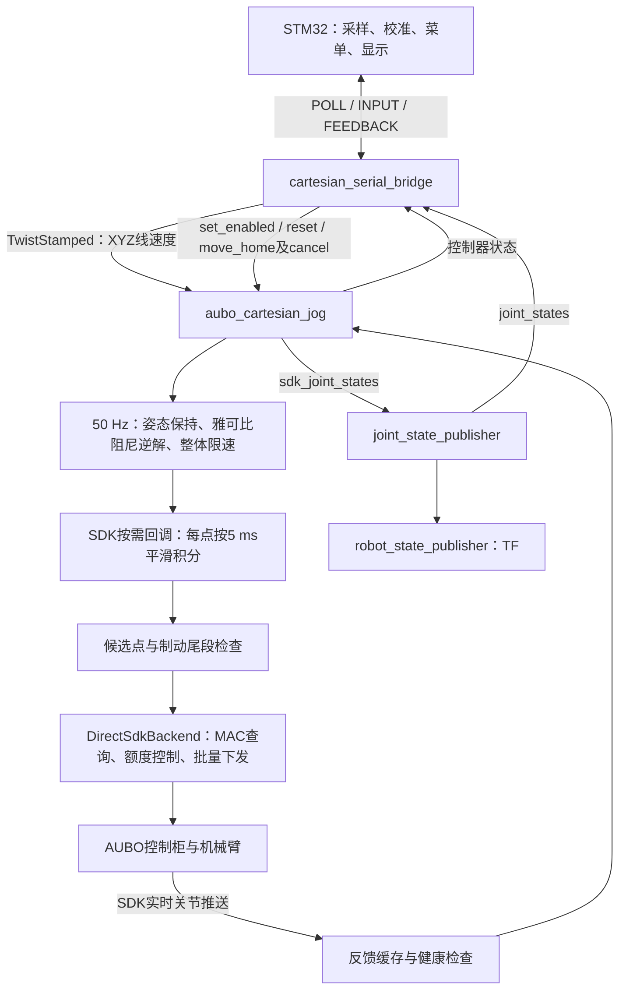

# AUBO 实机串口遥控与点动伺服执行流程

整理日期：2026-10-25。本文依据当前仓库源码，入口为
[`cartesian_remote_real.launch`](../aubo/aubo_remote_bridge/launch/cartesian_remote_real.launch)。
本文梳理默认 `backend=sdk` 的程序调用、状态机、控制算法、线程时序和参数；不代表完成了新的实机验证。

## 1. 总体职责与运行链路

这套程序实现末端 XYZ 连续点动：STM32 采集方向、速度和允许运动键，PC 将输入转换为笛卡尔线速度，计算六轴关节速度，平滑积分为位置点，再通过 AUBO SDK 下发。

启动时 SDK 会执行上电、松刹车相关初始化，但点动默认禁用，也不会自动回 HOME。点动需要显式 ENABLE；HOME 是另一个显式运动请求，要求点动禁用。



这里的“伺服”指 PC 持续更新运动目标并输出位置点。电机电流、速度、位置等驱动器内部控制环不在本仓库中实现。该入口使用 KDL 计算运动学、MoveIt 模型进行碰撞检查；默认不启动 MoveGroup 轨迹执行器、MoveIt Servo 或 JTC。

## 2. launch 展开：实际启动什么

```text
cartesian_remote_real.launch
├── aubo_ros_control/launch/cartesian_jog_real.launch
│   ├── aubo_moveit_config/launch/planning_context.launch
│   │   ├── robot_description：URDF / xacro
│   │   ├── robot_description_semantic：SRDF
│   │   └── 关节限位、笛卡尔限制、运动学配置
│   ├── aubo_joint_state_relay：joint_state_publisher
│   ├── robot_state_publisher
│   └── aubo_ros_control/launch/cartesian_jog.launch
│       └── aubo_cartesian_jog_node，节点名 aubo_cartesian_jog
└── aubo_remote_bridge/launch/cartesian_serial_bridge.launch
    └── cartesian_serial_bridge，节点名 cartesian_serial_bridge
```

launch 的包含顺序不是节点就绪屏障。串口桥和控制节点可以在初始化阶段同时运行，运动权限由状态与反馈检查决定。

### 2.1 顶层参数

| 参数 | 默认值 | 传递位置与作用 |
| --- | --- | --- |
| `port` | `/dev/ttyUSB0` | 串口桥私有参数 `~port` |
| `robot_ip` | `192.168.1.2` | 点动节点及其 SDK 后端 |
| `robot_xacro` | `aubo_i5_with_camera.xacro` | 从 `aubo_description/urdf` 加载对应模型 |
| `robot_srdf` | `aubo_i5_with_camera.srdf` | 从 `aubo_moveit_config/config` 加载语义模型 |
| `max_speed_mm_s` | `100.0` | 遥控输入线速度上限，允许 `(0,100]` mm/s |

顶层还固定传入 `panel=false`、串口桥 `joint_states_topic=/joint_states`。
下层实机 launch 默认 `backend=sdk`，原始六轴发布话题为 `/cartesian_jog/sdk_joint_states`，碰撞场景状态话题为 `/joint_states`。

`backend`、`config`、`panel`、`timing_trace_path` 等虽然在下层 launch 存在，但当前顶层没有声明和转发；不能直接给该顶层入口追加这些参数来修改下层行为。

### 2.2 模型与辅助节点

[`planning_context.launch`](../aubo/aubo_moveit_config/launch/planning_context.launch) 加载 URDF、SRDF、规划限位和运动学配置。点动实际使用自己的 KDL 雅可比求解器，加载 MoveIt 运动学配置不等于执行 MoveIt 全局规划。

`aubo_joint_state_relay` 将 SDK 六轴状态汇总为 `/joint_states`。夹爪模型的 `joint1`、`joint2` 以 `zeros={joint1: 0.0, joint2: 0.0}` 提供默认位置，表示模型采用 open 姿态；它们不是实机夹爪反馈，也不产生夹爪执行指令。

`robot_state_publisher` 依据模型和 `/joint_states` 发布 TF。串口桥使用汇总关节话题回传角度，碰撞场景使用该话题补全模型状态；运动控制健康检查仍来自 SDK 实际推送缓存。

带相机模型包含相机安装结构及碰撞几何，但此入口不启动相机驱动、视觉识别或点云建图。

## 3. 程序与源码索引

以下路径相对仓库根目录 `src/`。

| 文件/程序 | 职责 | 关键入口 |
| --- | --- | --- |
| [`aubo_remote_bridge/src/cartesian_serial_bridge.cpp`](../aubo/aubo_remote_bridge/src/cartesian_serial_bridge.cpp) | 遥控授权、ROS接口、离散操作与应答 | `run / receive / tick / halt / publishTwist / feedback` |
| [`aubo_remote_bridge/src/jog_remote_core.cpp`](../aubo/aubo_remote_bridge/src/jog_remote_core.cpp) | 点动轮询、会话切换、使能确认 | `JogPoller::poll / receive`、`JogEnableConfirmation::update` |
| [`aubo_remote_bridge/include/aubo_remote_bridge/posix_serial.hpp`](../aubo/aubo_remote_bridge/include/aubo_remote_bridge/posix_serial.hpp) | Linux termios串口、读写超时、字节解析接入 | `PosixSerial` |
| [`aubo_remote_bridge/src/RemoteProtocol.c`](../aubo/aubo_remote_bridge/src/RemoteProtocol.c) | 公共帧头、CRC、小端编解码 | `Remote_ParseByte / Remote_Encode / Remote_CRC` |
| [`aubo_remote_bridge/src/RemoteJogProtocol.c`](../aubo/aubo_remote_bridge/src/RemoteJogProtocol.c) | 点动 INPUT/FEEDBACK 编解码、字段检查 | `RemoteJog_DecodeInput / EncodeFeedback` |
| [`aubo_remote_bridge/src/remote_core.cpp`](../aubo/aubo_remote_bridge/src/remote_core.cpp) | 此链路复用请求结果缓存、关节名、帧编码 | `Ledger / jointNames / encode`；旧 `Poller` 不是本入口轮询器 |
| [`aubo_ros_control/src/cartesian_jog.cpp`](../aubo/aubo_ros_control/src/cartesian_jog.cpp) | 点动、HOME、状态机、模型与安全检查 | `CartesianJog` |
| [`aubo_ros_control/include/aubo_ros_control/cartesian_jog_common.h`](../aubo/aubo_ros_control/include/aubo_ros_control/cartesian_jog_common.h) | 固定周期平滑器、停止距离估算 | `VelocitySmoother / interpolationSteps` |
| [`aubo_ros_control/src/direct_sdk_backend.cpp`](../aubo/aubo_ros_control/src/direct_sdk_backend.cpp) | SDK启动、推送接收、MAC供点、传输故障锁存 | `connect / jogOutputLoop / queryDiagnosis / healthyAt` |
| [`aubo_ros_control/include/aubo_ros_control/sdk_jog_timing.h`](../aubo/aubo_ros_control/include/aubo_ros_control/sdk_jog_timing.h) | MAC目标缺口、发送预算、生产速率额度 | `SdkJogTiming / SdkPointPacer` |
| [`aubo_ros_control/include/aubo_ros_control/sdk_flow_control.h`](../aubo/aubo_ros_control/include/aubo_ros_control/sdk_flow_control.h) | MAC观测与在途预留、诊断超时 | `SdkFlowControl`，点动选 `SequentialMac` |
| [`aubo_ros_control/include/aubo_ros_control/sdk_tcp_transport.h`](../aubo/aubo_ros_control/include/aubo_ros_control/sdk_tcp_transport.h) | 当前进程SDK套接字的NODELAY/QUICKACK设置 | `configure / prepare` |
| [`aubo_ros_control/include/aubo_ros_control/motion_lease.h`](../aubo/aubo_ros_control/include/aubo_ros_control/motion_lease.h) | 本机运动写入进程互斥 | `MotionLease::acquire` |
| [`aubo_ros_control/include/aubo_ros_control/sdk_io_diagnostics.h`](../aubo/aubo_ros_control/include/aubo_ros_control/sdk_io_diagnostics.h) | 查询/发送批次、耗时与历史快照 | `SdkIoDiagnostics` |
| [`aubo_ros_control/include/aubo_ros_control/motion_timing_trace.h`](../aubo/aubo_ros_control/include/aubo_ros_control/motion_timing_trace.h) | 可选内存时序记录，退出后落盘 | `MotionTimingTrace` |

`aubo_cartesian_jog_node` 将 `cartesian_jog.cpp`、`direct_sdk_backend.cpp`、`visual_servo_common.cpp` 编译进同一个可执行程序。`DirectSdkBackend` 是节点内部对象，不是额外 ROS 节点。虽然复用视觉伺服命名空间及公共类型，本入口不会启动视觉伺服节点，也没有图像误差输入。

## 4. 串口桥：从输入到 ROS 指令

### 4.1 主循环与串口生命周期

`CartesianSerialBridge::run()` 的单次循环为：

```text
ros::spinOnce() 处理状态、关节、action回调
→ tick() 检查看门狗、异步服务结果、使能确认、周期发布
→ 打开串口或等待重试
→ JogPoller决定是否发送POLL
→ 读取并解析串口帧
→ 验证INPUT的字段、session、sequence及响应时限
→ receive() 处理实时输入与离散请求
→ tick()
→ 回传FEEDBACK
```

串口为 `115200 / 8N1 / 无流控`，独占打开。读操作单次 poll 最多等待 10 ms；写操作总预算 50 ms。异常后调用 `halt()`，释放串口，约 1 s 后重新打开并创建新会话。`baud` 虽为节点私有参数，但串口实现只接受 115200，launch 也未开放波特率参数。

ROS回调与串口在桥节点主线程执行；服务调用使用 `std::async`，避免同步服务阻塞串口心跳和取消。HOME action客户端使用主线程回调处理。

### 4.2 轮询与报文检查

| 项目 | 当前实现 |
| --- | --- |
| 外层帧 | `A5 5A`、版本`02`、类型、sequence、长度、payload、CRC |
| CRC | CRC-16/CCITT-FALSE，初值`0xFFFF`，多项式`0x1021` |
| 字节序 | 多字节整数小端 |
| POLL | 类型`0x11`，payload 4字节：PC生成的session |
| INPUT | 类型`0x12`，payload 18字节 |
| FEEDBACK | 类型`0x13`，payload 28字节 |
| 正常轮询间隔 | 约20 ms，同时最多一个未完成POLL |
| 响应有效窗口 | 小于100 ms，必须匹配当前session和sequence |

无效CRC、越界字段、旧session、旧sequence或重复响应不会刷新输入看门狗。
输入从有效退化为未校准/无效、响应超时或sequence用完后，轮询器会更换session。
新session第一帧只建立编号基线，并触发停止/禁用处理，防止恢复连接时执行缓存请求。

### 4.3 输入字段与速度换算

| 字段 | 范围/含义 |
| --- | --- |
| `request_id` | 离散请求编号，非零命令必须搭配非零编号 |
| `command` | 0无请求、1使能、2停止、3HOME、4取消、5复位 |
| `flags bit0/bit1` | 采样有效、校准完成；两者都为1才认为输入有效 |
| `flags bit2` | 允许运动键（deadman/SW）按住 |
| `frame` | 0基坐标系、1工具坐标系 |
| `speed` | 0.1 mm/s为单位，最大1000；方向非零时速度不能为0 |
| `axis[3]` | XYZ各分量`-1000..1000` |

设方向向量为 `a`，串口速度字段为 `s`，桥接限速为 `Smax`：

```text
S = min(s / 10, Smax)                       # mm/s
v = (S / 1000) × a / max(1000, ||a||)        # m/s
```

例如 `s=100, a=(1000,0,0)` 得到 X+ 10 mm/s；`a=(500,0,0)` 得到5 mm/s；`a=(1000,1000,0)` 的合速度仍为10 mm/s。摇杆死区和校准由MCU处理，回中发送精确零。

`publishTwist()` 发布 `geometry_msgs/TwistStamped`，时间戳为当前ROS时间，`frame_id` 使用配置的 `base_link` 或 `tcp_link`，角速度保持为零。
周期发布约50 Hz；`halt()` 还会额外立即发布一次零速度。

只有同时满足以下条件才发非零值：本端 `armed`、输入有效且新鲜、控制器状态新鲜、deadman按住，以及状态为 `ENABLED_IDLE/JOGGING`。

### 4.4 显式使能的两层授权

桥接节点的 `armed_` 与点动节点的 `enabled_` 是两个不同变量。

1. 输入回中、deadman释放，桥已见过中立输入，控制器状态为 `DISABLED`。
2. 发送新的ENABLE编号，桥异步调用 `/cartesian_jog/set_enabled(true)`。
3. 底层检查反馈、平滑器停稳、无故障、碰撞/限位条件以及SDK诊断就绪；`armMotion()`成功后设置 `enabled_`。
4. 服务成功返回时桥仍保持 `armed_=false`，继续发送零速度。
5. 等待服务返回后新收到的 `ENABLED_IDLE` 状态，最多1 s。
6. 确认后设置 `armed_=true`，该ENABLE请求反馈DONE；此后按住deadman才能点动。

等待期间输入离开中立、断链、控制器状态失效/故障、STOP/CANCEL会撤销授权并请求禁用。桥通过代次编号处理迟到的服务结果，避免已停止后又被旧服务成功结果重新授权。

### 4.5 离散请求、去重与停止

相同编号与命令只回放已有结果；同编号更换命令会拒绝并停止。编号倒退会拒绝，uint16前进距离需小于32768。请求缓存 `Ledger` 最多保存64条结果。

STOP/CANCEL优先进入停止路径；ENABLE/HOME/RESET则要求中立、状态新鲜并且没有未完成服务、使能确认、禁用或HOME等冲突操作。BUSY/拒绝的请求不会自动重试，需要新的显式编号。

`halt()` 会撤销 `armed_`、清除中立确认、发布零速度、取消使能确认、取消正在执行的HOME，并安排禁用服务。禁用服务失败后约250 ms再试。
STOP/CANCEL最终应答还会等待控制器新鲜状态为 `DISABLED`、HOME已结束以及禁用事务完成。

### 4.6 回传信息

FEEDBACK包含请求应答、控制器状态、HOME action状态、输入/授权/事务标志、六轴mrad角度、HOME最大关节误差和故障码。关节消息需时间戳有效，且有效期不超过500 ms；缺失或过期的关节通过mask标记无效。

`/remote/cartesian_status` 约10 Hz输出文字状态。FEEDBACK随有效INPUT返回，不是独立的固定10 Hz发送任务。完整逐字节定义见[串口协议](../aubo/aubo_remote_bridge/CARTESIAN_SERIAL_PROTOCOL.md)。

## 5. 点动节点初始化与并发结构

### 5.1 `CartesianJog` 构造过程

```text
parameters()：读取并验证参数，创建六个VelocitySmoother
→ initializeModel()：KDL链、FK、Jacobian、MoveIt场景
→ 注册command/state、set_enabled、reset
→ 创建DirectSdkBackend，注册generate回调并连接SDK
→ 创建50 Hz SDK反馈读取定时器
→ 创建10 Hz状态定时器和move_home action server
→ 启动50 Hz控制目标线程
```

模型检查包括：`base_link→tcp_link` 必须恰有六个活动关节，顺序必须匹配 `joint_names`；SRDF存在；MoveIt组存在；配置限位不能超出模型对应限制。模型错误会拒绝启动。

### 5.2 线程与频率

| 执行位置 | 工作 | 默认频率/触发方式 |
| --- | --- | --- |
| 点动主线程 | 监视健康、处理退出流程 | 50 Hz轮询 |
| ROS `AsyncSpinner(3)` | command、服务、action、反馈定时器、状态定时器等回调 | 按事件调度 |
| `control_thread_` | `updateControlTarget()`，计算关节速度目标 | 50 Hz，即20 ms |
| SDK `output_thread_` | 查询MAC、按需生成一批点、同步下发 | 取决于MAC和SDK RPC耗时 |
| SDK实时推送回调 | 接收真实六轴位置并缓存 | SDK/控制柜决定 |
| `readSdk`定时器 | 检查SDK缓存、更新控制反馈并发布六轴状态 | 50 Hz |
| `publishStatus`定时器 | 状态发布、HOME反馈与结果判定 | 10 Hz |

控制目标、平滑器及反馈等共享状态主要由点动节点 `mutex_` 保护。SDK缓存、流控、诊断等另有短锁。50 Hz目标计算与SDK供点仍可能因同一运动状态锁发生等待。

**5 ms是每个轨迹点的模型积分/执行周期，并不表示PC每隔5 ms准时进行一次网络发送。** SDK可能一次生成并发送多个点；批内每次调用生成器都按5 ms推进。RPC耗时不作为积分步长，也不用于判定控制柜已经消费了多少点。

## 6. 点动伺服：输入、姿态保持与逆解

### 6.1 输入检查 `command()`

禁用时忽略点动command。使能后必须先收到一次零线速度，才接收后续非零速度。
每条指令还需满足：

- XYZ及角速度均有限，角速度三个分量必须精确为0。
- 坐标系必须等于配置的基/工具坐标系。
- 时间戳非零，年龄不大于 `command_timeout`，未来偏差不超过50 ms。
- 时间戳不能倒退；同时间戳直接丢弃且不刷新看门狗。

无效输入触发 `invalid_or_stale_command`。有效XYZ合速度按 `max_linear_velocity` 再限幅，记录为 `requested_`。

### 6.2 两类关节位置变量

| 变量 | 含义 | 主要用途 |
| --- | --- | --- |
| `position_` | 生成轨迹当前推进到的六轴位置，可能领先实机 | FK、Jacobian、HOME误差控制、下一点积分与制动预测 |
| `feedback_` | SDK反馈经ROS定时器读取的实际位置 | 跟随误差、HOME实际到位、反馈速度估计 |
| SDK `last_position_` | 后端最近追加到发送批次的位置基准 | 下一点连续性与速度/加速度检查；失败后不恢复供点 |

初次SDK生成时，`position_` 由后端传入的起点初始化；连接时该起点来自SDK实时反馈。此后不会每个周期将轨迹位置强行跳回反馈位置。

因此，当前笛卡尔逆解不是简单的“每次用最新实际关节位置重算并覆盖轨迹”。生成端保持轨迹连续，实际反馈负责约束跟随偏差和判断健康/到位。

### 6.3 50 Hz目标更新 `updateControlTarget()`

```text
检查初始化、反馈超时、点动command超时
→ 无故障且未退出：HOME用homeVelocity，点动用desiredVelocity
→ 本次锁等待与计算达到控制周期预算：触发致命计算超时
→ 保存control_target_、更新时间及ready标志
```

控制线程每次从实际周期起点安排下一周期，发生延迟后不连续突发补算多个控制周期。
供点时若活动目标超过 `2×control_period` 未更新，默认40 ms，则触发 `control_target_timeout`。
零输入、禁用、HOME减速、故障或退出时供点目标直接取零，随后仍经过平滑器。

### 6.4 基坐标/工具坐标转换

`desiredVelocity()` 使用 `position_` 计算TCP正运动学 `R,p` 与六维雅可比 `J`。

```text
基坐标输入：v_base = v_input
工具坐标输入：v_base = R × v_input
```

工具坐标方向随当前TCP姿态定义；控制点是模型中的 `tcp_link`，不是固定假定的法兰原点。

### 6.5 姿态保持

每次使能设置 `capture_orientation_=true`。第一次计算非零点动目标时，保存当前生成轨迹TCP姿态为 `hold_rotation_`；零输入阶段不捕获新姿态。

```text
e_R = KDL::diff(R, R_hold)
ω_i = clamp(2.0 × e_R_i, -0.1, 0.1)       # rad/s
twist = [v_base_x, v_base_y, v_base_z, ω_x, ω_y, ω_z]
```

遥控器只输入XYZ，算法仍使用完整六维任务，通过姿态误差回授保持TCP朝向。增益2.0与角速度限幅0.1在源码中固定，不是当前YAML参数。姿态误差依据生成轨迹FK；对真实姿态的保持效果仍取决于跟随和模型精度。

### 6.6 阻尼最小二乘逆解

关节速度计算为：

```text
qdot_raw = Jᵀ × (J × Jᵀ + λ² × I)⁻¹ × twist
λ = dls_lambda = 0.02
```

源码使用矩阵分解求解而不是显式求逆。FK/Jacobian失败触发 `kinematics_failed`，结果非有限触发 `invalid_joint_velocity`。

随后以同一个比例缩放全部六轴速度，保持原关节速度向量方向：

```text
σ = J的最小奇异值
σ <= 0.008：singularity_stop
scale_sing = min(1, (σ - 0.008) / (0.06 - 0.008))

scale_vel = 各轴 V_i / |qdot_raw_i| 与1的最小值

room_i = 沿当前运动方向到“关节限位减去margin”的剩余角度
scale_limit_i = clamp((room_i - stoppingDistance_i) / 0.10, 0, 1)

qdot_target = qdot_raw × min(scale_sing, scale_vel, 所有scale_limit_i)
```

这里 `0.10` 是源码固定的关节余量缩放尺度，单位rad，不是末端100 mm/s速度。`singularity_slow/stop` 是当前雅可比定义下的数值阈值，不是距离或角度。

## 7. 5 ms平滑积分与停止预测

### 7.1 平滑器的离散公式

六个关节分别维护 `VelocitySmoother`。设步长 `h=0.005 s`，速度/加速度/jerk限制为 `V/A/J`，内部斜坡状态为 `r`，输出速度为 `v`：

```text
α = min(1, J × h / (2 × A))
u = clamp(qdot_target, -V, V)
r_next = r + clamp(u - r, -A × h, A × h)
v_next = v + α × (r_next - v)
q_next = q + v_next × h
```

第一层限制速度目标变化率，第二层一阶滤波限制加速度变化率。默认前3轴 `α≈0.03333`，后3轴 `α=0.0375`。反向时沿同一状态连续过渡，不直接翻转速度，也不会松手就清空滤波器。

这些限制作用于下发序列的离散速度、加速度、jerk；它们不等同于测得的真实关节瞬态上界。

### 7.2 每个位置点怎样生成

SDK回调调用链：

```text
jogOutputLoop()
→ point_generator_(requested)
→ CartesianJog::generate()
  → prepareGeneration()：初始化、反馈、command、跟随误差检查
  → pointTarget()：读取50 Hz目标或取零
  → interpolatePoint()：复制平滑器，尝试积分下一点
    → safeStop(next, next_filters)：预测该候选状态的完整减速尾段
  → 提交position_和filters_，返回六轴位置点
```

每次供点调用若总耗时超过20 ms（包含等待运动状态锁），触发 `control_computation_overrun` 并置致命标志，本点不继续下发。50 Hz控制目标计算也有自身约20 ms预算，两者不是同一个耗时检查。

### 7.3 `safeStop()`不只检查下一点

1. 复制候选位置和六个平滑器，不改变真实生成状态。
2. 对复制平滑器持续输入零，按5 ms预测减速轨迹。
3. 每个预测点检查有限性及带margin的关节限位。
4. 起点、停稳点、累计最大关节变化达到 `collision_resolution` 等位置执行MoveIt碰撞检查。
5. 最多推进600步，约3 s；不能在此范围内停稳也拒绝。

候选状态不安全时，程序锁存 `collision_or_stopping_limit`，从原有轨迹和平滑器改为零输入减速，不跳回反馈。随后还有不带margin的硬限位检查；非有限或超硬限位触发致命故障。

平滑器用于预先限速的保守剩余角位移估算为：

```text
T = |r| / A
stoppingDistance = |r| × (T + h) / 2 + h × |v| / α
```

碰撞检查依赖已加载模型和已发布场景。程序监听 `/planning_scene`、`/collision_object`、`/planning_scene_world` 等，不会自动识别现实障碍物。`collision_resolution=0.002` 的单位是rad，不是2 mm。离散制动检查不等于连续碰撞检测或全局绕障规划。

## 8. SDK后端：初始化、反馈与供点

### 8.1 SDK连接过程 `connect()`

1. 读取IP、端口、登录配置、碰撞等级和MAC参数并验证。
2. 获取本机 `/tmp/aubo_motion_writer.lock` 文件锁，拒绝另一个使用同一机制的运动写入进程。
3. 登录三个SDK会话，设置匹配控制柜端点的当前进程TCP连接为 `TCP_NODELAY/TCP_QUICKACK`。
4. 注册控制柜事件日志，检查真实机械臂存在；点动接管前检查控制柜报告停止状态。
5. 调用 `rootServiceRobotStartup`，执行握手；最多约10 s等待上电且无软件/远程急停及碰撞等就绪条件。
6. 注册实时路点回调，最多2 s等待首帧，使用该位置初始化后端轨迹起点。
7. 进入TCP2CANBUS；特定返回错误下先退出模式、等待200 ms再尝试一次。
8. 创建 `SequentialMac` 流控，启用首次运动授权门槛，启动输出线程。

当前工作区还增加了启动诊断就绪阶段：首次接受ENABLE/HOME前，需要连续3次及时返回且MAC为空的诊断。未授权阶段遇到慢诊断会撤销就绪并重新等待，不会仅因这类启动诊断超时直接杀死禁用节点；诊断RPC失败、保护标志、非法计数或未知非空MAC仍锁存故障。
`motionReady()`查询就绪状态，`armMotion()`在显式运动请求被接受时单向退出启动等待阶段，此后恢复严格诊断看门狗，即使还未发出首批轨迹也一样。禁用不会重新进入启动宽容阶段。

三个会话在当前点动路径的实际分工：

| SDK对象 | 用途 |
| --- | --- |
| `control_service_` | startup、握手、进入/退出透传、控制柜事件 |
| `state_service_` | 启动阶段状态检查、实时关节位置推送 |
| `mac_service_` | 输出线程串行执行MAC诊断和位置批次下发 |

虽然创建三个会话，点动的MAC查询与轨迹发送明确使用同一个 `mac_service_`，不并发发起这两类RPC。文件锁只约束本机遵守该机制的程序，不约束示教器、其他电脑或外部SDK客户端。

### 8.2 反馈链路

```text
SDK receiveWaypoint()
→ 检查六轴数值有限
→ 缓存pushed_position_及steady_clock接收时间
→ 50 Hz readSdk()调用readState()
→ 检查真实SDK回调缓存年龄不超过feedback_timeout
→ 更新feedback_并发布/cartesian_jog/sdk_joint_states
```

`readState()`不进行RPC，只读取缓存并检查实际SDK回调接收年龄。ROS定时器重新发布不能延长该SDK缓存的有效期。
实际关节速度 `feedback_speed_` 根据点动节点相邻反馈读取值和时间间隔估计，不是直接读取驱动器速度，也不具有控制柜硬件采样时间戳。

### 8.3 MAC单位与供点批次

MAC返回 `macTargetPosDataSize`，单位是关节标量；六个标量为一个完整六轴点。换算时对不完整点向上取整。

```text
target = sdk_mac_buffer_target / 6 = 50点
observed = ceil(mac_scalars / 6)
缺口至少4点时：deficit = target - observed
否则：deficit = 0，暂不补点
```

默认目标300标量，对应50点、名义250 ms前瞻。限额360标量对应60点、名义300 ms。MAC无硬件采样时间戳/点序号；该限额约束软件接受的观测与预留，不能认证任意时刻真实物理排队不超过300 ms。

### 8.4 `jogOutputLoop()`完整工作流

```text
检查healthy()
→ queryDiagnosis()：读取最新MAC及保护标志
→ 检查motionReady()：未就绪时等待，不生成/发送运动点
→ 如首批已发送但未观察到非零MAC，先等待，不重复发送
→ 计算目标缺口deficit
→ SdkPointPacer计算本次允许生成的点数wanted
→ 循环wanted次调用generate，每次按5 ms积分
→ 检查每个点有限、速度/加速度连续
→ 本批必须完整生成
→ 预留MAC容量及生产额度
→ 同步robotServiceSetRobotPosData2Canbus(batch)
→ 检查SDK返回、健康、完成计数与发送预算
→ 再查询MAC，进入下一轮
```

第一批通常按测得缺口建立前瞻；在尚未运动且生成位置未变化时，不发送静止批次。运动开始后则持续供点，包括停止后的保持点，避免已建立的透传流断流。

生产节流器 `SdkPointPacer` 以每5 ms一份额度累积，约200点/s，最大额度为目标点数；首次观察到首批MAC后会以当时缺口初始化额度。正常补点还需达到批次门槛，MAC接近目标时丢弃积存额度。
**时间只授予“可以生产多少点”的额度，不证明控制柜已经消费了点。** 发送仍必须同时满足测得缺口与独立容量预留。

### 8.5 点动分支不经过 `optimize()`

`DirectSdkBackend` 也保留了视觉伺服软件队列路径，但点动在 `outputLoop()` 入口发现 `point_generator_` 后直接进入 `jogOutputLoop()`：

- 点动平滑与积分在 `VelocitySmoother` 完成，SDK层再验证相邻点速度与加速度。
- 点动分支不从公共软件队列pop，也不调用 `optimize()` 二次改写轨迹。
- 节点中的 `unused_queue_(2)` 是复用构造接口用的占位对象，不是两点运动缓冲策略。

### 8.6 SDK健康与故障停流

以下情况会锁存后端故障并停止后续供点：运动授权后的诊断超时、诊断失败、启动未知非空MAC、控制柜保护或MAC中断、实测/预留超限、批次不完整、轨迹点不连续、发送失败、发送耗时超预算、建立后的MAC轨迹流再次观测为零等。首次授权前的慢诊断按上一节的启动就绪规则处理。

默认发送预算为 `min(100 ms, 名义前瞻)`，即100 ms。首批发送后在限额覆盖时间内仍未观察到非零MAC也会失败，默认约300 ms。

SDK调用成功仅表示接口返回成功，不表示点已执行完毕；调用在软件停流后仍可能迟到返回成功。故障后不自动恢复，也不靠补发历史点追赶。
后端已停流时无法继续生成并送出减速点，不能把这一类故障描述为“必然平滑停止”。

## 9. 控制器状态机与停止含义

底层没有一个单独enum贯穿全程，而是根据 `fault_ / home_goal_ / sdk_->motionReady() / initialized_ / enabled_ / settled()` 等变量生成状态文字，优先级为故障、HOME、等待SDK、等待反馈、禁用/停止、使能点动。

| 状态文字 | 生成条件/含义 |
| --- | --- |
| `WAITING_FOR_SDK` | SDK诊断尚未就绪，等待及时、空MAC的启动观测等条件 |
| `WAITING_FOR_FEEDBACK` | 尚未完成生成端初始化 |
| `DISABLED` | 点动禁用、无HOME，平滑器已停稳 |
| `ENABLED_IDLE` | 已使能，平滑器停稳且请求速度为零 |
| `JOGGING` | 已使能且有目标或尚未平滑停稳 |
| `STOPPING` | 已禁用但平滑器尚未停稳 |
| `HOME_MOVING` | 有HOME目标，尚未进入减速阶段 |
| `HOME_STOPPING` | HOME到位/取消/故障后进入减速 |
| `FAULT: ... \| STOPPING/STOPPED` | 锁存故障，后缀依据生成端平滑器是否停稳 |

典型操作过程：

```text
等待SDK/反馈 → DISABLED
→ 显式ENABLE → ENABLED_IDLE
→ 按住deadman并给方向 → JOGGING
→ 松开deadman → 零目标、平滑减速 → ENABLED_IDLE
→ STOP → STOPPING → DISABLED

DISABLED → 显式HOME → HOME_MOVING → HOME_STOPPING → DISABLED
```

松开deadman只让桥发零，链路健康时不会自动禁用；STOP/CANCEL、断链或输入无效会撤销使能。

当前串口桥 `controllerCode()` 尚未单独映射新增的 `WAITING_FOR_SDK`，所以ROS文字状态可以看到该名称，但串口控制器枚举会回传 `UNKNOWN`。等待底层进入 `DISABLED` 后再发ENABLE即可。

**`DISABLED`、故障后缀`STOPPED`及普通STOP应答主要依据生成端平滑器和事务状态，不等同于硬件测量确认整台机械臂已经物理静止。** HOME结果额外检查实际反馈误差、估计速度及反馈新鲜度，要求更严格。

普通控制故障由 `fault()` 置零目标并锁存，条件恢复后可尝试RESET；RESET要求已初始化、禁用、无HOME、无致命故障、平滑器停稳、反馈健康、停止位姿安全且跟随误差合格，成功后也不自动使能。SDK后端停流或致命计算/硬限位故障通常需要重启节点。

## 10. HOME控制也复用同一条伺服管线

[`MoveHome.action`](../aubo/aubo_ros_control/action/MoveHome.action) 的goal为空；目标从YAML读取，result为 `success/message`，feedback包含实际与目标关节位置、最大误差和stopping。

### 10.1 接受条件

`startHome()` 要求无其他HOME、点动未使能、未退出、已初始化、无故障、平滑器停稳、反馈健康、制动状态安全，且生成位置与实际反馈各轴误差不超过0.01 rad；SDK `armMotion()`也必须成功。它不会调用阻塞式SDK `moveJoint`。

### 10.2 关节空间回授

```text
e_i = home_i - position_i
qdot_raw_i = 0.8 × e_i
scale = min(1, 所有 min(home_joint_velocity, V_i) / |qdot_raw_i|)
qdot_home = qdot_raw × scale
```

默认 `home_joint_velocity=0.10 rad/s`。这里误差依据生成轨迹位置；实际反馈另外用于最终到位判定。
最大生成位置误差小于0.001 rad时开始减速；超出90 s触发 `home_timeout`。
HOME绕过笛卡尔雅可比逆解，因此不受点动奇异阈值直接限制，但仍经过相同平滑器、制动碰撞检查、限位、跟随误差和SDK下发检查。

### 10.3 完成与取消判定

`updateHome()` 约10 Hz发布反馈，只有以下条件同时满足才给出最终结果：进入stopping、平滑器停稳、生成与实际各轴误差不超过0.01 rad、估计反馈关节速度不超过0.01 rad/s、反馈新鲜。

随后有故障则ABORTED，已取消则CANCELED，否则实际最大HOME误差不超过0.005 rad才SUCCEEDED，超差则ABORTED。所有结果均保持点动禁用。

## 11. 参数与时序速查

### 11.1 YAML运动参数

来源：[`cartesian_jog.yaml`](../aubo/aubo_ros_control/config/cartesian_jog.yaml)，加载到 `/aubo_cartesian_jog` 私有命名空间。下面是该launch加载后的值，不应与C++缺参时的fallback混淆，例如C++ `max_linear_velocity` fallback为0.02，而YAML覆盖为0.10。

| 参数 | 当前值 | 单位/作用 |
| --- | --- | --- |
| `base_link / tool_link / group_name` | `base_link / tcp_link / aubo_i5` | KDL链、控制坐标系、MoveIt组 |
| `max_linear_velocity` | `0.10` | m/s，XYZ合速度上限 |
| `control_frequency` | `50.0` | Hz；周期须包含1..10个完整5 ms点 |
| `command_timeout / feedback_timeout` | `0.15 / 0.15` | s |
| `max_following_error` | `0.12` | rad，生成与实际位置差阈值 |
| `joint_limit_margin` | `0.08` | rad，限位余量 |
| `dls_lambda` | `0.02` | 阻尼逆解参数 |
| `singularity_stop / singularity_slow` | `0.008 / 0.06` | 最小奇异值停止/减速阈值 |
| `collision_resolution` | `0.002` | rad，制动预测碰撞采样间隔 |
| `home_joint_positions` | `[0,0,1.6292,0,1.6628,0]` | rad，J1..J6，非全零位 |
| `home_joint_velocity / home_timeout` | `0.10 / 90.0` | rad/s、s |
| `planning_scene_topic` | `/planning_scene` | 外部场景输入 |
| `initial_scene_service` | 空字符串 | 默认不主动获取既有完整场景 |
| `sdk_mac_buffer_target / sdk_mac_buffer_limit` | `300 / 360` | 关节标量，即50/60个六轴点 |
| `sdk_diagnosis_timeout` | `0.15` | s |
| `robot_ip / server_port` | `192.168.1.2 / 8899` | IP由launch参数覆盖 |
| `username / password` | 见YAML | SDK登录配置 |
| `collision_class / require_real_robot` | `6 / true` | startup碰撞等级、要求真实机械臂 |

关节顺序固定为 `shoulder_joint, upperArm_joint, foreArm_joint, wrist1_joint, wrist2_joint, wrist3_joint`。

| 限制 | J1 | J2 | J3 | J4 | J5 | J6 |
| --- | --- | --- | --- | --- | --- | --- |
| 下限rad | -3.04 | -1.0471976 | -3.04 | -3.04 | -3.04 | -3.04 |
| 上限rad | 3.04 | 1.0471976 | 3.04 | 3.04 | 3.04 | 3.04 |
| 速度rad/s | 0.25 | 0.25 | 0.25 | 0.35 | 0.35 | 0.35 |
| 加速度rad/s² | 0.60 | 0.60 | 0.60 | 0.80 | 0.80 | 0.80 |
| jerk rad/s³ | 8 | 8 | 8 | 12 | 12 | 12 |

YAML中的 `controller_command_topic/controller_manager_service/controller_name` 只用于显式选择的旧ros_control路径；`gazebo_command_topics` 用于Gazebo。它们不参与默认SDK运动输出。

### 11.2 各层超时不能互相替代

| 检查 | 阈值 | 处理位置与行为 |
| --- | --- | --- |
| 有效串口输入新鲜度 | 100 ms | 桥撤销armed、零指令、取消HOME、请求禁用 |
| 控制器状态新鲜度 | 300 ms | 桥视为UNKNOWN，活动授权撤销 |
| 使能状态确认 | 1 s | 服务成功后仍需新的ENABLED_IDLE |
| 串口回传关节有效期 | 500 ms | 清除joint_mask，不是底层反馈容忍时间 |
| 点动command | 150 ms | 底层故障并置零目标 |
| 实际SDK推送缓存 | 150 ms | SDK readState失败，底层故障 |
| 活动控制目标 | 默认40 ms | `pointTarget()`触发目标超时 |
| 单点生成总耗时 | 20 ms | 致命计算超时，不发送本点 |
| 控制目标计算耗时 | 默认20 ms | 达到控制周期预算触发致命故障 |
| SDK单次发送 | 默认100 ms | 后端停流 |
| SDK诊断请求/连续无有效响应 | 150 ms | 首次授权前撤销就绪并等待；授权后后端停流 |
| HOME | 90 s | HOME超时故障并请求减速 |

这些是软件检查阈值，触发还依赖线程获得执行机会，不能当作硬实时响应保证。

## 12. 一次X+点动、松手与退出的实际过程

以基坐标10 mm/s为例：

1. MCU持续响应POLL，完成有效/校准标志并回中松键。
2. ENABLE获得服务成功及新状态确认，桥armed、底层enabled。
3. MCU发 `frame=0, speed=100, axis=(1000,0,0), deadman=1`。
4. 桥发布 `linear=(0.01,0,0) m/s`。
5. 下一次目标线程用生成轨迹位置计算FK/Jacobian、捕获姿态、计算关节速度及整体缩放。
6. SDK查询发现足够MAC缺口且生产额度充足，调用生成器若干次，逐点平滑、积分、验证并组批发送。
7. 实机执行队列中的点，SDK推送反馈；生成与实际位置偏差超过0.12 rad会故障。
8. 松开deadman后桥发零；随后生成的新点逐步减速，但已提交的点不能撤回。
9. 平滑器停稳后底层可能进入ENABLED_IDLE，链路正常时无需重新使能即可再次按住点动。

实际松手延迟包含MCU采样、轮询、ROS发布与调度、SDK同步调用、已有前瞻点、平滑减速以及机械臂跟随。不能只用20 ms或100 ms代表总停止时间。

桥正常退出先 `halt()`，最多约2 s等待禁用相关事务；点动节点处理SIGINT/SIGTERM时保持回调与SDK运行，先请求零目标和取消HOME，健康时最多约3 s等待平滑器停稳，再留400 ms名义缓冲排空余量。随后停止线程、退出透传、注销回调和登录、释放文件锁。该排空等待不证明硬件实际队列已经清空。

## 13. 查看状态与定位问题

先加载工作空间环境，以下查看命令分别在终端执行：

```bash
source /home/zlab/aubo/ros_mobile_manipulation_lab/devel/setup.bash
rostopic echo /remote/cartesian_status
rostopic echo /cartesian_jog/state
rostopic echo /cartesian_jog/command
rostopic echo /cartesian_jog/sdk_joint_states
rosparam get /aubo_cartesian_jog
rosnode info /aubo_cartesian_jog
```

| 现象 | 优先查看 |
| --- | --- |
| `WAITING_FOR_SDK` | 连续3次及时空MAC诊断、诊断RPC耗时；串口枚举暂显示UNKNOWN |
| 串口收到字节但没有有效输入 | 串口诊断的bytes/frames/accepted；版本、类型、CRC、session/sequence |
| ENABLE服务成功但不能点动 | 桥armed、使能确认、是否等到新ENABLED_IDLE、是否中立/松键 |
| 使能后仍不动 | deadman、axis、speed、底层首次零指令要求、command坐标系与时间戳 |
| 速度低于遥控设定 | 关节限速、奇异值缩放、限位制动余量、平滑器过渡 |
| `following_error` | 生成位置领先量、实机反馈、MAC前瞻、执行及反馈延迟 |
| `control_computation_overrun` | 控制/供点计算耗时、锁等待、碰撞检查负载 |
| SDK后端故障/节点退出 | `[sdk/transport]`、`[sdk/history]`、发送返回耗时、MAC与反馈年龄 |
| STOP有应答但实机仍有短暂运动 | 已提交轨迹、平滑尾段；注意普通DISABLED不是硬件静止确认 |

当前仓库[点动说明](../aubo/aubo_ros_control/CARTESIAN_JOG.md)记录过SDK同步发送超时，且连续XYZ实机点动尚未验证通过。进一步时序诊断见[SDK时间线与MAC分析](../aubo/aubo_ros_control/TIMING_DIAGNOSIS.md)。本文保留该验证边界，不将代码设计或离线测试视为实机连续运动通过。

## 14. 建议阅读源码顺序

1. 顶层launch → `cartesian_jog_real.launch` → `cartesian_jog.launch`：确定参数和节点。
2. 桥 `receive / tick / publishTwist`：理解授权与XYZ输入。
3. 点动 `command / enable / desiredVelocity`：理解指令检查、姿态保持和逆解。
4. `updateControlTarget / pointTarget / generate / interpolatePoint`：理解50 Hz目标和5 ms点。
5. `VelocitySmoother / safeStop`：理解平滑、减速与碰撞预测。
6. SDK `connect / queryDiagnosis / jogOutputLoop / healthyAt`：理解实际传输与故障边界。
7. `startHome / homeVelocity / updateHome / publishStatus`：理解HOME和状态结果。
