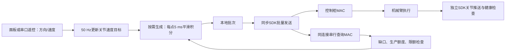

# AUBO 实机点动问题与调试复盘

整理日期：2026-10-25。覆盖2026-10-23至2026-10-25的实机点动调试，依据现场反馈、终端日志、保存的采集记录和当前源码整理。

当前结论：用户反馈点动执行良好；10月25日10:09:53开始的一次约62秒完整采集没有出现停流故障，仍存在偶发慢诊断查询。现阶段保留当前参数作为基线，继续观察停止、反向和长时间运行表现。

本文记录问题如何定位、哪些修改有效、哪些结论仍有限制。程序完整调用链见[AUBO实机串口遥控与点动伺服执行流程](AUBO实机串口遥控与点动伺服执行流程.md)，包内详细分析见[SDK时间线、MAC水位与反向平滑](../aubo/aubo_ros_control/TIMING_DIAGNOSIS.md)。

## 1. 调试目标与初始现象

目标是实现类似视觉伺服的末端XYZ在线点动：持续接收方向和速度，在线生成平滑的六轴位置点，通过SDK送入控制柜。HOME也是显式请求，由同一个点生成器输出；启动后默认禁用，不自动运动。

最初使用 `cartesian_jog_real.launch` 时，出现启动后、点击HOME或使能后按X+立即报错退出的情况。节点设置为 `required`，点动节点退出会导致整个launch关闭，因此面板、状态发布器等一起退出是后续现象，需先查点动节点的第一条故障。

| 日志或现象 | 当时需要区分的问题 |
| --- | --- |
| `控制柜缓冲欠载，停止透传` | 初始供点不足、持续补点中断，还是MAC观测/账面模型有误 |
| `SDK 下发阻塞超过名义前瞻时间` | SDK同步调用等响应过久，还是生成/锁竞争拖慢 |
| `sdk_feedback_failed`、`feedback_timeout` | 真反馈过旧，还是反馈查询、ROS回调和诊断互相阻塞 |
| `Missing joint1, joint2` | 模型缺少夹爪状态；与六轴SDK反馈超时分别处理 |
| MAC实测高于账面、例如306标量 | 是否真正超容量，还是严格账本不适用于该诊断接口 |
| 未使能、尚未发点就因诊断超时退出 | 启动就绪与运动阶段是否需要不同状态处理 |

对照入口 `aubo_real_bringup.launch` 已通过MoveIt执行过完整轨迹，用户确认运动正常。这说明硬件具备正常执行轨迹的能力，但不能由此证明点动的同步通信、反馈时序和连续补点策略同样满足要求。

## 2. 调试过程与关键转折

### 2.1 早期：缓冲很短，同步SDK调用占用大部分时间

10月23日现场日志中，初始目标为60标量，即10个六轴点，名义覆盖50 ms；一次发送约91.39 ms，诊断也出现约91.67 ms等待，随后报缓冲欠载。

在项目按每5 ms消费一点的设计下，50 ms前瞻难以覆盖这样的调用长尾。后续增加了SDK调用耗时、反馈年龄、MAC水位和批次信息，区分计算时间与等待时间。

TCP_NODELAY/TCP_QUICKACK等设置曾用于排查通信延迟，但后续仍观测到慢查询和慢发送，不能将这一步视为底层长尾已经解决。

### 2.2 对照正常驱动，短暂使用ros_control路径

为了对照能正常执行MoveIt轨迹的入口，曾接入已有硬件驱动和JTC。点动程序发布滚动的单点 `JointTrajectory`，由JTC和底层驱动负责执行。

这条路径仍出现 `feedback_timeout`。反馈处理先后尝试了实时关节推送、诊断与反馈发布解耦、独立回调队列，以及推送间隙内的真实路点查询补充。

独立查询保留请求开始时间戳，迟到回复不能伪装成当前新采样；两条来源都变旧时仍触发保护。现场记录曾出现272.73 ms推送间隔和213.40 ms独立查询，说明仅切换输出路径不能消除SDK等待和反馈长尾。

用户进一步明确需要直接在线伺服，因此当前默认回到SDK路径。历史 `backend:=ros_control` 保留用于对照，其测试结果只适用于当时版本。

### 2.3 固定目标层与插补层的职责

控制调整为50 Hz更新目标、按名义5 ms生成平滑点，SDK按需批量发送。降低上层频率减少重复运动学计算，但SDK同步RPC耗时仍需单独解决。

六轴绝对位置点是SDK透传所需的数据。当前默认路径不发布 `JointTrajectory`，也不通过JTC执行。

### 2.4 MAC计数误判：51点不等于超过60点限额

一次HOME实机记录发送42批后退出：诊断返回306标量，即51点，本地严格账本推算50点，于是触发协议错误。该次最后发送约21.32 ms、诊断约4.86 ms，实际观测也没有超过360标量限额。

这次直接原因是账本假设与MAC接口观测不一致。SDK诊断没有硬件采样时间戳或已执行点号，无法证明返回值必定严格服从本地推算，也不能据此断言多执行了一个点。

修正为点动使用 `SequentialMac` 策略：查询和发送串行，以新MAC观测决定补点准入；达到目标则暂停补点，超过限额仍停流。发送未结束时不查询，查询未结束时不预留发送，不按墙钟时间假定控制柜已经消费点。

证据见[MAC计数修正记录](../aubo/aubo_ros_control/logs/sdk_mac_validation_20261024/mac_count_fix/validation_summary.md)。

### 2.5 同连接按需补点通过HOME，XYZ仍暴露长尾

查询和发送改为同一SDK连接串行执行，同时增加按200点/s累积的生产额度。该额度限制PC生成速率；是否允许发送仍取决于MAC观测与预留检查。

10月24日14:49的一次接近HOME位置的实机回位完成并确认停稳。但14:54用户以10 mm/s点击X+，第二批4点同步发送耗时118.73 ms，超过100 ms预算而停流；该批生成仅约0.26 ms。

随后两次采集进一步区分了故障：

| 记录 | 结果与定位 |
| --- | --- |
| 15:10，基坐标系X+、1 mm/s，单次采集 | 未复现退出；179次发送RPC中位6.44 ms、P95 24.63 ms、最大75.86 ms；277次查询中位15.50 ms、P95 26.21 ms、最大98.43 ms |
| 15:24，基坐标系X+、10 mm/s，非零指令最多0.2秒 | 首批50点发送16.28 ms成功返回；随后诊断等待，距上次有效响应165.56 ms时先触发150 ms诊断看门狗，未发第二批 |

系统调用采集显示，相应请求的内核发送很快，主要时间用于等待响应。例如15:24查询的 `sendto` 约0.008 ms，随后等待约160.7 ms。这个证据支持继续定位同步响应长尾，尚不能区分网络、服务器处理或SDK内部机制。

1 mm/s通过、10 mm/s失败也不足以证明速度本身导致延迟：启动空闲时同样出现过慢查询。以上strace统计包含采集扰动、启动和停止尾段，不能直接当成全部运动阶段的稳态指标。

### 2.6 改为完整时间线驱动调试

用户提出按顺序记录指令产生、入队、出队、发送时刻，检查堆叠、水位、RPC耗时和周期抖动。此后冻结运动参数，增加可选内存记录和退出后的离线分析。

记录事件包括输入接收、目标更新、单点生成与锁等待、加入批次、发送起止、MAC查询起止。每个点关联点号、目标号和批次号；分析器检查关联、点数、时间顺序和调用配对后才统计。

这一阶段明确了当前点动绕过 `CommandQueue`，因此“队列入队/出队时间”不适用。应测量生成到加入本地批次、批内等待、SDK调用等待及MAC观测，而不是填入虚构的FIFO时间戳。

10月24日20:38–20:41用户已反馈功能基本正常，但当时只有限频日志，无法求出全部调用的分位数。随后两份完整采集中仍分别出现约120.10 ms发送等待和诊断新鲜度越界，因此保留了这些失败记录，没有将“偶尔正常”作为全部问题解决的依据。

### 2.7 启动就绪修正：尚未发点时等待恢复

10月25日09:53记录出现启动后直接退出。四次诊断耗时依次约5.11、16.60、27.28、156.37 ms，全部MAC=0，**没有任何发送调用或批次入点**；退出时SDK反馈年龄约14.56 ms。

本次是未运动阶段的诊断超时，与轨迹积压无关。修正后增加明确的启动就绪阶段：

1. 从未接受使能/HOME请求时，慢诊断使节点保持 `WAITING_FOR_SDK`，禁止点预留和发送。
2. 连续3次及时、间隔新鲜且MAC为空的有效诊断后，才允许新的显式运动请求。
3. 使能/HOME通过其它检查后，原子检查SDK就绪并激活运动阶段看门狗。
4. 首次接受运动请求后持续执行严格保护；后续禁用/取消不会退回启动等待规则。迟到响应不能解除已锁存的故障。
5. 启动时SDK调用失败、异常非空MAC、协议和容量错误仍会锁存故障；被拒绝的运动请求不保存、不自动重放。

发送100 ms、诊断150 ms等运动保护阈值没有放宽。遥控桥将 `WAITING_FOR_SDK` 映射为已有等待状态，串口协议编号无需改变。

离线回放验证了启动慢响应、连续3次恢复、就绪过期和故障不可复活；ROS模拟注入1秒启动查询，确认使能/HOME被拒绝、恢复后仍无自动发送，再执行后续点动和取消测试。

## 3. 当前执行结构与参数基线



默认实机入口为 `cartesian_jog_real.launch backend:=sdk`；串口遥控入口 `cartesian_remote_real.launch` 包含该实机点动入口。控制连接用于启动等操作，反馈独立推送，MAC查询与点发送在同一连接串行执行。

| 层级/参数 | 当前值 | 含义 |
| --- | --- | --- |
| 目标更新频率 | 50 Hz | 每约20 ms更新运动学求解得到的关节速度目标 |
| 点的名义时间间隔 | 5 ms | 平滑器积分步长及当前控制柜消费周期设计假设 |
| SDK发送频率 | 按需、可变批次 | 每次发送多个点，不等于200次SDK调用/s |
| MAC目标 | 300标量=50点 | 名义覆盖250 ms |
| MAC观测/预留限额 | 360标量=60点 | 名义300 ms；不认证任意时刻真实柜内积压上界 |
| 生产额度 | 200点/s | 限制生成速率，不作为已消费点数的证据 |
| 最小补点缺口 | 4点 | 对应名义20 ms |
| 单次发送预算 | 100 ms | 超时停流 |
| 诊断看门狗 | 150 ms | 同时检查查询在途和距有效诊断的时间 |
| 反馈/输入超时 | 各150 ms | 分别约束真实反馈新鲜度和输入心跳 |
| 首次非零MAC确认期限 | 300 ms | 首批后等待确认，期间不因旧零观测重复预装 |

50 Hz与5 ms属于不同层次。SDK补点时可以在几毫秒内集中生成一批点，但每点仍表示5 ms名义运动；积分步长不能随某次SDK调用耗时拉长。

持续供点应满足平均吞吐约200点/s。例如每次4点、平均20 ms一批，与每次8点、平均40 ms一批具有相同名义吞吐。批量越大可能越有利于覆盖通信等待，也会增加已经提交的旧目标长度，需结合停止响应选择。

## 4. 其它问题的处理与边界

### 4.1 `Missing joint1, joint2`

这两个名字对应模型中的夹爪关节，不是六个机械臂控制关节。实机点动入口通过 `joint_state_publisher` 的 `zeros` 提供 `joint1=0`、`joint2=0` 默认位置，补全碰撞模型状态。

固定值表示模型采用open姿态，不是真实夹爪反馈，也不下发夹爪指令。六轴控制健康检查继续使用真实SDK反馈，不能用模型补全或缓存重发来延长反馈有效期。

### 4.2 MAC账面值、观测值与实际积压

MAC原始单位为标量，六轴一点；300标量换算为50点。当前实现对不足六标量的余量向上取整进行容量准入，避免放行小数点额度。

SDK诊断没有硬件采样时间戳或执行点号，所以：

- 前后两次观测可能包含缓存或采样延迟，MAC向上修正不能直接认定为重复发送。
- “发送前/后MAC”分别关联前一次/后一次诊断观测，不是调用边界处的瞬时水位。
- SDK返回成功不表示点已全部执行，也不能作为柜内逐点入队时间戳。
- 名义覆盖值可用于比较样本；不能保证响应到达时还剩同样长度，也不能简单减去RPC耗时得到即时余量。

### 4.3 是否需要改成SPSC无锁队列

当前SDK点动按需生成点，直接组批，绕过了旧视觉伺服的 `CommandQueue`。本次生成锁等待最大约0.011 ms，暂无队列锁是瓶颈的证据。

旧 `CommandQueue` 还有满时由生产者删除最旧点、多个控制路径调用 `clear()` 等语义；其条件变量只有通知，没有等待。直接替换成普通单生产者单消费者环形队列，会遗漏清空和读位置所有权的问题。

如后续优化旧视觉伺服队列，应先定义唯一读写者、清空请求处理、满队列策略及轨迹连续性，再考虑预分配无锁实现。完整平滑点序列不能任意丢弃中间点后仍宣称导数界不变。

## 5. 加速度、反向与增量限制

当输入从−X切换到+X，新的期望速度可以跳变，平滑器的已积分位置与速度状态保持连续。每轴使用加速度受限斜坡加一阶滤波：

```text
h = 0.005 s
alpha = min(1, J*h/(2*A))
r[k] = r[k-1] + clamp(v_target-r[k-1], -A*h, A*h)
v[k] = v[k-1] + alpha*(r[k]-v[k-1])
q[k] = q[k-1] + v[k]*h
a[k] = (v[k]-v[k-1])/h
jerk[k] = (a[k]-a[k-1])/h
```

从零初态、目标速度始终受限时，生成的离散指令序列满足速度、加速度和jerk界。这是斜率限制与滤波，不是时间最优S曲线；jerk有界也不表示jerk自身连续。

| 参数/每点增量上限 | 前三轴 | 后三轴 |
| --- | ---: | ---: |
| 速度V / rad/s | 0.25 | 0.35 |
| 加速度A / rad/s² | 0.60 | 0.80 |
| jerk J / rad/s³ | 8 | 12 |
| 最大位置增量Vh / rad | 0.00125 | 0.00175 |
| 最大速度增量Ah / rad/s | 0.003 | 0.004 |
| 最大加速度增量Jh / rad/s² | 0.040 | 0.060 |

50 Hz目标更新不改变上述5 ms增量。增大A、减小J、减小MAC目标等修改会同时影响平滑、制动和通信余量，需要逐项验证。

生产平滑器的离线满关节速度反向示例中，−V切到+V后约0.555–0.560秒速度过零；该示例不代表10 mm/s TCP点动的实际反向时间。柜内已提交的旧点无法因新输入撤回，实机反向还包含目标更新、通信、柜内排队、制动和反向加速。

当前限制是关节指令的V/A/J上界。TCP加速度还包含 `J(q)*qddot + Jdot(q,qdot)*qdot`，真实反馈也有非等间隔和噪声，需独立测量；不能用关节限值直接声称笛卡尔加速度具有相同数值上限。

## 6. 最近一次完整实机采集结果

记录目录：`aubo/aubo_ros_control/logs/jog_timing_20261025_100953_t1eIlV/`。

用户反馈“除了警告外，执行情况还挺好”。完整记录跨度62.39秒，首末批发送开始相隔56.92秒，1,834批共11,414点；2,711次诊断和所有发送均返回0，无trace丢失和未返回调用。当前运行时间窗口无ERROR/FATAL，点动节点收到Ctrl+C后返回0。

| 指标 | 中位数 | P95 | P99 | 最大值 |
| --- | ---: | ---: | ---: | ---: |
| 发送RPC / ms | 6.254 | 24.770 | 33.648 | 64.252 |
| MAC查询RPC / ms | 15.546 | 24.843 | 36.201 | 108.014 |
| 单点生成 / ms | 0.198 | 0.341 | 0.374 | 0.488 |
| 生成完成到发送开始 / ms | 0.281 | 1.690 | 2.989 | 7.415 |
| 批次发送开始间隔 / ms | 29.478 | 49.834 | 72.139 | 140.137 |

目标平均周期20.064 ms，约49.84 Hz；实际发送约32.20批/s，平均批间隔31.055 ms、标准差10.178 ms。首批50点，后续每批4–25点，以5–7点为主。剔除首批预装，在首末发送开始区间内累计补点约199.63点/s。

批次大小可变，不能把所有批间隔偏离5 ms都叫调度抖动。本次频率与吞吐支持保留当前目标层和按需发送方式。

首批发送后2,404次有效MAC观测为23–47点，中位数42点，名义覆盖115–235 ms、中位210 ms；没有观测到零水位。各10秒窗口的本地等待没有持续增长，当前记录没有显示长期低水位或本地轨迹堆叠。

成功返回批次中连续位置点按名义5 ms差分，六轴速度、加速度和jerk都低于配置上限。这验证此次指令序列的界限，不能替代实测电机/TCP加速度或停止距离。

这些MAC统计是采样等权的分布，不是水位的时间占比；查询之间存在观测盲区。约一分钟通过也不能证明所有负载和运行时长下都没有SDK长尾。

完整数据见[复核报告](../aubo/aubo_ros_control/logs/jog_timing_20261025_100953_t1eIlV/analysis/review.md)、[统计JSON](../aubo/aubo_ros_control/logs/jog_timing_20261025_100953_t1eIlV/analysis/summary.json)和[时间线图](../aubo/aubo_ros_control/logs/jog_timing_20261025_100953_t1eIlV/analysis/timing.png)。

## 7. 现在的WARN具体表示什么

```text
[sdk/diagnosis] 查询偏慢 83.13 ms；MAC观测=23 点，名义覆盖 115.0 ms，
诊断看门狗=150.0 ms；MAC无硬件采样时间戳，覆盖值不代表即时余量
```

| 字段 | 含义 |
| --- | --- |
| 查询偏慢83.13 ms | 一次SDK诊断调用从发起到返回的耗时，超过当前50 ms提示阈值 |
| MAC观测23点 | 本次诊断返回的缓冲点数 |
| 名义覆盖115 ms | 按23×5 ms换算的轨迹长度 |
| 诊断看门狗150 ms | 运动阶段对查询在途时长及距上次有效诊断时间的保护限制 |
| 无硬件采样时间戳 | 不知道该水位的精确采样时刻，不能保证返回时的即时余量 |

本次2,711次查询中17次达到50 ms提示阈值，约0.63%；其中1次达到100 ms。最大有效诊断返回间隔124.543 ms，没有触发本次停止保护。

日志等级和控制保护分别处理：

| 事件 | 当前处理 |
| --- | --- |
| 20–50 ms诊断查询 | 默认5秒限频INFO |
| 达到50 ms诊断查询 | 默认1秒限频WARN；门槛实际为 `min(50 ms, 诊断看门狗/2)` |
| MAC在目标以内向上修正 | 5秒限频INFO，显示账面、观测与单位 |
| MAC高于目标但未超过限额 | WARN并暂停补点 |
| 运动阶段发送/诊断超时、超限或已建立流出现空MAC | 锁存故障并停流，不能靠迟到响应自动恢复 |

目前保留慢查询警告，便于观察通信长尾；不以终端没有WARN作为验收标准。

## 8. 如何重复采集和分析

在已source工作空间的终端运行：

```bash
# 只准备配置和唯一目录，不启动ROS/SDK
rosrun aubo_ros_control capture_cartesian_jog_timing.sh --prepare

# 启动SDK实机点动并记录；默认禁用，由现场操作者显式操作
rosrun aubo_ros_control capture_cartesian_jog_timing.sh
```

实机启动包含SDK上电/握手等初始化，不会自动发送点动或HOME请求。正常Ctrl+C后等待线程退出和导出，脚本自动生成分析目录。

采集脚本当前启动 `cartesian_jog_real.launch`，不是串口遥控总入口；本次报告也不能据此认定所有串口链路已覆盖。遥控链路专门验证时，还需对齐MCU输入、桥接输出和点动状态的时间线。顶层遥控launch目前没有转发全部时序采集参数，参数传递情况见执行流程文档。

| 产物 | 用途 |
| --- | --- |
| `manifest.json`、`config.yaml` | 启动参数、配置快照和部分源码哈希；不认证二进制一致性或全部ROS生效参数 |
| `console.log` | 本次启动与控制日志 |
| `timing.csv` | steady clock时序和点/目标/批次关联 |
| `analysis/point_lifecycle.csv` | 逐点生成、入批和发送关联；当前路径队列入出列留空 |
| `analysis/batches.csv` | 每批点数、RPC耗时、前后关联MAC观测 |
| `analysis/summary.json` | 分位数、最大值、水位、等待与指令导数 |

从仓库 `src/` 目录可重新离线分析并生成图片：

```bash
python3 aubo/aubo_ros_control/scripts/analyze_motion_timing.py \
  aubo/aubo_ros_control/logs/<本次目录>/timing.csv \
  --output /tmp/aubo_jog_review --plot
```

记录器在内存中采集，停止线程后写盘。强制杀进程或SDK调用始终不返回可能导致记录不完整；先查记录完整性，再解释性能。脚本保留launch退出码，但判断节点是否故障仍需查看节点日志和返回记录。

输入ROS时间戳与steady时间属于不同时间域，不能直接相减。ROS master日志目录可能被复用，过滤当前运行窗口后再统计ERROR。限频终端日志只反映打印出来的样本，不能代替全量CSV计算分位数。

## 9. 已完成验证与后续顺序

| 验证类型 | 已覆盖 | 结论边界 |
| --- | --- | --- |
| 数值与单元测试 | 约30万步平滑输入、启停/反向/随机/NaN、V/A/J与制动界；流控、发送预算、首次MAC确认和启动恢复边界 | 验证算法及状态逻辑，不代表实机时延分布 |
| 记录器与分析器测试 | 多线程记录、容量溢出、缺失返回、未发送点、关联与时间顺序检查 | 验证采集和离线统计的可信性 |
| ROS离线集成 | 慢发送、慢诊断、缓存滞后、六方向点动、HOME、取消、反馈中断和启动拒绝运动 | 注入模型内通过；主动制造故障的日志需结合测试断言阅读 |
| 历史实机 | HOME及低速点动有通过记录，也保留了慢发送/诊断导致的失败记录 | 结论只适用于相应版本与动作条件 |
| 最近实机完整采集 | 约62秒、1,834批，用户反馈执行良好，未触发停流 | 仍有慢查询，停止/反向与长时间表现需继续测量 |

后续按以下顺序进行：

1. 固定当前版本和参数，保存动作方向、速度、坐标系、负载、运行时长及完整采集。
2. 先核对事件完整性，再检查生成到发送等待是否持续增长。
3. 对齐每批点数、前后MAC观测、响应年龄、查询和发送耗时，定位真正主耗时层。
4. 单独验证松手、禁用、取消及方向反转，记录输入变化到真实停稳/反向的时间与位移。
5. 仅在证据显示瓶颈后一次修改一个环节。降低水位需同时观察欠载风险和停止延迟，修改A/J需同时观察导数、跟随和制动距离。
6. 用重复采集和更长运行记录评估长尾，避免只用平均值、单次成功或没有WARN作判断。

目前没有证据支持优先更换无锁队列、固定SDK为200 Hz调用或继续放宽看门狗。尚未定位SDK响应长尾的底层来源，也未以真实反馈完整量化全部停止和反向工况。

## 10. 关键源码与证据索引

| 文件 | 调试时关注的内容 |
| --- | --- |
| [cartesian_jog.cpp](../aubo/aubo_ros_control/src/cartesian_jog.cpp) | 输入、目标更新、点生成、启停/HOME状态、反馈新鲜度 |
| [cartesian_jog_common.h](../aubo/aubo_ros_control/include/aubo_ros_control/cartesian_jog_common.h) | 平滑器、固定积分步长与制动估算 |
| [direct_sdk_backend.cpp](../aubo/aubo_ros_control/src/direct_sdk_backend.cpp) | SDK推送、诊断、按需补点、RPC与停流诊断 |
| [sdk_flow_control.h](../aubo/aubo_ros_control/include/aubo_ros_control/sdk_flow_control.h) | MAC观测/预留、串行策略、启动就绪与故障锁存 |
| [sdk_jog_timing.h](../aubo/aubo_ros_control/include/aubo_ros_control/sdk_jog_timing.h) | 批次缺口、发送预算和生产额度 |
| [motion_timing_trace.h](../aubo/aubo_ros_control/include/aubo_ros_control/motion_timing_trace.h) | 时序事件采集 |
| [analyze_motion_timing.py](../aubo/aubo_ros_control/scripts/analyze_motion_timing.py) | 生命周期、水位、分位数和导数分析 |
| [cartesian_jog.yaml](../aubo/aubo_ros_control/config/cartesian_jog.yaml) | 当前参数默认值 |
| [cartesian_serial_bridge.cpp](../aubo/aubo_remote_bridge/src/cartesian_serial_bridge.cpp) | 遥控输入转换、使能确认与SDK等待状态映射 |

较早的实机和离线材料保存在 `aubo/aubo_ros_control/logs/sdk_mac_validation_20261024/`，启动等待验证材料在 `logs/startup_readiness_validation_20261025/`。这些运行产物通常被Git忽略，迁移环境时需单独归档；本文保留主要数字和结论，避免仅依赖本机日志目录。
