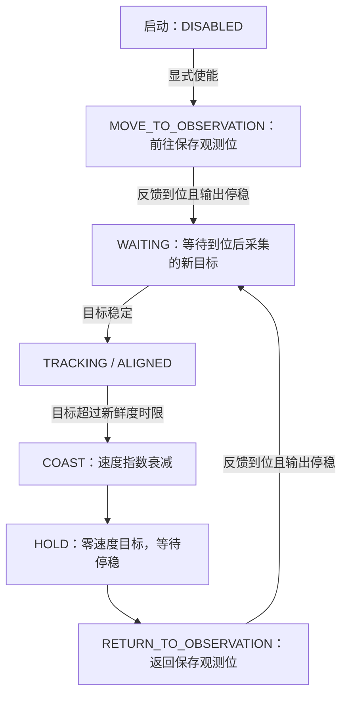

# 眼在手外固定观测位与丢失回位

统一入口：`roslaunch aubo_ros_control eye_to_hand_visual_servo_real.launch`。
默认打开调试台，启动禁用；显式使能后才允许移动。

## 本次记录的观测位

2026-11-03 19:31:58（北京时间），从正在运行的实机驱动
`/aubo_i5/aubo_hw_node/raw_joint_states` 连续读取30帧新鲜反馈。
驱动反馈源为 `query_latched`，六轴采样最大变化为 `0.00000930 rad`。
采集过程只读，没有登录第二个 SDK 控制连接，也没有下发运动指令。

| 关节 | 保存角度 / rad |
| --- | --- |
| shoulder_joint | 0.8182812929153442 |
| upperArm_joint | -0.2107091099023819 |
| foreArm_joint | -2.743088483810425 |
| wrist1_joint | -1.626612663269043 |
| wrist2_joint | -1.089650034904480 |
| wrist3_joint | -2.174524307250977 |

由当时加载模型的正运动学计算，`base_link → tcp_link`：

- 位置约 `[-62.879, -389.828, 126.595] mm`。
- RPY 约 `[-175.857, 45.623, 92.903]°`。

当前模型和已加载场景的状态有效性检查通过；该结果只针对采样状态，不代表任意返回路径可行。
配置保存在 [visual_servo_eye_to_hand_observation.yaml](../aubo/aubo_ros_control/config/visual_servo_eye_to_hand_observation.yaml)，
来源、采样跨度、模型摘要和 FK 记录保存在
[visual_servo_eye_to_hand_observation_reference.json](../aubo/aubo_ros_control/config/visual_servo_eye_to_hand_observation_reference.json)。

`initial_search_posture` 和 `recovery_posture` 固定保存同一组关节角。
`desired_target_rpy` 保存上述 TCP 朝向，默认开启姿态控制。
正常跟踪时，位置目标仍为物体深度表面点上方150 mm，朝向保持记录值。
这组姿态来自用户选定的当前机械臂状态，是否保持目标可见仍需用实际图像验证。

## 状态流程



默认目标新鲜度上限为200 ms。判定丢失后衰减阶段350 ms，指数时间常数180 ms，
另有200 ms恢复等待；回位还必须等平滑器停稳且命令与真实反馈相差不超过0.005 rad。
这些时间不包含控制柜已提交轨迹的执行时间，不能据此推算真实停车距离。

六轴反馈都距保存值不超过0.005 rad，且输出与反馈停稳后才判定到位。
回位开始后，即使中途识别恢复，也先完成返回；到位前采集的旧目标会被丢弃。
到位后的新目标须连续稳定300 ms，再恢复跟踪。
已经 `ALIGNED` 后持续丢失目标，也执行相同回位策略。

观测位移动与回位复用固定5 ms速度/加速度/加加速度平滑、关节限位及碰撞检查，
关节速度目标上限0.05 rad/s，同时按雅可比缩放到配置的笛卡尔速度上限。
它不会自动规划绕障路径；回位超过90秒锁存停止。
界面停止按钮可取消正在进行的回位；重新使能会重新执行初始观测位阶段。
碰撞、反馈过期、跟随误差或 SDK 故障走停止保护，不尝试自动回位。

## 配置与复位的含义

丢失策略内部沿用 `loss_strategy: coast_then_open` 名称，实际回位目标是
`recovery_posture`，此处已设为本次保存的观测位。
调试台显示新的观测位阶段，并可调整衰减阶段、衰减常数和回位前等待时间。

统一入口的 `observation_config` 默认加载上述 YAML，顺序在通用实机低速配置之后。
如需更换固定观测位，显式指定另一份完整配置并重启：

```bash
roslaunch aubo_ros_control eye_to_hand_visual_servo_real.launch \
  observation_config:=/absolute/path/to/observation.yaml
```

启动、使能、丢失和 `/visual_servo/reset` 都不会用当时的关节状态覆盖该记录。
`reset` 服务用于清除允许复位的锁存状态，不执行运动，也不自动使能。

## 验证范围

生产节点配合模拟反馈的 `eye_to_hand_observation.test` 覆盖无目标初始到位、
丢失衰减与回位、中途重现不打断回位、到位后重新跟踪、ALIGNED 后丢失回位、
回位中禁用，以及完整输出序列的速度/加速度/加加速度约束。
原眼在手上初始观测测试、假 SDK 反向/停止/反馈故障回归、启动参数解析和调试台单元测试通过。
本次没有执行实机运动；实机测试步骤见[实机视觉伺服测试](AUBO眼在手外视觉伺服实机测试.md)。
