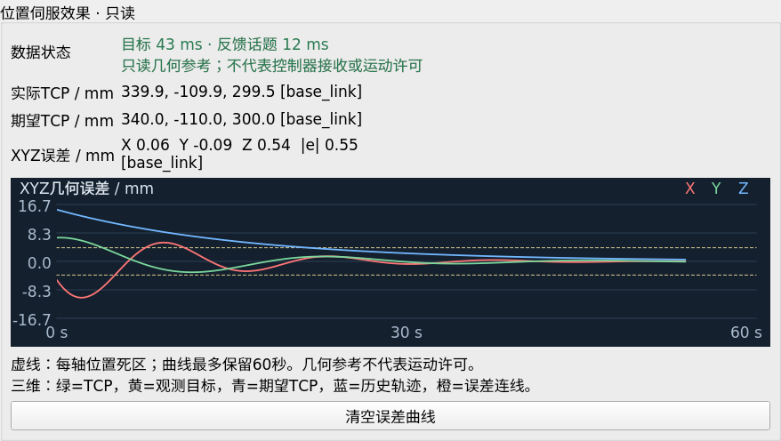

# 视觉伺服可视化界面使用说明

日期：2026-10-25。面向独立 `eye_in_hand / eye_to_hand` 位置伺服，在现有RViz控制面板上增加几何显示和误差曲线。显示计算由独立的只读节点完成，不进入SDK供点线程。

## 1. 已经运行伺服时打开界面

在已source工作空间的终端执行：

```bash
roslaunch aubo_ros_control visual_servo_view.launch
```

这个入口打开RViz，不启动机械臂驱动、相机或伺服控制器，也不会自动使能或切换跟踪目标。面板中的启动、停止、复位和调参按钮仍是显式操作。

新版视觉伺服入口默认启动只读显示节点。如果使用旧的自定义启动方式，没有该节点，可补充：

```bash
roslaunch aubo_ros_control visual_servo_view.launch start_monitor:=true
```

该节点需要已经存在 `/robot_description` 和控制器参数，默认从 `/aubo_visual_servo` 读取；自定义命名空间可传 `controller_ns:=/你的控制器`。不要重复启动同一显示节点。

## 2. 从实机或仿真入口一起打开

```bash
# 这两个入口会连接真实SDK；伺服默认禁用，运动需显式使能。
roslaunch aubo_ros_control eye_in_hand_visual_servo_real.launch rviz:=true
roslaunch aubo_ros_control eye_to_hand_visual_servo_real.launch rviz:=true

# 仿真入口原本就默认打开RViz。
roslaunch aubo_ros_control eye_in_hand_visual_servo_gazebo.launch
roslaunch aubo_ros_control eye_to_hand_visual_servo_gazebo.launch
```

每次按实际相机安装方式选择其中一个入口。实机入口的 `rviz` 默认false，方便无桌面运行；四个入口均可用 `visualization:=false` 关闭只读显示节点，用 `rviz:=false` 关闭窗口。

## 3. 三维画面

| 颜色/图形 | 含义 |
| --- | --- |
| 绿色球 | TCP当前位置，由六轴关节反馈经正运动学计算 |
| 黄色球 | 观测目标位置 |
| 青色球 | 当前几何关系下的期望TCP位置，包含安装方式的期望距离或偏移 |
| 橙色箭头 | 从TCP指向期望TCP的误差连线 |
| 蓝色线 | 历史TCP反馈轨迹，最多保留400个位置变化超过0.5 mm的点 |
| 浮动文字 | 控制器最近报告的状态及误差大小/数据无效原因 |

显示使用 `base_link` 作为RViz固定坐标系。机械臂模型、TF和原有识别结果图像继续保留，图像话题为 `/visual_servo/debug_image`。

期望TCP和观测目标可能不重合：眼在手上有期望观测距离，眼在手外有 `target_offset`，这正是显示两个位置的用途。

目标或反馈过期时删除当前目标、期望位置和误差箭头；反馈过期还会删除当前TCP球。历史轨迹保留，用于回看已经走过的路径，不能当成正在运动的轨迹。

## 4. 面板新增内容

“位置伺服效果·只读”区域显示：

- 目标年龄和反馈话题年龄，以及缺失、TF等待或过期原因。
- TCP与期望TCP的坐标，单位mm，附带基坐标系名称。
- XYZ几何误差和误差范数，附带误差坐标系名称。
- 最近60秒的XYZ误差曲线，X红、Y绿、Z蓝；黄色虚线为每轴位置死区。
- “清空误差曲线”按钮，只影响本地显示，不清空控制柜、不改变运动状态。

误差历史最多600个样本。数据无效时曲线断开，旧曲线仍保留；显示节点超过约0.7秒无新数据后，界面隐藏当前数值并提示失联。

下面是离线合成数据预览，未连接机械臂或相机：



[完整面板预览](images/visual_servo_panel_preview.png)。

## 5. 如何解释误差

眼在手上：

```text
误差(TCP坐标系) = 观测目标(TCP坐标系) - desired_target_position
期望TCP(基坐标系) = 当前TCP + 当前TCP旋转矩阵 × 误差
```

眼在手外：

```text
期望TCP(基坐标系) = 观测目标(基坐标系) + target_offset
误差(基坐标系) = 期望TCP - 当前TCP
```

显示节点按输入时间戳处理TF，并对暂时缺少TF的目标进行有界、非阻塞重试。几何参数约每秒同步一次；显示约10 Hz更新。

这些量是依据输入目标、关节话题和参数重建的几何参考，不是控制器内部逐点回放，也不表示目标已通过控制器的所有安全检查。反馈话题年龄不等于控制柜硬件采样年龄或SDK RPC耗时。

曲线虚线对应每轴死区，误差范数不能直接与单轴死区比较来判断ALIGNED。最终对齐状态仍由控制器的逐轴误差、姿态条件、保持时间和平滑停稳等检查决定。面板中绿色数据状态表示显示数据有效，不代表已对齐或允许运动。

hybrid模式下保留TCP与轨迹显示，但不将独立PBVS的几何公式当作规划轨迹误差，误差区会明确提示不适用。

## 6. 话题与实现

| 话题 | 类型 | 用途 |
| --- | --- | --- |
| `/visual_servo/status` | `aubo_ros_control/VisualServoStatus` | 几何信息、年龄、有效性与说明 |
| `/visual_servo/markers` | `visualization_msgs/MarkerArray` | TCP、目标、期望点、误差与历史路径 |
| `/visual_servo/debug_image` | 图像 | 原有感知模块输出的识别结果 |

只读节点从控制器参数读取实际目标、关节和状态话题，源码为[visual_servo_visualization.cpp](../aubo/aubo_ros_control/src/visual_servo_visualization.cpp)。面板和曲线见[visual_servo_panel.cpp](../aubo/aubo_ros_control/src/visual_servo_panel.cpp)、[visual_servo_error_plot.h](../aubo/aubo_ros_control/include/aubo_ros_control/visual_servo_error_plot.h)。

该节点没有SDK对象、运动发布器或使能/复位客户端；原有伺服算法与供点代码不因显示而改写。

## 7. 验证范围

已用本机合成数据验证：

- 眼在手上和眼在手外的几何误差；工具坐标旋转90°后期望点的基坐标变换。
- TCP轨迹来自关节反馈，目标/反馈过期时发送删除标记，不继续显示有效误差。
- NaN输入不会刷新有效目标，TF迟到后可恢复显示。
- Qt跨线程更新、600样本上限、无数据隐藏读数及离线截图。
- 打开界面不自动发布目标选择消息。

本轮没有执行实机运动。预览图只证明界面呈现，三维坐标正确性由上述几何测试覆盖；真实相机标定和现场轨迹仍需通过实际数据检查。
