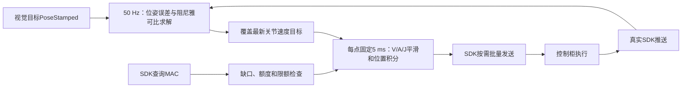

# 视觉位置伺服按需供点改进

日期：2026-10-25。适用独立 `eye_in_hand / eye_to_hand` 视觉位置伺服，默认 `hybrid_enabled=false`。本轮将已用于点动的固定步长平滑和SDK按需供点方式接入PBVS，已做离线验证，未执行新的真机运动。

## 1. 改动原因

点动调试发现，控制柜同步SDK调用存在几十至上百毫秒的响应长尾；需要同时观察MAC水位、生成等待和发送耗时，不能只提高ROS循环频率。完整背景见[AUBO实机点动问题与调试复盘](AUBO实机点动问题与调试复盘.md)。

视觉伺服此前仍使用旧输出路径：50 Hz回调依据实际回调耗时生成若干位置点，放入容量默认80点的FIFO，队满丢最旧点；SDK默认MAC目标60标量，即10点/名义50 ms。输出端再次限速度和加速度，但没有点动平滑器的jerk界。

另外，反馈位置混合、进入ALIGNED时回到实际反馈、清零输出速度等操作会改变位置序列。对于存在柜内前瞻和反馈延迟的实机，这些操作不能直接视为连续平滑的停止。

## 2. 当前结构



| 环节 | 本轮行为 |
| --- | --- |
| 视觉误差 | 保留眼在手上/眼在手外的TF、位姿误差、阻尼雅可比和对齐迟滞逻辑 |
| 目标更新 | 每个控制周期覆盖最新速度目标，不预先排入一串旧目标位置 |
| 点生成 | SDK需要补点时调用；每点固定按5 ms积分，实际回调耗时不改变积分步长 |
| 平滑 | 直接复用点动的 `VelocitySmoother`，限制离散速度、加速度和jerk |
| 位置状态 | 从有效初始反馈建立一次，目标反向、禁用和复位不重置积分位置/速度 |
| 输出 | 独立PBVS绕过 `CommandQueue`，不发布JTC关节轨迹 |
| SDK流控 | 复用串行MAC查询/发送、补点额度、启动就绪、首次MAC确认和超时锁存 |
| Gazebo | 使用同一个固定步长生成器，按200 Hz发布六轴位置 |

独立PBVS新路径不使用 `feedback_blend` 和 `tracking_velocity_filter_alpha`；速度平滑统一由V/A/J生成器完成。这两个旧参数仍供旧队列/hybrid路径使用。

本轮没有改写hybrid规划轨迹回放。`hybrid_enabled=true` 时继续原路径，并打印提示；旧路径不会自动获得新生成器的jerk保证。

## 3. 启停、对齐和故障行为

- **SDK启动**：保持禁用；连续有效空MAC诊断就绪后才接受显式使能。按需SDK模式中，`auto_start=true`可启动感知，但不会自动授权机械臂运动。
- **初始参考**：从SDK传入的保持参考建立积分器，显式使能前生成器不输出点；后续推送的微小静止漂移不会被误当成预使能运动。Gazebo则从首个有效反馈初始化。
- **使能**：要求真实反馈新鲜、生成器已经初始化并停稳、反馈与指令位置差不超过0.01，以及无锁存保护、SDK可接受运动请求。使能后等待新的视觉目标。
- **禁用**：最新速度目标立即改为零，保留平滑器状态生成减速尾段，状态经过 `STOPPING`。不能撤回已经提交给控制柜的旧点。
- **对齐**：视觉误差满足保持时间后，还要等平滑器停稳、反馈与指令位置差不超过0.005，才进入 `ALIGNED`。不通过清零速度或回写反馈位置制造停止。
- **视觉目标丢失**：继续遵循当前安装方式配置的stop/coast/恢复搜索策略，输出通过同一个平滑器。普通目标丢失与底层反馈故障是不同事件。
- **输出保护**：反馈陈旧、控制目标快照过期、跟随误差过大或关节制动余量不足会锁存停止目标并减速。后续新目标不能自动解除该保护。
- **复位**：先禁用，等待生成器停稳、反馈新鲜并跟上，再清除前端保护。SDK传输层停流故障仍需重启；复位不自动使能。

`DISABLED`、`HOLD`等状态表达控制器状态，不能代替真实机械臂的停稳测量。已下发的前瞻与滤波尾段仍会影响实际停止时间。

## 4. 参数与限位

| 参数 | 默认值 | 说明 |
| --- | --- | --- |
| `on_demand_output` | true | 独立PBVS使用新路径；false可显式对照旧队列路径 |
| `control_rate` | 50 Hz | 视觉目标求解频率 |
| `output_rate` | 200 Hz | 新路径要求固定5 ms点周期 |
| `joint_velocity_limits` | 前三轴0.50、后三轴0.70 | 保留原视觉伺服关节速度上限 |
| `joint_acceleration_limits` | 前三轴0.80、后三轴1.20 | 保留原视觉伺服加速度上限 |
| `joint_jerk_limits` | 前三轴8、后三轴12 | 新增离散指令jerk上限 |
| `control_target_timeout` | 0.04 s | 目标计算停更时停止继续追逐旧速度 |
| `feedback_timeout` | 0.15 s | SDK按实际推送年龄检查，不依赖ROS缓存重发时间 |
| `max_following_error` | 0.12 | 指令位置相对反馈的最大允许误差 |
| `sdk_mac_buffer_target` | 按需路径默认300标量 | 50点、名义250 ms；可通过私有参数显式设置 |
| `sdk_mac_buffer_limit` | 360标量 | 观测与预留限额，不认证任意时刻真实积压上界 |
| `sdk_diagnosis_timeout` | 0.15 s | 运动阶段诊断看门狗 |

V/A/J的单位分别为rad/s、rad/s²、rad/s³。新路径在每个候选点检查限位和零输入制动余量，余量不足时采用平滑的零目标减速，不在关节边界直接裁剪位置或清零速度。

上述是关节指令界，不是实测电机/TCP导数。视觉参数比点动参数有不同速度、加速度上限，不能将点动实机通过直接当作本版本视觉伺服通过。

本轮复用的是输出与通信机制，没有给独立PBVS新增MoveIt场景碰撞检查或全局避障规划；原有目标安全距离、限位和控制柜诊断仍保留。参数是否适合实际负载、延迟和目标噪声，需要实机采集确认。

## 5. 实机入口与采集

两个实机入口已透传 `on_demand_output`、`sdk_mac_buffer_target` 和 `timing_trace_path`。launch显式设置MAC目标，避免同一ROS master遗留的旧60标量参数影响本次新路径；默认独立按需模式300标量，旧队列/hybrid模式60标量。例如：

```bash
# 以下命令会启动真实SDK连接；机械臂运动仍需显式使能。
roslaunch aubo_ros_control eye_in_hand_visual_servo_real.launch \
  auto_start:=false timing_trace_path:=/tmp/visual_eye_in_hand_01.csv

roslaunch aubo_ros_control eye_to_hand_visual_servo_real.launch \
  auto_start:=false timing_trace_path:=/tmp/visual_eye_to_hand_01.csv
```

每次采集使用新的绝对路径。退出并完成导出后，从仓库 `src/` 目录离线分析：

```bash
python3 aubo/aubo_ros_control/scripts/analyze_motion_timing.py \
  /tmp/visual_eye_in_hand_01.csv --output /tmp/visual_eye_in_hand_01_analysis --plot
```

时序记录包含视觉输入接收、目标计算、点生成和锁等待、批次入点、MAC查询及发送起止。输入ROS时间戳与steady时钟不能直接相减；这份CSV不保存原始图像、完整目标位姿序列或真实机械臂逐点执行时间。

SDK执行层复用点动代码，因此部分底层日志仍带 `[sdk/jog]` 标签。MAC水位没有硬件采样时间戳，SDK成功返回不等于全部点执行完成。慢查询警告与含义见[点动复盘的WARN说明](AUBO实机点动问题与调试复盘.md#7-现在的warn具体表示什么)。

两个实机入口将六轴SDK发布改为 `/visual_servo/sdk_joint_states`，经 `joint_state_publisher` 汇总到 `/joint_states`；夹爪模型采用 `joint1=joint2=0` 默认位置。该汇总用于TF/模型，控制健康判断直接读取SDK真实推送缓存。

## 6. 离线验证与后续实机检查

本轮测试不登录真实SDK、不执行真实运动：

| 验证 | 覆盖内容 |
| --- | --- |
| `visual_servo_stream_test`数值测试 | 反向、停止、V/A/J差分、关节边界前制动、非法参数/NaN、禁止重置活动积分器 |
| `visual_servo_stream.test` | 生产PBVS前端＋假SDK；眼在手外90 ms晚接收、眼在手上60 ms早接收；诊断20 ms、缓存滞后20 ms、启动慢查询500 ms |
| 同一ROS测试中的状态检查 | 禁用启动零发送与静止反馈微漂、反向、视觉零误差后等待平滑停稳再ALIGNED、丢失目标、禁用连续减速、反馈中断锁存、停稳复位 |
| 逐点验证 | 跨批次位置连续，按5 ms差分的V/A/J均不超过配置上限 |
| 回归 | 初始观察位先于视觉跟踪；原hybrid规划/异常轨迹处理 |
| 时序分析 | 新PBVS的CSV通过原分析器关联/时序检查，无需另外实现发送统计 |

两组最终离线采集分别为眼在手外122批/2,722点、眼在手上167批/2,733点，均无记录丢失或缺少返回，逐点V/A/J检查通过。原观察位和hybrid回归也通过。日志中的反馈中断、异常轨迹ERROR属于主动故障注入，应结合测试结果阅读。
验证材料保存在 `aubo/aubo_ros_control/logs/visual_stream_validation_20261025/`，包括CSV、统计、测试结果与源码/二进制哈希；运行产物通常被Git忽略，迁移环境需单独保存。

验证时也区分了生成与SDK返回的时刻：90 ms晚接收模型中，发布ALIGNED时最后一批已返回点仍可能属于较早的生成状态，曾测得约1.67e-6的残余指令速度。因此测试等待后续批次返回再检查对应序列，没有把ALIGNED等同于所有在途批次均已返回，也没有放宽V/A/J界限。该数值来自模拟指令，不是电机实测速度。

测试入口：

```bash
rostest aubo_ros_control visual_servo_stream.test mode:=eye_to_hand send_delay_ms:=90
rostest aubo_ros_control visual_servo_stream.test mode:=eye_in_hand send_delay_ms:=60 accept_late:=false
```

离线测试使用合成运动学链和模拟柜内消费，不覆盖真实RGB-D噪声、标定误差、实际碰撞环境或服务器响应分布。下一步实机应从低速、小误差开始，分别测跟踪收敛、目标反向、丢失后的停止以及对齐时的实际停稳，连同时序与真实反馈保存；不在同一轮同时调整增益、MAC水位和A/J。

关键实现：[VisualServoStream](../aubo/aubo_ros_control/include/aubo_ros_control/visual_servo_stream.h)、[VisualServo前端](../aubo/aubo_ros_control/src/visual_servo.cpp)、[共用SDK后端](../aubo/aubo_ros_control/src/direct_sdk_backend.cpp)。
